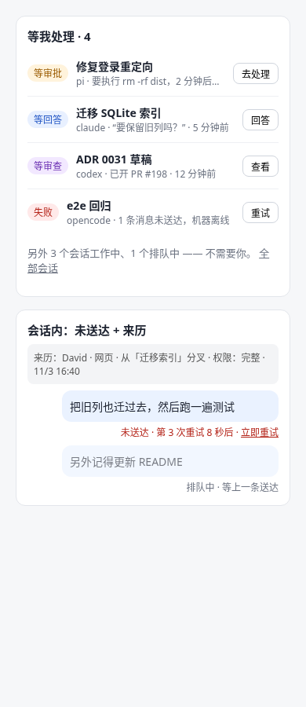
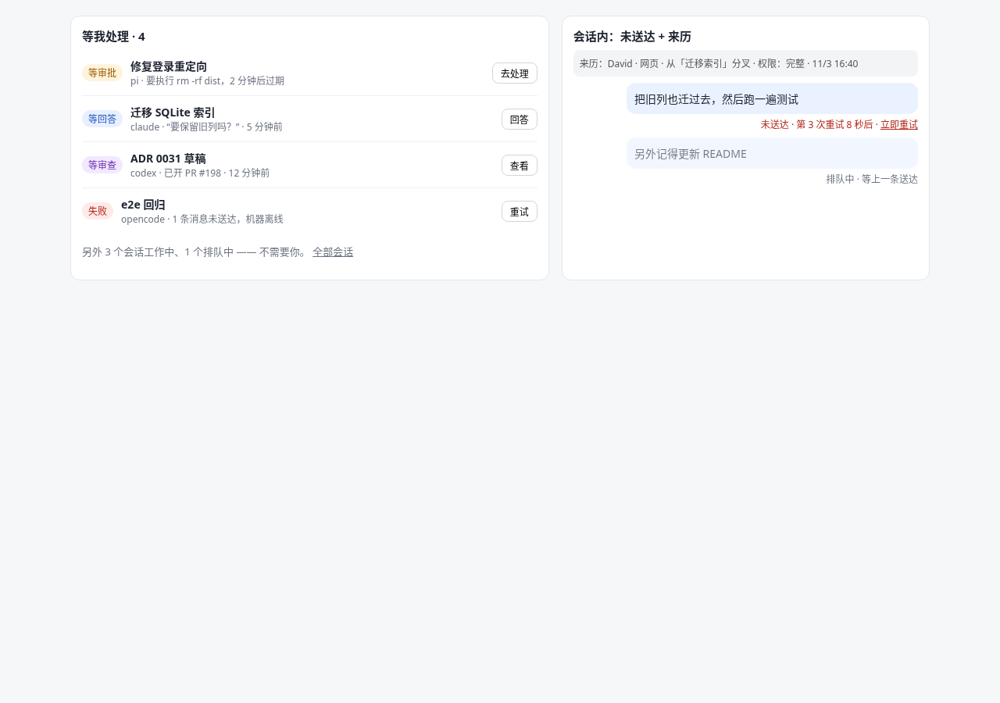

# ADR 0031：「等我处理」收件箱、消息送达可见可重试、任务来历

- 状态：proposed（设计稿，等 David 定 Q1–Q8）
- 相关：ADR 0023（运行时审批卡）、ADR 0028（原生回退）、ADR 0029（上下文交接）、ADR 0030（Worker 加固：能力范围、审计）
- 参考：DeepSeek dsh-superagent-prototype（研究原型，docs/000–008）：「人的注意力是最稀缺资源」、会话阶段派生、投递失败可见并退避重试、每张工单带 mandate（谁、从哪、凭什么）

## 背景：现状（已核实，master）

| 主题 | 已有 | 缺口 |
|---|---|---|
| 会话状态 | `SessionStatus = running/stopped/done/interrupted/failed`（`domain/session.ts:14`）；`stall.ts` 标记卡住的会话；首页 `loadHome` 按时间列最近 24 个会话（`use-cases/home.ts`） | 没有「需要人」的视角：等回答、等审查、待审批卡混在「最近」里，要一个个点开看 |
| 审批卡 | `openApprovals(events, at)` 能算出某会话未决的审批（`domain/approval.ts:92`） | 只在会话页内可见，首页和手机列表看不到 |
| 消息投递 | `promptSessionUseCase` 先记 prompt 事件再 `ensureHosted`（`use-cases/conversation.ts:74`），起不来就 `failTurn` | ① Worker 离线时这句话只是失败，没有「未送达 / 重试」；② ADR 0028 回退后的交接简报 `pendingBriefs` 是**内存 Map**（`use-cases/rewind.ts:80`），hub 重启就丢——这是已知 bug |
| 来历 | `SessionOrigin = derive / fork`（`session.ts:16`）；prompt 带 `author.via`；`ports/audit-log.ts` 有审计 | 没有一条不可变的「这个任务会话谁、从哪、凭什么开的」；API token、交接、回退来的会话分不清 |

## 决定

遵循六边形：阶段派生、退避计算、来历校验都是 `packages/domain` 纯函数；SQLite 表在 `storage-sqlite`；推送和 UI 是适配器。

### D1「等我处理」收件箱

**领域** `domain/attention.ts`：

```ts
type Phase = 'needs_approval' | 'needs_answer' | 'needs_review' | 'failed' | 'undelivered'
           | 'queued' | 'working' | 'idle';
derivePhase(session, tailEvents, delivery, now): { phase, since, reason }
needsHuman(phase) = phase ∈ {needs_approval, needs_answer, needs_review, failed, undelivered}
```

派生规则（优先级从高到低）：
1. `openApprovals(...)` 非空 → **等审批**（显示过期倒计时）。
2. 有未送达消息且已超过自动重试上限，或 Worker 处于 rejected → **未送达**（归入失败组展示）。
3. `status ∈ {failed, interrupted}` 且之后没有新 prompt → **失败**。
4. 最后一轮 agent 结束（turn end）且最后一条 assistant 消息以问句/明确提问结束，或 agent 调了 ask 工具 → **等回答**。
5. 最后一轮结束且这一轮产生了 PR、commit 或 checkpoint（ADR 0027）→ **等审查**。
6. 有排队消息未发出 → **排队**；`running` → **工作中**；其余 → **空闲**。

「人已看过」：用户打开会话并停留，或点「稍后」，记 `attention_ack(sessionId, phaseSince)`；同一阶段不再上榜，阶段变了重新上榜。

**端口** `ports/attention-store.ts`：`ack / acks(accountId)`；阶段本身不落库，读时由事件尾部派生，并在 `session-stream` 有事件时增量刷新（缓存在内存，重启可重算）。

**UI**：
- 首页顶部「等我处理 · N」卡片，只列需要人的会话，按优先级 + 时间排序；每行一个直达按钮（去处理 / 回答 / 查看 / 重试）。
- 都健康时**安静**：卡片收成一行灰字「3 个工作中，没有要你处理的」，不弹不闪。
- 手机（390）：底部导航加「待办」角标，列表同一组件。
- 浏览器标签页标题前缀 `(N)`；不做系统推送（见 Q5）。

### D2 消息送达可见、可重试

**领域** `domain/delivery.ts`：

```ts
type DeliveryState = 'queued' | 'sending' | 'delivered' | 'undelivered' | 'cancelled';
nextRetryAt(attempt, now) = now + min(2s · 2^(attempt-1), 60s) ± 10% 抖动
```

- 自动重试：2s、4s、8s… 封顶 60s；连续失败 10 次（约 6 分钟）后停止自动重试，状态停在「未送达」，进入收件箱。
- Worker 重连（ADR 0030 LinkState → live）时立即把该机器上的未送达消息重排，不等退避。
- 同一会话**严格按序**：前一条没送达，后面的只「排队」，不会越过。
- 幂等：每条消息有 `deliveryId`，Worker 侧按 id 去重，重试不会让 agent 收到两遍。

**端口** `ports/delivery-queue.ts`：`enqueue / claimDue(now) / markDelivered / markFailed(nextAt, error) / cancel / pendingFor(sessionId)`。

**存储**（新表，迁移只加不改）：

```sql
CREATE TABLE message_delivery (
  id TEXT PRIMARY KEY, session_id TEXT NOT NULL, seq INTEGER NOT NULL,
  kind TEXT NOT NULL,            -- prompt | handoff_brief
  payload TEXT NOT NULL,         -- JSON（不含附件二进制，只存引用）
  state TEXT NOT NULL, attempt INTEGER NOT NULL DEFAULT 0,
  next_at INTEGER, last_error TEXT, created_at INTEGER NOT NULL, updated_at INTEGER NOT NULL);
CREATE INDEX message_delivery_due ON message_delivery(state, next_at);
```

- **修 bug**：`rewind.ts` 的 `pendingBriefs` 改为写入 `message_delivery(kind='handoff_brief')`，hub 重启后启动时 `claimDue` 会接着送。
- prompt 事件仍先记 journal（用户看到原话），送达状态是旁路，不改事件格式。

**UI**：气泡下方小字：
- 排队中 · 等上一条送达（灰）
- 发送中…（灰）
- 未送达 · 第 3 次重试 8 秒后 · 立即重试 | 撤回（红）
- 送达后不显示任何东西（安静）。

### D3 任务来历（mandate）

**领域** `domain/provenance.ts`：

```ts
interface Provenance {
  readonly sessionId; readonly taskId;
  readonly actor: { kind: 'user' | 'api_token' | 'agent' | 'system'; id; name };
  readonly via: 'web' | 'mobile' | 'api' | 'fork' | 'rewind' | 'handoff' | 'continue_elsewhere' | 'bot' | 'group';
  readonly parent?: { sessionId; atSeq? };      // fork / rewind / handoff 的来源
  readonly authority: { role: string; scope?: string /* ADR 0030 能力预设 */; tokenId?: string };
  readonly createdAt: number;
}
```

- 会话创建时由 use-case 一次写入，**不可变**（表上无 UPDATE 路径，仓储接口只有 `record` 和 `get`）。
- 校验：`authority.scope` 不得宽于发起者自身权限（只能收窄，沿用 ADR 0030 规则）；agent 发起的（`session.read` / 交接）必须带 `parent`。
- 同时写一条 `audit-log`（`session.created`），审计里放 provenance id，方便反查。
- 老会话：迁移时按 `SessionOrigin` 回填 `via=fork|web`、`actor=system(legacy)`，标注「补录」。

**UI**：会话页顶部一行可折叠的「来历：David · 网页 · 从「X」分叉 · 权限：完整 · 时间」；收件箱行内悬停可见。

## 分期

| 期 | 内容 | 验证 |
|---|---|---|
| P1 | D2 存储 + 退避 + `pendingBriefs` 落库（先修 bug） | 测试 worker：断开机器发消息→「未送达」→重连自动送达；hub 重启后交接简报仍送达 |
| P2 | D2 UI（未送达/排队/立即重试/撤回） | e2e + 390/1280 截图 |
| P3 | D3 来历表 + 回填 + 会话页一行 | 测试账号用网页、fork、回退、API 各开一个会话核对 |
| P4 | D1 阶段派生 + 首页「等我处理」+ 手机角标 | 造出等审批/等回答/等审查/失败四种，确认都上榜；健康时安静 |

每期：本地 `npm run ci` + 完整 e2e 通过才合并，部署前快照，线上只用测试账号验证。

## 不做

- 不照搬 dsh 的总管会话自动拆单、工作会话免审批执行（与 ADR 0023/0030 方向相反）。
- 不做 GitHub 评论触发（第 4 条，另写 ADR）。

## 待定问题（附推荐）

1. **「等回答」怎么判断？** 推荐：只认显式信号（agent 调 ask 类工具、ACP 的 input-required），再加「最后一条以问号结尾」的启发式，启发式行标「可能在等你」。
2. **「等审查」的触发？** 推荐：这一轮产生了 PR 或 commit 才算；只改了文件不算，免得刷屏。
3. **收件箱范围？** 推荐：只列我是任务负责人或发起人的会话；团队空间里别人的会话不进我的收件箱。
4. **自动重试上限？** 推荐：10 次（2s 倍增，封顶 60s，约 6 分钟）后停手转「未送达」，Worker 重连时再自动试一次。
5. **要不要推送通知？** 推荐：本期不做系统推送，只做角标和标题 `(N)`；以后可接 ADR 0030 的通道。
6. **未送达的消息能撤回/编辑吗？** 推荐：能撤回（标记 cancelled，journal 里保留并标「已撤回」），不支持编辑，撤回后重新发。
7. **老会话的来历怎么办？** 推荐：按 origin 回填并标「补录」，不伪造发起人。
8. **分期顺序？** 推荐：P1 先修排队简报丢失的 bug，其后 UI、来历，收件箱最后（它依赖送达状态和来历）。

## 草图

- 手机 390：
- 电脑 1280：
