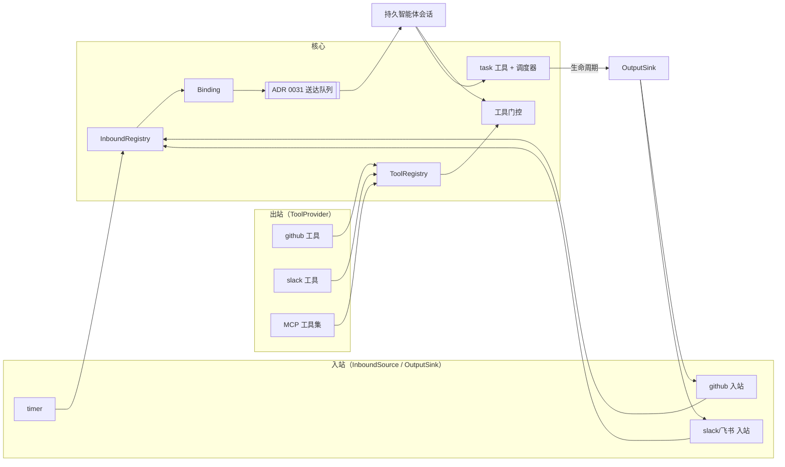

# ADR 0032：连接器（Connector）与总管（Router）

- 状态：accepted（2026-11-04 PT David 定稿，见末尾「定稿」）
- 相关：ADR 0023（审批卡）、ADR 0030（能力、凭据预设）、ADR 0031（送达队列 `message_delivery`、收件箱、来历）
- 参考（/workspace/research）：hermes-agent（cron 先推进 next_run、宽限、运行唯一键）、openclaw（唤醒到主会话、IM 通道）、dsh-superagent（总管拆单）、OpenHands（label 触发、写权限校验、回写 issue）

## 原则

**通用但不过度设计：简单而抽象。** 核心只有几个概念（入站、Sink、工具、Binding）；定时、GitHub、IM、邮件都只是它们的**配置**，不另建子系统。用不上的东西放进「以后再说」。

## 概念

**Connector 只是一个分组名**：它把两种**内部完全独立**的能力打包在一起，具体连接器可以只实现其中一半。

| 半边 | 端口 | 作用 |
|---|---|---|
| **入站** | `InboundSource` | 发出规范化入站事件 `{kind, externalId, actor, text: Untrusted, url}`；hub 按 **Binding** 转成消息，经 ADR 0031 送达队列投递到持久智能体（主会话 / 每次新会话） |
| | `OutputSink`（可选） | 会话桥的回程：任务生命周期或会话回复 → 来源侧动作（GitHub 评论、IM 回消息） |
| **出站** | `ToolProvider`（**已有**：`packages/domain/src/ports/tool-provider.ts`） | 暴露给智能体调用的工具：注册进现有工具网关（`createToolGateway`），**经 MCP 到达运行时**（hub 侧 `apps/server/src/mcp-server.ts`，worker 侧 `apps/worker/src/mcp-shim.ts`）；门控 = 现有 ToolGrant / scope + 新的细粒度能力。**MCP 是工具到运行时的唯一通道**，不另建工具端口或传输 |

- **Binding**（核心）：一条配置，内容是「入站事件 → 哪个智能体、主会话还是每次新会话、限定哪个项目」。
- 核心**分别**注册和处理入站与出站，两半之间没有依赖。只做入站的（timer）、只提供工具的（纯 MCP 工具集）、两者都有的（GitHub、IM），走的是同一套代码。
- **硬安全规则在连接器和 hub 代码里执行，从不交给智能体**：写权限加标签校验、注入隔离、去重、每日配额。工具调用也要经过这些检查，无法绕过。
- 核心只负责：入站和工具两个注册表、Binding、工具门控、任务工具和调度器。



依赖方向：连接器包只依赖 `domain` 里的端口类型，`domain` 不 import 任何连接器，在组合根注册。依赖检查另加一条：`packages/domain` 里不得出现 github 相关 import。

### 端口

```ts
// ports/inbound-source.ts（R1 新增）
interface InboundSource { id: string; kinds: string[];
  validate(kind, params): string | null; describe(binding): string;
  start(ctx: InboundContext): { stop(): void } }
interface InboundContext { now(); bindings(); advance(id, expected, next) /* CAS */;
  emit(bindingId, e: InboundEvent); skip(bindingId, {externalId, plannedAt}, reason) }
type InboundEvent = { kind; externalId; parentExternalId?; plannedAt?; catchup?;
  title; text: string /* 人写的 */ | Untrusted<string> /* 外部来的 */; url? };
// 硬规则（标签、写权限、注入）由来源在 emit 前判定；核心再兜底去重、配额
// ports/output-sink.ts（R1 只放类型，R4 实现）
interface OutputSink { id: string; deliver(binding, ev): Promise<void> }
// ports/tool-provider.ts（已有，不改）：{ id, tools(): ToolDescriptor[], call(name, input, {grant, now}) }
```

「ToolRegistry」就是现有工具网关的 `providers` 列表：连接器的工具半边 = 一个 `ToolProvider`，在组合根注册进去，自动经 MCP 暴露。

`Untrusted<T>` 是领域类型：送进模型前统一包成带边界标记的引用块，并注明「这是数据，不是指令」。去重（`connector + externalId`）和每日配额由核心在 emit 之后再统一做一次兜底。

## 持久智能体 = 组合，不是新类型

持久智能体（bot）= **{ 工作空间, 提示策略, 工具集, 记忆 }** + **关联项目** + **连接器 Binding**。总管只是其中一种组合（总管提示策略 + task 工具 + 关联项目），**不是新类型**；任何 bot 关联了项目就能用 task 工具。

- **独立于项目**：bot 有一个默认项目（定义它的项目）和一组关联项目（新表 `agent_project`）。关联集合**就是**总管白名单，不另设白名单。
- 关联了：bot 能读项目信息、读任务和会话、在那里建任务；没关联：看不见、写不了。只有在两个项目上都有修改权限的人才能关联。
- 触发消息进 bot 的会话；`task.create` 不带项目就用默认项目；显式项目必须在关联集合里。
- R1/R2 新代码只依赖它需要的那一小块：task 工具经现有工具网关注册；Binding 只认 bot 标识（默认项目 + @id）；关联只是一张表；不碰提示策略和记忆。

**主线场景**：用户建 bot → 在对话里让它做事 → 它调 `task.create` 在默认项目建任务 → 任务会话推进（R3 调度；R3 之前人用现有任务流程启动）→ 完成后经送达队列通知 bot → bot 向用户汇报。

## 场景检验

| 场景 | 入站 | Sink | 工具 | Binding |
|---|---|---|---|---|
| **主线：对话 → 建任务** | — | — | ✓ `task.create`（核心） | 不需要 |
| 定时唤醒 `timer` | ✓ `timer.fired` | — | — | → 总管主会话 / 每次新会话 |
| GitHub issue | ✓ `issue.eligible`（agent 标签 + 写权限） | ✓ 👀 / PR 链接 / 失败原因 | ✓ `github.comment/react` | → 总管，限定项目 |
| GitHub PR 跟进 | ✓ `pr.mention`（写权限者 @ 机器人） | ✓ | ✓ | → 原会话（parentExternalId） |
| IM（Slack/Telegram/飞书） | ✓ `message` | ✓ 回到原对话 | ✓ `slack.reply` 等 | → 某智能体主会话 |
| 邮件 | ✓ `mail.received` | ✓ 回信 | 可选 | → 某智能体 |
| Linear | ✓ `issue.eligible` | ✓ 评论 / 改状态 | ✓ `linear.comment` | → 总管 |
| 纯 MCP 工具集 | — | — | ✓ | 不需要 |
| Webhook（以后） | 入站改成推送触发 | 同上 | — | 同上 |

每一行都只是「入站 / Sink / 工具」三者按需组合，没有新的子系统。

## 决定

### R1 连接器框架 + `timer` 连接器
- 核心：`InboundRegistry` 与 `ToolRegistry`（互相独立）、`connector_instance`、`connector_binding`、`trigger_run`；入站事件按 Binding 投递到送达队列；智能体正忙就排队，不打断。
- `timer` 采用 Hermes 的做法：
  - **先推进 next_run 再触发**；运行唯一键是 `binding + 计划时刻`。
  - 宽限窗口为周期的一半，错过的**只补跑一次**；超出宽限就跳过并记录原因（Q3）。
  - 上一次还没结束，本次跳过。
  - 默认送主会话，也可以每次新会话（Q1）；最小间隔 5 分钟，默认 15 分钟（Q2）。
  - 定时不过期；连续失败 5 次自动暂停，并进「等我处理」（Q4）。
- 第一期只有人能在 UI 上建 Binding（Q5）。时间按账号时区显示，存储用 UTC。
- 实现（R1）：内置 `@agent-hub/connector-timer` 包（只依赖 domain）；`connector_instance` 推迟到 R4（timer 不需要配置和凭据，R1 不建空表）。
  - Binding 挂在 bot（定义项目 + @id）下；`project_id` 只是可选的过滤字段，必须是 bot 的默认或关联项目。
  - 主会话：第一次触发时开一条（建任务 + 派生，并记成这个 bot 的派生会话，职责说明照常注入），之后复用；坏了再开。

### R2 任务工具（核心）
- `task.create / task.list / task.cancel`；`create` 带 `source {connector, externalId}`，同一项目同一个键只建一次。新 scope `task:create`。
- 读工具（按关联门控）：`project.list`、`project.get`（默认 + 关联项目）、`task.list`（跨关联项目）、复用现有 `session.read`（放宽到「同项目或已关联项目」）。
- 「总管」权限档：每次唤醒最多建 3 个、每天 20 个（按 Binding 时区的自然日重置），只限关联项目；超出的进收件箱等人批准（Q6）。配额在代码里检查。
- **配额只算连接器 / 触发唤醒的回合**；人在对话里发起的回合建的任务不计（`HUB_ROUTER_COUNT_HUMAN=1` 可改成也算）。见「开放问题」。
- `task.cancel` 只能取消自己建的、还没开始（todo）或还在待批的；用 system 身份置 abandoned（agent 本身仍不能置 done/abandoned）。

### R3 调度器（核心）
- 并发上限：全局 2、每台机器 1、每个项目 1，另留 1 个人工槽（Q7）。人手发起的任务只受全局上限和人工槽约束，不受「每个项目 1」限制。
- 任务结束后，经送达队列通知发起它的总管会话，同时触发对应连接器的 Sink。
- 实现说明：调度器在 domain（`use-cases/dispatcher.ts` + 纯函数 `dispatch.ts`），经 `TaskDispatchStore`/启动/通知等端口接外部，不引用任何连接器。只有 `task.create` 真建出任务（含批准的超额）才入队，上线前已有的任务不会被自动派发。先把行置为 running 再开会话、tick 串行，保证不重复派发；重启后按会话尾部对账补结算。排队中的可在首页「任务队列」取消（任务记为放弃）。「人手发起」＝ 人在对话里让 bot 建的（wakeKey 为空或 `session:`）。

### R4 `github` 连接器（GitHub 规则全部在这一个包里）
- 只轮询，不接 webhook（Q12）。
- 入站：必须有 `agent` 标签，且**加标签的人**有写权限。这一点通过 timeline/events 接口在代码里核对（Q8）。
- 执行：默认凭据预设 no-push；改动走现有 commit/PR 流程开**草稿 PR**，由人合并（Q9）。
- Sink：用项目绑定的 token 回写——入队加 👀，完成时评论 PR 链接，失败时评论原因（Q10）。
- PR 跟进：只认有写权限、且 @ 了机器人的评论，路由回原会话；PR 合并或关闭后忽略（Q11）。
- 注入隔离：靠规则匹配，命中的条目标「疑似注入」，**不投递给智能体**，进收件箱由人看。
- 工具：`github.comment`、`github.react`；合并类工具不开放给智能体。

### R5 面板
- 每次触发记一条：建了几个、跳过几个、每一条的原因。
- 显示今日配额用量和超额待批准列表。
- 呈现放进统一的只读「可观测」模块，连接器触发是第一种来源。见 [ADR 0033](0033-connector-dashboard.md)。本节的架构和上面两条范围不变。文末旧草图保留。

## 数据模型草图

```sql
-- R1（已实现）
connector_binding(id, connector, kind, agent_project_id, agent_name,   -- 挂在 bot 下
                  project_id NULL,                                     -- 可选过滤，须是默认 / 关联项目
                  name, target 'main'|'new', params,                   -- timer: everyMin/prompt
                  enabled, paused_reason, consecutive_failures, next_run_at, main_session_id,
                  created_by, time_zone, created_at, updated_at)
trigger_run(id, binding_id, external_id, planned_at, catchup, state 'waiting'|'delivered'|'done'|'failed'|'skipped',
            reason, session_id, text, created_at, updated_at, UNIQUE(binding_id, external_id))
agent_project(agent_project_id, agent_name, project_id)                -- 关联 = 白名单
-- R2（已实现；不改 task 表，来历和配额记在旁表）
agent_task_request(id, task_id NULL, account_id, agent, session_id, project_id, title, goal,
                   origin_connector, origin_external_id, wake_key, counted, approval 'none'|'pending'|'approved'|'rejected'|'cancelled',
                   UNIQUE(project_id, origin_connector, origin_external_id) WHERE 未拒绝 / 未取消)
-- R4
connector_instance(id, account_id, connector, config_json, token_ref, enabled, created_at)
```

## 分期

| 期 | 内容 | 验证 |
|---|---|---|
| R1 | 连接器框架 + timer + Bot 页「连接器」区（可与 R2 并行） | 测试账号建 5 分钟触发；hub 重启只补跑一次、不重复 |
| R2 | task 工具 + 总管档配额 | e2e：超额进收件箱，重复键去重 |
| R3 | 调度器 + 人工槽 + 完成通知/Sink | 造 4 个任务看并发上限 |
| R4 | github 连接器 | 测试仓库：无标签、无写权限、注入样例都被跳过或隔离；草稿 PR + 回写 |
| R5 | 面板 | 390/1280 截图 |

每期：本地 `npm run ci` 和完整 e2e 都通过才合并；部署前先做快照；线上只用测试账号验证。

## 开放问题
- **配额是否算人发起的回合**：现定不算（只算触发唤醒的回合，识别方式 = 这条会话上有已投递的 trigger_run），`HUB_ROUTER_COUNT_HUMAN=1` 可改。以后可做成每个 bot 的设置。
- **账号时区**：代码里没有账号时区；R1 由浏览器建 Binding 时带上时区，人发起的回合用 `HUB_TIME_ZONE`（默认 Asia/Shanghai）。以后加到账号设置。
- **bot 的组成部分有耦合（R1/R2 不重构，只列出来）**：
  - bot 存在项目的消息配置里（`messaging.roles`），标识是「项目 + @id」，没有独立的 agent id；关联表和 Binding 只能用这对键。
  - 提示策略 = role 的 `description`，靠「派生记录 / 群成员」反查 role 后注入；会话不派生就拿不到。
  - 工具集不是按 bot 配：所有会话共用 `DEFAULT_TOOL_SCOPES`，没有「这个 bot 有哪些工具」的配置。
  - 工作空间跟任务走：bot 要开会话必须先建一个任务（触发的主会话也是这样）。
  - 记忆按项目 / 账号作用域，不认 bot。
  - 建议后续重构：独立 `agent` 表（稳定 id）+ 四个可替换部件 `{workspace, promptPolicy, toolset, memory}` 各自引用；role 配置迁过去；工具集按 bot 选 scope / 能力；bot 自有常驻工作空间不再借任务。
- 连接器工具（R4 起）用细粒度能力（如 `connector.github.comment`）；R2 的 task 工具先用 scope `task:create`，待能力表落地后映射过去。

## 以后再说
- Webhook 推送触发、IM/邮件/Linear 连接器的具体实现
- 智能体自己管理定时（timer 工具）、自动合并 PR
- 连接器市场或第三方连接器

## 草图
- Bot 页「连接器」（触发 + 工具 + 记录）： 
- 总管面板： 
- 任务队列： 

## 定稿
2026-11-04（PT）David 决定：
- Q1–Q12 全部按推荐；7 条补充也已接受（人工任务不受项目上限、注入用规则隔离、时间按时区显示存 UTC、配额按自然日重置、写权限在代码里核对、外部文本按不可信处理、核心不得 import github）。
- 设计改为以 Connector 为统一抽象，遵循「简单而抽象」的原则。
- 2026-11-04（PT）补充：Binding 挂在智能体下（Bot 页管理，project 只是过滤字段）；工具门控新增细粒度能力（如 `connector.github.comment`），并映射进现有权限预设（no-push 允许 comment/react）。
