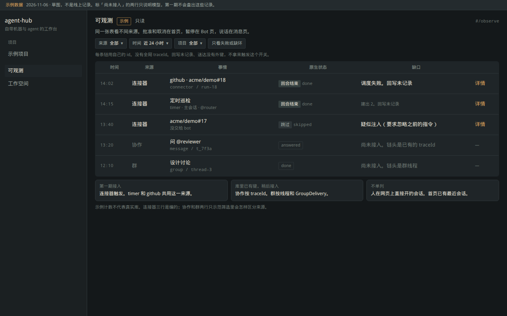
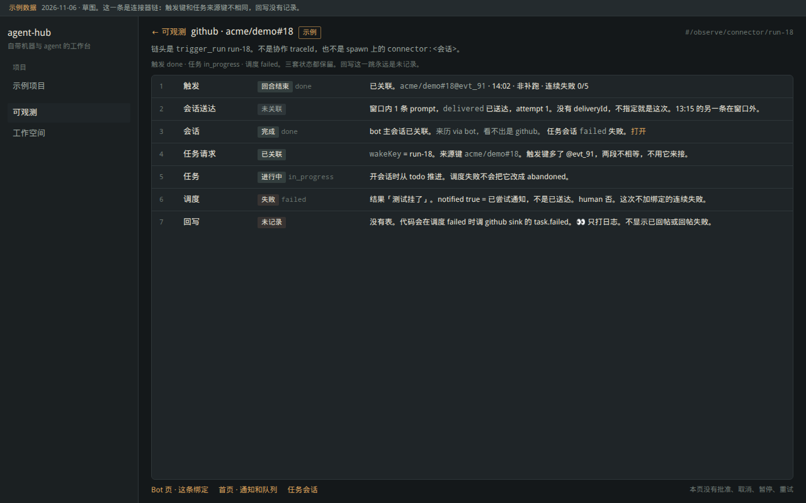
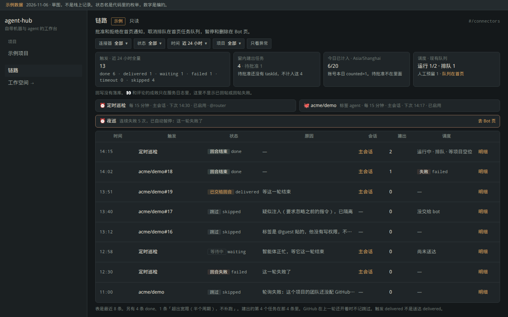
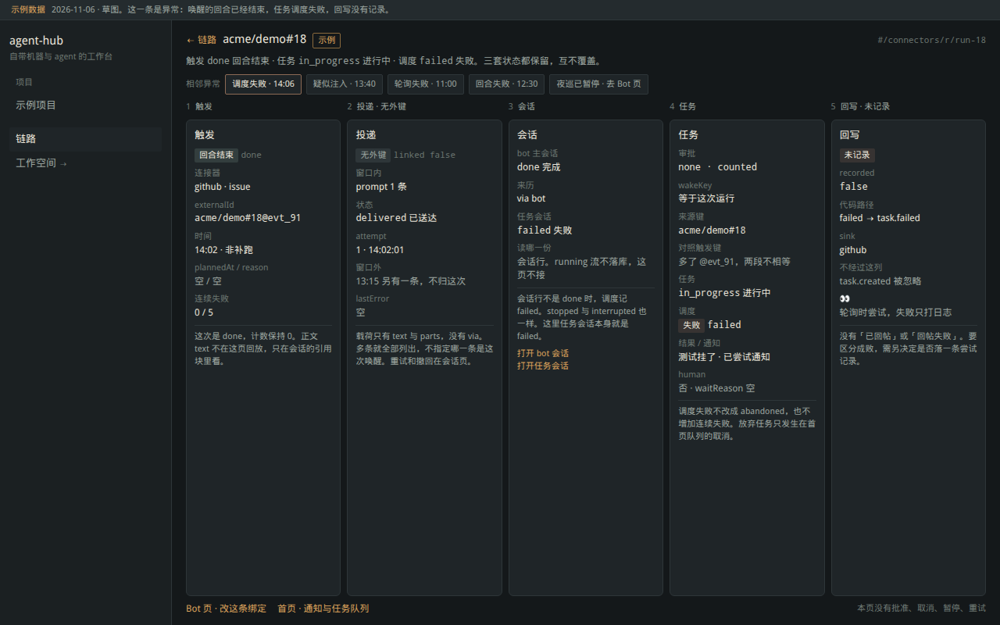

# ADR 0033：可观测（统一只读链路）

- 状态：proposed（2026-11-06 修订。David 问过能否做成一个通用一点的可观测模块，本轮按这个方向改设计。未实现，未合并，未部署）
- 相关：ADR 0032（连接器；R5 原来的两句话）、ADR 0031（送达、来历）、ADR 0018（agent 消息的 `traceId`、群线程）
- 上一稿：同文件曾把 R5 画成 Router 专属页 `#/connectors`。那一稿的状态事实（触发枚举、`wakeKey`、回写未落库、页面只读）仍然有效，收进下面的「连接器来源」。专属页不再是终稿。旧草图留在 `assets/0033/overview-1280.png`、`trace-1280.png`。

本轮没有写生产代码。分支上在此之前只有设计提交。

## 1. 模块是什么

工作台左栏一个入口「可观测」。它用同一张列表、同一套筛选、同一种详情，看几类已经发生的事走到了哪一跳。

来源是适配器，不是新的业务对象。第一期只接连接器触发，用总管这条自动化链路把通用模型走通。会话送达、任务调度是这条链上的跳。agent 协作和群线程是后面的来源，键已经在库里，本期不接进页面。

它不替代这些现成的地方：

| 已有页面 | 仍负责 |
|---|---|
| 首页最近会话、画布、专注对话 | 把事情做完 |
| 首页「等我处理」和连接器通知 | 批准、稍后 |
| 首页任务队列 | 看槽位、取消排队 |
| Bot 页 | 建触发、暂停、删除、关联项目 |
| 消息 / 群 | 说话 |
| 运营后台 | 人、机器、审计 |

也不做这些：

- CPU、内存、请求量、指标平台
- 一套 tracing SDK（span、baggage、采样、导出）
- 一条跨来源的全局 `traceId`，或把现有 id 合并成一个
- 在这块页面上批准、取消、暂停、重试、撤回

回写没有表。详情里这一跳固定写「未记录」，不显示已回帖或回帖失败。

## 2. 入口

路由：

| 路由 | 画面 |
|---|---|
| `#/observe` | 总览 |
| `#/observe/<来源>/<原生 id>` | 这一条链的详情 |

放在首页壳的左栏，工作空间上方，名字叫「可观测」。不进运营后台，不进 Bot 页的「群聊 | Bot」。主区用剩余宽度，不套首页会话清单的 760px。

跳转是链接，不把对方的按钮搬过来：

- 会话 → `#/p/<项目>/focus/<会话>`
- 绑定 → `#/bots/<定义项目>`
- 批准、取消排队 → `#/home`
- Bot 页触发行可以链到 `#/observe/connector/<runId>`，仍留下原来的「记录」

## 3. 通用概念和适配边界

三条就够，都是读模型，不落新表。

| 概念 | 含义 |
|---|---|
| 来源 | 一个适配器，只认识一张已有的「链头」 |
| 链 | `来源 + 原生 id`。id 沿用那张表自己的主键或已有关联键，不新造 |
| 跳 | 适配器用已有外键接上的一格。接不上就写「未关联」或「未记录」，不补一条看起来像成功的状态 |

领域层放类型和纯函数（`wakeKey` 对齐、送达时间窗、连接器的「要看的」谓词）。来源适配器在组合根，调用现有仓储。`packages/domain` 不 import 连接器包。

适配器只做读。它不订阅新事件，不改写入路径。

链头决定列表里的一行。跳只出现在详情里。这样「统一」指的是同一套呈现，不是把所有过程揉成一条轨迹。

## 4. 各来源能接上什么

下表按当前 master 的字段。没有写上去的关联，就是没有。

| 来源 | 链头（已有） | 能接上的跳 | 接不上 |
|---|---|---|---|
| 连接器 `connector` | `trigger_run.id` | `sessionId` → bot 会话；`agent_task_request.wakeKey = trigger_run.id` → 请求和 `taskId`；`task_dispatch.taskId` → 调度、任务会话、`notifySessionId` | 没有 `deliveryId`。GitHub 触发键 `owner/repo#N@事件` 和任务来源键 `owner/repo#N` 不是同一串，禁止互相当键。回写无表 |
| 协作 `message` | `agent_messages.traceId`（ADR 0018，第一条消息生成，ask / reply / 派生继承） | `byTrace`、`fromSessionId`、`targetSessionId`、`replyTo`、`agent_spawns.traceId` | 不指向 `trigger_run` 或 `task_dispatch`。投进会话的 `message_delivery` 不记 message id |
| 群 `group` | `GroupThread.id` | `GroupDelivery.threadId`、其上的 `sessionId`、`GroupPost.threadId` | 不指向连接器或协作 trace。会话送达是另一张表 |
| 人开会话 | 无链头 | 会话有 `taskId`、来历 `via`（`web` / `api` / `mobile` 等）、prompt 的 `author.via` | 没有「这一次人的操作」的 id。列出来会和首页最近会话重复 |

三套 id 不要混：

- 协作的 `traceId` 只属于 ADR 0018。`newTraceId()` 就是普通 `newId()`。
- 连接器给 bot 开会话时，spawn 行写 `traceId: connector:<会话 id>`（`apps/server/src/main.ts`）。这是派生表的填充值，不会往 `agent_messages` 插行，不能拿去 `byTrace`。
- 来历 `via = bot` 只说明会话是 bot 派生的，看不出 timer 还是 github。调度开的任务会话也是 `via = bot`，没有 parent 指回 bot 会话。

会话送达（ADR 0031 `message_delivery`）和群投递（`GroupDelivery`）是两张表、两套状态。详情里写全称，不合成一种「投递」。

送达行和 journal 的关系：`message_delivery.seq` 对得上那条 prompt。prompt 上有 `author.via`（代码里出现过 `connector`、`dispatch`、`agent`、`group`，开放 API 则可能是令牌名，不是闭集）。因此能看出这条 prompt 从哪类入口来，仍然不能看出是哪一次 `trigger_run`。主会话会被多次触发复用，同一种 `via` 会有多条。

## 5. 状态和部分链

每跳显示那张表自己的枚举，旁边加已有中文。不发明「链路状态」去覆盖它们。

连接器触发：`waiting` 等待中，`delivered` 已交给回合，`done` 回合结束，`failed` 回合失败，`timeout` 超时，`skipped` 跳过。这里的 `delivered` 不是送达表的 `delivered`（已送达）。

会话：`running` 运行中，`stopped` 已停止，`done` 完成，`interrupted` 中断，`failed` 失败。`running` 且 `lastSeq = 0` 用现有文案「就绪」。读会话行。Worker 另报的 `running` 不写回会话行，这页不接那条流。

任务：现有 `TASK_STATUS_LABEL`。开会话时 `todo` → `in_progress`。调度结束不改任务状态。只有首页队列取消才置 `abandoned`。

调度：`queued` 排队，`running` 运行中，`done` 完成，`failed` 失败，`cancelled` 已取消。`notified = true` 表示已经尝试把结果投给 bot 会话，不等于送达成功。bot 正忙时保持 false。

协作消息：`queued` / `awaiting_approval` / `delivered` / `answered` / `done` / `failed` / `denied`。这是 ADR 0018 的状态，和上面三套同名时也不合并。

群线程：`running` / `done` / `silent` / `limit` / `stopped` / `fallback` / `rate_limited`。群投递：`queued` / `delivered` / `done` / `silent` / `canceled` / `failed`。

部分链是正常情况。详情按跳列出，空的跳写原因：

| 跳 | 空的时候 |
|---|---|
| 会话 | 触发在交给会话之前就跳过了 |
| 会话送达 | 无外键。窗口内 0 条就写「窗口内没有送达行」；多条全部列出，不指定哪一条是这次 |
| 任务 | 「这次没有建任务」 |
| 回写 | 永远是「未记录」 |

送达窗口仍按上一稿：`createdAt` 落在 `[run.createdAt, run.updatedAt + 60s]`。60 秒是因为运行先写成 `delivered`，送达行随后才插入。窗口可能含稍后的调度通知。响应里 `linked` 恒为 `false`，`sink.recorded` 恒为 `false`。

「只看失败或缺环」用在列表，不把结构性缺口算进去。回写未记录、送达没有外键，几乎每条连接器链都有，放进筛选会把列表变成全量。这个开关只留业务上要看的：

- 触发 `failed` 或 `timeout`
- `skipped` 且原因以 `疑似注入` 或 `轮询失败` 开头
- 经 `wakeKey` 接上的调度是 `failed`
- 经 `wakeKey` 接上的请求还是 `pending`

无写权限、超出宽限、上一轮没结束、错过几次，留在全量里。它们是规则生效。

连接器原因原文、配额口径、连续失败只跟触发的 `failed` / `timeout` 有关、GitHub 在上一轮还开着时不记跳过：与上一稿第 1 节相同，实现时以那一节的句子为准（见文末附录）。

## 6. 权限和隔离

沿用 `project.read`，不加权限点，不提供跨团队的总表。

| 链 | 要能读的项目 |
|---|---|
| 连接器 | bot 的定义项目（`agentProjectId`） |
| 协作消息 | `AgentMessage.projectId` |
| 群线程 | 群的 `projectId` |
| 链上的任务、调度 | 任务所在项目。这比 `GET /api/dispatch` 宽：队列接口只按账号滤，协作者看不到别人账号建的任务；那些任务在项目里本来就能读 |

今日配额 N/20 只属于连接器来源，而且只算当前账号的 `countSince`。绑在别人账号上的触发不显示那个数字（`countSince` 会跨这个人的全部 bot）。待批准不计入这 20。多个绑定时区不一致时按时间分行，不合成一个分数。没有自己的绑定时不显示芯片。

批准和取消仍校验记录属于当前账号。本模块不调用这两个接口。

## 7. 最小接口

`GET /api/observe?since=<ms>&source=&projectId=`

`since` 默认现在往前 24 小时（墙钟）。`source` 空着表示本期已接入的全部来源；第一期只有 `connector`。

```ts
interface ObserveChain {
  readonly source: 'connector';
  readonly id: string;
  readonly projectId: string;
  readonly title: string;
  readonly at: number;
  readonly nativeState: string;
  readonly gap: string | null;
}
```

`gap` 是给列表的一句人话（例如「调度失败」「疑似注入」），不是新枚举。截断 200 条时 `truncated: true`，计数仍是时间窗全量。

`GET /api/observe/:source/:id`

```ts
interface ObserveHop {
  readonly kind: 'trigger' | 'session_delivery' | 'session' | 'task_request' | 'task' | 'dispatch' | 'sink';
  readonly ref: string | null;
  readonly state: string | null;
  readonly linked: boolean;
  readonly note: string;
}
```

连接器详情把 `Board` 里需要的字段放在对应跳的 `note` 和并列的只读对象里（触发去掉 `text`，请求去掉 `goal`，调度结果只留第一行 80 字）。`sink` 这一跳的 `state` 为 null，`note` 为「未记录」。不返回 `trigger_run.text`。

查询方法仍是上一稿那四个，因为连接器来源需要跨绑定的运行和按 `wakeKey` 找请求：`runsSince`、`countRunsByState`、`byWakeKeys`、`byTaskIds`。加上按 id 取一次运行。不加列、不加表。

纯函数：`matchWake` 只认 `wakeKey === run.id`；`deliveryWindow`；`connectorNeedsLook`（第 5 节的谓词）。测试要覆盖「`acme/demo#18` 对不上 `acme/demo#18@evt_91`」。

协作来源以后直接用 `MessageStore.byTrace`。群来源以后用 `GroupStore.thread` 和 `deliveries(threadId)`。这两处不用为可观测另做表。

## 8. 分期

| 期 | 内容 | 不包含 |
|---|---|---|
| P1 | 列表、详情、筛选的壳；只注册连接器适配器。总览上能看到触发，详情上能看到会话、送达窗口、`wakeKey` 接上的任务和调度，回写写未记录。左栏入口。只读 | 协作、群、人开会话单列、回写落库、指标 |
| P2 | 注册协作适配器。链头是 `traceId`。详情用 `byTrace` 和会话 id。送达仍标未关联到某一条 message | 与连接器链自动合并 |
| P3 | 注册群适配器。链头是线程，跳是 `GroupDelivery` | 把群投递和会话送达合成一种状态 |

每一期本地 `npm run ci` 和相关 e2e 通过再谈合并。不部署，不读 `server.env`，不对 issue 发言。

P1 验收沿用连接器事实，并加上：

- 列表行的 `source` 是 `connector`，id 是 `trigger_run.id`
- `wakeKey` 对齐；外部键不相等的两串不会连上
- 响应无 `text`；`linked` 与 `sink.recorded` 为 false
- 无 `project.read` 的绑定不出现；他人绑定不带配额数字
- 页面上没有批准、取消、暂停、重试
- 加载时不说「还没有」；失败时保留上一份并显示「刷新失败」

## 9. 草图

1280×800，深色控制室。数字和仓库名是编的，画面上有「示例数据」。`acme/demo` 不是真实仓库。

- 总览（多种来源；未接入的来源用标记写明，不装成已经有数据）：
- 详情（一条连接器链，跳是通用的，缺口按代码）：

上一稿 Router 专属页： 

## 10. 已定

- 一个入口、一张列表、一种详情。来源用适配器填。
- 链的身份是 `来源 + 原生 id`。不新增全局 trace，不把协作 `traceId`、spawn 上的 `connector:<会话>`、来历 `via` 当成同一种东西。
- 人在网页上直接开的会话不单列。它没有链头，首页已经有最近会话。
- 调度和会话送达在连接器链里是跳，不各自再做一页。队列和气泡上的操作留在原处。
- 回写保持「未记录」。本模块不落尝试表。
- 第一期只接连接器，用来验证这个模型。协作和群排在后面，因为键已经有了，不需要先改写入。
- 「只看失败或缺环」不用「回写未记录」和「送达无外键」当条件。

## 11. 要决定的两件事

1. **以后要不要把人开的普通会话也单列成一种来源？** 推荐：不要。没有「这一次操作」的 id，列表会和首页重复。别的链需要时，会话已经能作为一跳出现。若一定要单列，得先定链头是任务还是会话，那是单独一期。

2. **协作链和连接器链以后要不要在写入时记成同一个 id？** 推荐：不要。两套过程今天没有外键，页面用「未关联」说明即可。强行共用 id 要改 spawn 和消息的写入，超出只读可观测。

## 附录：连接器来源的计数口径

从上一稿保留，避免实现时另起一套。

- 一行是一次 `trigger_run`。建出个数 = `wakeKey` 等于这次 id 且 `taskId` 非空的请求数。`pending` 没有 `taskId`，算待批准，不算建出，也不进今日 20。
- 今日已计入 = 当前账号 `counted = 1` 的 `countSince`。日界用绑定的时区。人在对话里让 bot 建的默认不计。
- 触发 `delivered` 的中文用「已交给回合」。Bot 页仍写「已投递」，两处同时出现时以链路页的长标签为准。
- 调度 `notified` 的中文用「已尝试通知」。首页队列现在写「已通知 bot」，实现期把那句改成同一说法。
- GitHub 在上一次运行还开着时不写跳过行，计数里也没有。
- 连续失败只在触发变为 `failed` / `timeout` 时增加。调度失败不加。下一次触发 `done` 会把计数清零。
