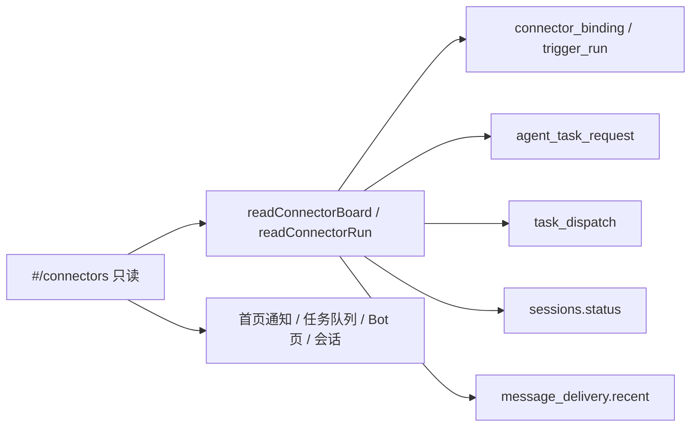

# ADR 0033：R5 连接器链路（只读面板）

- 状态：proposed（2026-11-06，设计稿，未实现）
- 相关：ADR 0032（连接器与总管，R5 的两句话范围）、ADR 0031（送达队列、收件箱、来历）、ADR 0030（能力与审计）
- 不改：0032 已定的端口、Binding 挂在 bot 下、工具只走 MCP、timer 只做入站、GitHub 规则留在连接器包里

本文只定 R5 怎么做成一个最小可读的面板。不实现、不合入生产、不部署。

0032 文末的浅色「总管面板」草图是定架构时的示意图。它把一行画成一条 GitHub issue，并把「批准」放在面板上。R1–R4 落地之后，一行对应的是 `trigger_run`，批准、取消、暂停已经有页面。下面的草图按代码里的表和枚举重画，旧图保留在 0032。

## 1. 现在库里有什么

核对对象是 master（R4 已合入，`#210`）。下面每格都是已有字段或已有行为。

| 环节 | 存在哪里 | 真实状态 | 和下一环怎么接 |
|---|---|---|---|
| 触发 | `trigger_run` | `waiting` `delivered` `done` `failed` `timeout` `skipped` | `sessionId` 指向 **bot 会话**。没有 `deliveryId` |
| 送达 | `message_delivery` | `queued` `sending` `delivered` `undelivered` `cancelled` `held` | 只有 `sessionId`。载荷是 `{text, parts}`，没有作者、没有 `via` |
| 会话 | `sessions.status` | `running` `stopped` `done` `interrupted` `failed` | bot 会话和任务会话是两条。来历 `via` 为 `bot`（派生时写入） |
| 建任务记录 | `agent_task_request` | 审批 `none` `pending` `approved` `rejected` `cancelled` | 唤醒键 `wakeKey` = 这次 `trigger_run.id`。人发起的是 `null` 或 `session:<id>` |
| 任务 | `tasks.status` | `todo` `in_progress` `blocked` `in_review` `done` `abandoned` | 开会话时 `todo` → `in_progress`。调度结束**不**改任务状态。从队列取消才置 `abandoned` |
| 调度 | `task_dispatch` | `queued` `running` `done` `failed` `cancelled` | `taskId`、`sessionId`（任务会话）、`notifySessionId`（bot 会话）、`originConnector`、`originExternalId`、`notified`、`waitReason`、`human` |
| 回写 | 无表 | 无枚举 | `OutputSink.deliver` 失败被吞掉，只打日志。👀 失败同样只打日志 |

同一枚举词在两张表里不是一回事：

- `trigger_run.delivered`：这次运行已经调用送达，bot 这一轮还没结束。
- `message_delivery.delivered`：某一条 prompt 已经交给运行时。

等待原因和跳过原因是代码里写死的句子，不是新枚举：

| 来源 | `reason` |
|---|---|
| 忙 | `智能体正忙，等它这一轮结束`（停在 `waiting`，此时还没调用送达） |
| 上一轮没完（仅 timer，带 `plannedAt`） | `上一次还没结束，本次跳过` |
| timer 宽限 | `超出宽限（半个周期），不补跑` |
| timer 漏跑 | `错过 N 次（hub 不在线），只补最近一次` |
| GitHub 写权限 | `标签是 @某用户 贴的，他没有写权限，不处理` |
| GitHub 注入 | `疑似注入（<规则 id>），已隔离，没交给 bot：<url>` |
| GitHub 轮询 | `轮询失败：<错误>`，每天最多一条（`externalId` 为 `error:<日序号>`） |
| 回合 | `这一轮失败了` / `这一轮被打断了`（`stopped` 与 `interrupted` 都走后一句） |
| 超时 | `超过 N 分钟没等到这一轮结束，按超时处理` |
| 自动暂停 | 绑定 `pausedReason` = `连续失败 N 次，已自动暂停：<原因>`，N = 5 |

GitHub 在上一次运行还开着时**不记跳过**（没有 `plannedAt` 就直接返回，下次轮询再看）。面板上不会有这一行，计数里也不会有。

调度 `waitReason` 只有四句：`等机器上线`、`等机器空位`、`等项目空位`、`并发已满`。

配额（`ROUTER_CAPS`）：一次唤醒 3，一个账号一个自然日 20。只数 `counted = 1` 的行。超额当时记 `pending` 且 `counted = 0`，批准后仍是 `counted = 0`。所以「今日已计入」和「建出了几个任务」是两个数。日界用**那次唤醒的绑定时区**；代码里没有账号时区。人在对话里让 bot 建的任务默认不计（`HUB_ROUTER_COUNT_HUMAN=1` 才计）。

GitHub 的两边键不一样，不能拿字符串对齐：

- `trigger_run.externalId` = `owner/repo#N@<事件 id>`
- `task.create` 的 `source.externalId` = `owner/repo#N`（提示词里要求 bot 这样填）

能对齐的键是 `agent_task_request.wakeKey = trigger_run.id`。

`notified = true` 的含义是：调度器已经尝试把结果投进 bot 会话（先把标记写成 true，再调用送达）。bot 正忙时标记保持 false。调用失败只打日志，标记不会改回 false。它不等于「bot 已经收到」。

绑定连续失败只在触发运行变成 `failed` / `timeout` 时 +1。任务调度失败不加这个计数。下一次触发运行变成 `done` 时，计数清零。

会话行的 `status` 只在 `ended` 时写成终态。Worker 报的 `running` 只推到界面流，不写回会话行。链路页首期读会话行，和调度器读的是同一份；不接那条不落库的流。

## 2. 范围

R5 做一块**只读链路**：近一个时间窗里，我能读到的触发各自走到哪一环，今日配额用了多少，超额还待批几条。

一行是一次 `trigger_run`。这一行上能数出来的：

- 跳过：本行 `state = skipped`，原因用 `reason` 原文。
- 建了几个：`wakeKey` 等于本行 id、且 `taskId` 非空的 `agent_task_request` 条数。`pending` 还没有 `taskId`，算在「待批准」里，不算进「建出」。

### 非目标

- 不新建连接器，不做 webhook / IM / 邮件 / Linear，不让智能体自己改定时，不自动合并 PR。
- 不改 0032 的端口和表的职责。首期两段**不加列、不加表**。
- 不把 Bot 页的「触发」编辑器、首页「任务队列」、首页「等我处理 / 连接器通知」再做一遍。
- 不在这块页面上批准、拒绝、取消排队、暂停或删除绑定、重试或撤回送达。
- 不回放 `trigger_run.text`。外部正文可能是注入样本；timer 的原文在 Bot 页和会话里已经有。
- 不把服务日志刮进面板（`[github] 👀 失败`、`[github] 回帖失败`、`调度：通知 bot 失败` 仍只在日志里）。
- 不重做 bot 的身份模型（0032 开放问题里的独立 `agent` 表）。
- 本设计稿不实现页面、不跑线上、不对任何 issue 发言。

## 3. 入口与导航

新路由放在现有首页壳里（左侧 220px 栏 + 右侧主区），不进运营后台，也不进 Bot 页的「群聊 | Bot」切换。

| 路由 | 画面 |
|---|---|
| `#/connectors` | 总览 |
| `#/connectors/b/<bindingId>` | 总览，预先筛到这一条绑定 |
| `#/connectors/r/<runId>` | 这一次运行的五环明细 |

主区拉满剩余宽度。首页会话清单仍是中间 760px，这条路由不套那个上限，否则五环排不开。

入口（都是链接，不新做一套导航）：

1. 首页左栏，「工作空间」上方，一项「链路」。有没有调度记录都在，因为任务队列在空的时候整段隐藏，链路不能跟着藏。
2. 首页「任务队列」标题右侧，文字链「链路」。队列本身仍留在首页。
3. Bot 页每个触发上现有的「记录」保留（最近 30 条）。旁边加「链路」，去 `#/connectors/b/<id>`。
4. 首页连接器通知仍负责批准和「去 Bot 页」。通知行加文字链「链路」：暂停去绑定，隔离去那次 `skipped` 运行，待批去总览并带上待批筛选。

手机宽度以后把左栏和五环改成上下堆叠，沿用现有组件。本设计稿只画 1280×800。实现期按 0032 的验收再补 390 的截图。

## 4. 信息层次

总览从上到下：

1. **标题行**：链路。副文案写明只读，以及批准、取消、暂停分别在哪一页。
2. **筛选**：连接器（来自 `GET /api/connectors` 的 `sources`，现在是 timer 与 github）、触发状态（六个枚举）、时间窗（默认近 24 小时，墙钟）、项目（绑定上的可选 `projectId`，或 bot 的定义项目）。另有开关「只看异常」。
3. **四块计数**，每块标明口径：
   - 触发：时间窗内按 `trigger_run.state` 的全量计数（不是表格截断后的条数）。
   - 建出：窗内 `taskId` 非空的请求数；旁边是待批准数。
   - 今日已计入：当前账号 `countSince` / 20。时区见第 8 节。待批准不在这 20 里。
   - 调度：当前账号队列里 `running` 与 `queued` 的条数，上限用现有 `DISPATCH_CAPS`（全局 2 + 人工预留 1）。不重画首页的槽位格子。
4. **一句固定说明**：回写没有落库，👀 和评论的成败只在服务日志里。这句不是计数。
5. **绑定条**：名称、`describe()` 的摘要、主会话或新会话、下次运行、启用 / 停用 / 自动暂停。自动暂停用 `pausedReason` 原文，链到 Bot 页。
6. **运行表**：最近若干条。列是时间、触发、状态（枚举 + 中文）、原因、bot 会话、这次唤醒建出的任务数、调度摘要。点一行进明细。
7. **脚注**：表是最近 N 条；上面的触发计数是时间窗全量。GitHub 在上一轮还开着时不产生跳过行。

明细是五列，从左到右，缺的环留空并写原因，不补一个看起来像成功的状态：

| 列 | 展示 | 空的时候写什么 |
|---|---|---|
| 触发 | 枚举、`externalId`、`catchup`、`plannedAt`、`reason`、绑定连续失败的当前值 | 不会空，这条页面就是一次运行 |
| 投递 | 该 bot 会话上、落在对照窗口里的 `message_delivery`：枚举、`kind`、`attempt`、`lastError` | `sessionId` 为空，或窗口内 0 条：写「无外键，窗口内没有送达行」。有多条：全部列出，不指定哪一条「就是这次」 |
| 会话 | bot 会话与任务会话各自的 `status`（用现有 `STATUS` 文案）。bot 会话来历 `via = bot` | 跳过且从未解析会话：这一列空 |
| 任务 | 请求的审批、`counted`、`wakeKey`、来源键、任务状态、调度状态、`waitReason`、`human`、`notified`、结果第一行（最多 80 字，与首页队列一致） | 这次唤醒没有请求：写「这次没有建任务」 |
| 回写 | 固定「未记录」 | 始终是这一句。有 `originConnector` 时补一句代码路径：调度 `done` 会调 `task.finished`，`failed` 会调 `task.failed`；`task.created` 被 GitHub sink 忽略；👀 在入站轮询时尝试 |

对照窗口（服务端算，不把 `text` 发给浏览器）：

- 候选是该 `sessionId` 上 `createdAt` 落在 `[run.createdAt, run.updatedAt + 60s]` 的送达行。60 秒是因为运行先写成 `delivered`，送达行在那之后才插入，用闭区间会漏掉刚写上的那一条。
- 窗口可能含稍后的「调度通知」（也是 `kind = prompt`）。载荷里没有 `via`，所以不能靠它区分。
- 响应里这些行带 `inWindow: true`，并带 `linked: false`。`linked` 在有外键之前恒为 false。

「只看异常」为真时留下满足任一条件的运行，外加自动暂停的绑定（绑定不是运行，单独一条）：

- 触发状态是 `failed` 或 `timeout`
- `skipped` 且 `reason` 以 `疑似注入` 或 `轮询失败` 开头
- 经 `wakeKey` 接上的调度状态是 `failed`
- 经 `wakeKey` 接上的请求审批是 `pending`

无写权限、超出宽限、上一轮没结束、错过 N 次，留在全量列表里，不进异常。它们是规则生效，不是故障。

明细页顶上用同一谓词列出相邻的异常，点哪条换 `#/connectors/r/<id>`；暂停的绑定去 Bot 页。

### 中文标签

Bot 页已有「已投递」。链路页同时出现两套 `delivered`，标签写成：

| 枚举 | 链路页中文 | 已有页面 |
|---|---|---|
| 触发 `waiting` | 等待中 | Bot 页同文 |
| 触发 `delivered` | 已交给回合 | Bot 页写「已投递」 |
| 触发 `done` | 回合结束 | Bot 页写「完成」 |
| 触发 `failed` | 回合失败 | Bot 页写「失败」 |
| 触发 `timeout` | 超时 | 同 |
| 触发 `skipped` | 跳过 | 同 |
| 送达六态 | 排队 / 发送中 / 已送达 / 未送达 / 已撤回 / 挂起 | 会话气泡已用前五态；`held` 是交接简报，连接器唤醒不会产生 |
| 会话五态 | 现有 `STATUS`：运行中、完成、已停止、中断、失败。`running` 且 `lastSeq = 0` 显示「就绪」 | 同 |
| 任务六态 | 现有 `TASK_STATUS_LABEL` | 同 |
| 调度五态 | 首页队列已有：排队、运行中、完成、失败、已取消 | 同 |
| `notified` | true 写「已尝试通知」，false 写「等 bot 空下来再通知」 | 首页队列后半句已有；前半句把「已通知 bot」改成「已尝试通知」，避免读成已经送达。首页那句留到实现期一并改掉，避免两处说法不同 |

枚举值用等宽字跟在中文旁边，方便对日志。

## 5. 只读、跳转、三种空态

这块页面没有写按钮。

| 想做的事 | 去哪 |
|---|---|
| 批准或拒绝超额 | 首页连接器通知（已有「批准 / 拒绝」） |
| 取消还在排队的调度 | 首页任务队列（已有「取消」） |
| 暂停、恢复、删除、修改绑定 | Bot 页该触发的行 |
| 立即重试或撤回一条送达 | 会话页该气泡下（已有） |
| 看 bot 或任务会话 | `#/p/<项目>/focus/<会话>` |
| 看自动暂停或隔离的原文通知 | 首页通知 |

跳转都用现有 `formatRoute`。明细列上的会话 id、任务 id 做成这些链接。

三种状态分开，不把「还没加载」说成「没有」：

| 情况 | 表现 |
|---|---|
| 加载 | 计数和表的位置是灰块。不出现「还没有」「0」 |
| 成功但没有绑定 | 「还没有触发。」链接到 Bot 页 |
| 成功但时间窗内 0 条 | 「这段时间没有运行。」计数为 0，表空 |
| 异常开关下 0 条 | 一行灰字「没有要看的异常」，与首页收件箱安静时同一语气 |
| 请求失败 | 保留上一份成功数据（若有），顶上一行「刷新失败」，带「重试」。没有上一份时整页这一行，不渲染成空列表 |
| 轮询 | 一份 `GET`，10 秒，与「等我处理」相同。刷新失败不把表清掉 |

## 6. 权限与可观测性

沿用现有检查，不加权限点：

- 绑定和运行：对 bot 的定义项目有 `project.read`（与 `GET .../bindings`、`GET /api/bindings/:id/runs` 相同）。没有权限的绑定不出现。
- 请求和调度行：对任务所在项目有 `project.read`。这比 `GET /api/dispatch` 宽。现有队列接口只按 `accountId` 滤，协作者看不到别人账号建的任务；那些任务在项目里本来就能读。链路按项目读，才能把一次唤醒和它建的任务接上。
- 今日 N/20：只算**当前账号**的 `countSince`。绑在别人账号上的触发，写「配额在建触发的人账上」，不显示那个数。`countSince` 跨这个人的全部 bot，把别人的日计数画出来会带出别的项目。
- 批准、取消仍校验记录属于当前账号。本页不调用这两个接口。

可观测性就是这份读模型加上现有日志。不做指标管道，不新开推送。`truncated: true` 时脚注写「表只显示最近 200 条，计数是全量」。

## 7. 数据与接口

首期读现有表。新代码是一个用例如下，外加查询方法。`packages/domain` 继续不 import 连接器。



已有、总览直接复用的部分：

- `GET /api/connectors`：连接器 id 与 kinds，筛选用。
- `ConnectorStore.bindingsOf` / `allBindings`，再按 `project.read` 滤。
- `AgentTaskStore.countSince`、`pendingFor`。
- `Dispatcher` 的上限常量。队列格子仍用现有 `GET /api/dispatch`，链路页不靠它做关联（它只含当前账号最近 60 条，且响应类型在前端没把 `originConnector` 标出来）。

现有接口不够、需要补的只是查询，不是新表：

| 端口方法 | 原因 |
|---|---|
| `ConnectorStore.runsSince(bindingIds, since, limit)` | 现有 `runs` 按单条绑定、路由里写死 30 条。5 分钟一次的 timer 一天远超 30 |
| `ConnectorStore.countRunsByState(bindingIds, since)` | 计数要全量，不能靠截断后的列表加总 |
| `AgentTaskStore.byWakeKeys(keys)` | 现有只有 `bySession`、`pendingFor`、`countWake` |
| `TaskDispatchStore.byTaskIds(ids)` | `recent(account, 60)` 接不全 |

HTTP 两个，都挂在现有 `connector-routes`：

`GET /api/connectors/board?since=<ms>&bindingId=&connector=&state=`

```ts
interface ConnectorBoard {
  readonly since: number;
  readonly truncated: boolean;
  readonly quota: { readonly used: number; readonly cap: 20; readonly perWake: 3; readonly timeZone: string; readonly since: number } | null;
  readonly pending: readonly { readonly id: string; readonly title: string; readonly projectId: string; readonly createdAt: number }[];
  readonly counts: Readonly<Record<TriggerRunState, number>>;
  readonly createdTasks: number;
  readonly dispatch: { readonly running: number; readonly queued: number; readonly caps: { readonly global: 2; readonly humanReserved: 1 } };
  readonly bindings: readonly BindingView[];
  readonly runs: readonly BoardRun[];
  readonly requests: readonly BoardRequest[];
  readonly dispatches: readonly BoardDispatch[];
}
```

`quota` 在「不该看别人的日计数」时为 `null`。`BindingView` 用现有字段。`BoardRun` 是 `TriggerRun` 去掉 `text`。`BoardRequest` 含 `id, wakeKey, taskId, projectId, title, approval, counted, originConnector, originExternalId, createdAt`，不含 `goal`。`BoardDispatch` 含 `id, taskId, state, waitReason, sessionId, notifySessionId, notified, human, originConnector, originExternalId, resultFirstLine, workerId, updatedAt`。

`GET /api/connectors/runs/:runId`

```ts
interface ConnectorRunDetail {
  readonly run: BoardRun;
  readonly binding: BindingView;
  readonly requests: readonly BoardRequest[];
  readonly dispatches: readonly BoardDispatch[];
  readonly sessions: readonly { readonly id: string; readonly role: 'bot' | 'task'; readonly status: SessionStatus; readonly lastSeq: number }[];
  readonly deliveries: readonly { readonly id: string; readonly kind: DeliveryKind; readonly state: DeliveryState; readonly attempt: number; readonly lastError: string | null; readonly createdAt: number; readonly inWindow: boolean }[];
  readonly linked: false;
  readonly sink: { readonly recorded: false };
}
```

`linked` 与 `sink.recorded` 写成字面量 `false`，实现里不要改成可空的成功态。任务状态由已有任务仓储按 `taskId` 读取，放在 `requests` 旁的 `taskStatus` 字段（`TaskStatus | null`）。没有单独发明「链路状态」。

纯函数放在 `packages/domain`：`summarizeBoard` 做计数和配额窗口，`assembleRun` 做五环。时区、权限过滤的输入由用例注入，函数本身不读钟、不读库。

今日配额的时区规则：当前账号名下、自己能读的绑定，若 `timeZone` 全部相同，用它做 `dayStart`，芯片印出这个时区名。若不一致，芯片按每个时区分行，每行一个 `countSince(我, dayStart(now, 该时区))`，不合成一个分数。没有绑定时，不显示芯片（没有可以引用的时区；人发起的回合用 `HUB_TIME_ZONE`，那不是这块页面的默认）。

`since` 默认 `now - 24h`。这是墙钟窗口，和「今日已计入」的自然日并排，两个标签都写出来。

## 8. 分期与验收

每期一个实现 PR。本地 `npm run ci` 与相关 e2e 通过再合。不合入本设计稿。不部署，不读 `server.env`，不对 issue 发言，不用线上 worker。

### P1 总览

- 领域纯函数 + 四个查询方法 + `GET /api/connectors/board`。
- 路由与左栏入口、队列标题上的链接、Bot 行上的「链路」。
- 总览的筛选、四块计数、绑定条、运行表、加载 / 空 / 错误。
- 页面上没有批准、取消、暂停、删除。

验收：

- 计数按六种触发状态加总，截断 200 条时 `truncated` 为真且计数仍是全量。
- `pending` 与批准后的行不进 `used`。两个时区出两行，不合并。
- `wakeKey` 对齐；`acme/demo#18` 与 `acme/demo#18@evt_91` 不会被当成同一键。
- 响应里没有 `text`。无 `project.read` 的绑定不出现。他人绑定的 `quota` 为 `null`。
- 组件或 e2e 用本地夹具打开 `#/connectors`：加载时不出现「还没有」；失败时出现「刷新失败」；链接指向 `#/home`、`#/bots/...`、`#/p/.../focus/...`。

### P2 明细

- `GET /api/connectors/runs/:runId` 与五环页面、异常开关、相邻异常。
- 首页队列把「已通知 bot」改成「已尝试通知」。

验收：

- 触发 `done`、任务仍是 `in_progress`、调度 `failed` 三套状态同时出现，互不覆盖。
- 调度失败不增加绑定的 `consecutiveFailures`；之后的 `done` 会把该计数清零（用现有夹具，不断言新行为）。
- `sink.recorded` 与 `linked` 为 false。窗口比 `updatedAt` 晚 5ms 的送达行仍出现；更早的同文案 timer 送达不出现。
- `notified: true` 不生成送达成功的展示。
- 异常谓词：无写权限的跳过不在内；`疑似注入`、`轮询失败`、触发 `failed`、调度 `failed`、`pending` 在内。
- 本地 1280 与 390 截图。390 是同一块上下排列。

### P3 回写记录（仅在第 11 节得到肯定之后）

另加一张只追加的尝试表，由组合根在调用 sink 与 👀 之后写入：连接器 id、`externalId`、种类（`eyes` / `task.finished` / `task.failed`）、成功或失败、错误摘要、时间。不改 `OutputSink` 的语义，失败仍然不阻断调度。面板第五列才从「未记录」换成这条尝试。没有这条决定之前不做 P3。

## 9. 草图

桌面 1280×800，深色控制室（`docs/design/visual-direction.md` 的色板与字号）。数据是编的，画面上有「示例」标记。仓库名用 `acme/demo`，没有令牌、没有 issue 正文。

- 总览：
- 异常明细（一次唤醒回合已结束，任务调度失败，回写未记录）：

示例世界与计数一致，便于对照第 4 节：

- 近 24 小时触发 13 条：`done` 6、`delivered` 1、`waiting` 1、`failed` 1、`timeout` 0、`skipped` 4。表显示最近 8 条，其余 4 条 `done` 与 1 条宽限跳过在计数里、不在表里。
- 窗内建出任务 4。待批准 1，不在这 4 里，也不在 6/20 里。
- 今日已计入 6/20，时区 `Asia/Shanghai`（示例里两条启用绑定同时区）。
- 调度：运行 1、排队 1（`等项目空位`）。全局上限 2，人工预留 1。
- 绑定「夜巡」自动暂停，原因是连续失败 5 次。它不是一条运行。
- 明细那一行：触发 `done`，外部键 `acme/demo#18@evt_91`；来源键 `acme/demo#18`；bot 会话 `done`；任务会话 `failed`；任务 `in_progress`；调度 `failed`，结果第一行「测试挂了」；`notified` true；回写未记录。窗口内一条 `prompt` / `delivered`，另有一条更早的不在窗口内。

## 10. 已定（实现时直接照此，不再单开选择题）

- 页面只读；写操作留在已有按钮上。
- 路由 `#/connectors`、`#/connectors/b/<id>`、`/r/<id>`，放在首页左栏。
- 一行是一次 `trigger_run`。关联用 `wakeKey`，不用 GitHub 两边的外部键互比。
- 首期不落回写、不给 `trigger_run` 加 `deliveryId`。第五列写「未记录」，投递列写对照窗口。
- 不返回 `text`。
- 异常谓词按第 4 节。无写权限等规则跳过留在全量列表。
- 配额芯片只显示当前账号；多时区分行。
- 会话状态读会话行，不读 Worker 的未落库 `running` 流。

## 11. 需要决定的一件事

**回写成败要不要在 P3 落一条只追加的尝试记录？**

推荐：**首期不要。** 面板写「未记录」。👀 和回帖失败今天只在服务日志里，调度不会因为回帖失败而改状态。若要在面板上区分「已回帖 / 回帖失败」，再单开 P3，不放进 P1/P2，也不改 sink 的失败处理。

没有第二件必须现在拍板的事。第 10 节如果要改，直接在审阅里指出即可。
