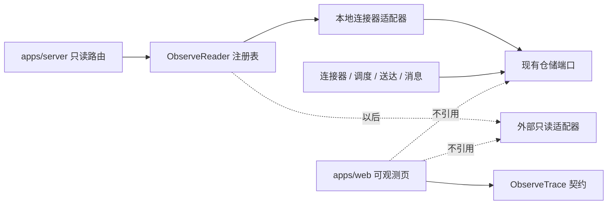
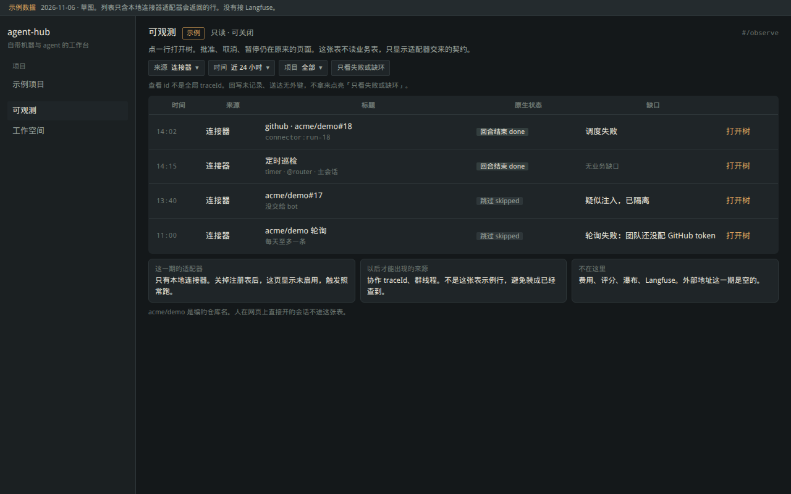
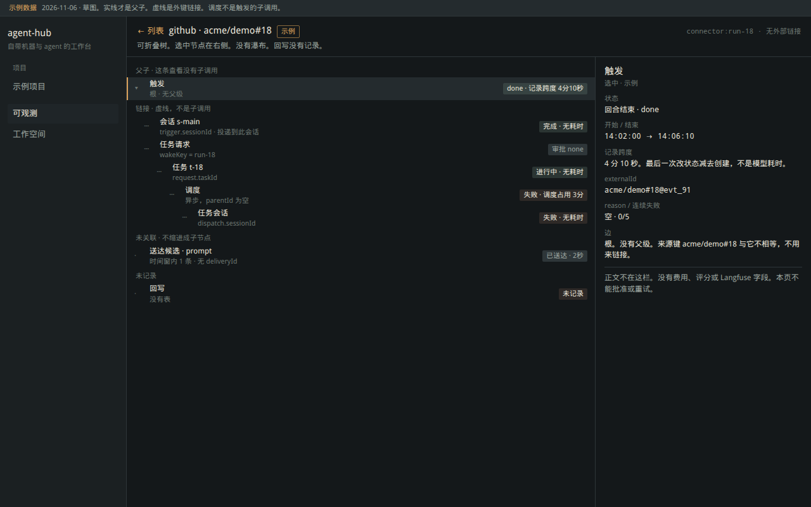

# ADR 0033：可观测（可替换的轻量只读模块）

- 状态：P1 已实现，未合并，未部署（2026-11-06）。David 对这一版回复「可以」后按本文实现。P2/P3 仍未做。
- 相关：ADR 0032（连接器）、ADR 0031（送达、来历）、ADR 0018（协作 `traceId`、群线程）
- 本文件的前两稿：Router 专属页；然后是「按业务表来源 + id 直接读」的统一列表。第二稿的字段事实还用，产品形态改成下面这一版：界面只认一份厂商无关的只读契约，本地表和将来的 Langfuse 都是适配器。

P1 已有代码：`packages/observe`、本地连接器适配器、`#/observe`。没有连接 Langfuse，没有读密钥。实现时补了两处本文原先没写死的细节，见第 7 节。

## 1. 查过什么

只看了公开文档，以及文档里直接链出来的两张图。没有登录 Langfuse、LangSmith、Phoenix、AgentOps，没有开账号，没有打开需要登录的控制台。

| 来源 | URL | 实际看到的 |
|---|---|---|
| Langfuse 数据模型 | https://langfuse.com/docs/observability/data-model | 正文。Observation 嵌在 trace 里，trace 可再归进 session。采集在后台批量发送，不挡请求。短命进程要自己 `flush()`，否则退出时队列里的记录会丢 |
| Langfuse 追踪概览 | https://langfuse.com/docs/observability/overview | 正文，以及文中的图 https://langfuse.com/images/docs/tracing-overview.png 。这张图看过：左侧是筛选和观察表（时间、类型、名字、trace），中间是缩进的观察树，节点上有名字和秒数，右侧是选中节点的 Preview（输入、输出）。同页还有分数、费用、图表入口。图里没有单独的瀑布条 |
| Langfuse 新 trace 视图说明 | https://langfuse.com/changelog/2025-03-19-new-trace-view | 正文：Tree 和 Timeline 可以切换。这一页的抓取结果里没有图，不能说看过那张瀑布 |
| Langfuse 观察表用法 | https://langfuse.com/faq/all/explore-observations-in-v4 | 正文：默认先看根观察。父级被导出过滤掉时，子级仍带着 parent id，所以「没有父行」和「逻辑上的根」不是一回事 |
| Langfuse 公开 API | https://langfuse.com/docs/api-and-data-platform/features/public-api | 正文：`parentObservationId` 是物理父级。`isRootObservation` 为真时，父级 id 仍可能非空 |
| Langfuse session 图 | https://langfuse.com/images/docs/session.png | 图看过：左侧按轮次折叠的轨迹，右侧是对话，不是调用树 |
| Langfuse 什么是一条好 trace | https://langfuse.com/docs/observability/best-practices | 正文：一条 trace 是一次自洽的工作；多轮用 session 串。树里应能看到每次模型调用，而不是包成一个总数 |
| LangSmith 概念 | https://docs.langchain.com/langsmith/observability-concepts | 正文：run 组成 trace，thread 串多轮，trajectory 是把嵌套摊平后的消息。没有打开他们的产品界面 |
| LangSmith 看 trace | https://docs.langchain.com/langsmith/view-traces | 正文：列表点进去是侧栏；Trajectory / Turns / Details 三种。没有 `thread_id` 就没有 Turns。没有看见图 |
| LangSmith run 字段 | https://docs.langchain.com/langsmith/run-data-format | 正文：`parent_run_id`、`trace_id`、起止时间、`child_run_ids`。费用和 token 是字段，不是我们要做的功能 |
| Phoenix 信号 | https://arize.com/docs/phoenix/tracing/concepts-tracing/otel-openinference/signals | 正文：树来自 `parent_id`。父级 id 指向不存在的 span 叫 orphan。Span links 指向别的 span，可跨 trace。没有看见图 |
| OpenTelemetry 概念 | https://opentelemetry.io/docs/concepts/signals/traces/ | 正文：一个 span 至多一个 parent。Links 用来表示异步、当时还不知道何时开始的后续工作。Span 状态是 Unset / Error / Ok |
| AgentOps 概念 | https://docs.agentops.ai/v2/concepts/traces 与 https://docs.agentops.ai/v2/concepts/spans | 正文：列表、树、时间线、详情是不同视图。https://app.agentops.ai/traces 打开后是登录墙，没有看见图 |

第三方课程站上的瀑布说明没有当作产品事实。

从这些材料里拿走的，只是布局和两个关系：

- 轻量入口是一张表。点一行，左边是可折叠的树，右边是选中节点。Langfuse 那张追踪图就是这个结构。
- 父子和链接分开。OpenTelemetry 写明：父子是同一条轨迹里的直接下级；链接是因果，常用于排队之后才发生的工作。Phoenix 把对不上的父级标成 orphan，不把它画成根下面的亲子。

不拿走的：费用、token、评分、数据集、标注、告警、图表、LLM-as-a-judge、prompt 管理和实验。Langfuse 自己的概览把这些算作追踪之外的用法。

配色仍用 agent-hub 的深色控制室。Langfuse 那张图是浅色后台，不照搬。

## 2. 模块边界

可观测是只读模块。业务执行不调用它。注册表里没有适配器时，页面显示「未启用」，连接器、调度、送达照常工作。



依赖方向：

- `packages/observe` 只有类型和纯函数（组树、缺父级、脱敏后的属性）。它不 import domain、sqlite、Langfuse SDK、HTTP。
- 本地适配器在组合根。它 import 现有仓储端口和 `packages/observe`，把行映射成契约。domain 的连接器、调度、消息代码不 import 可观测。
- 网页只消费 HTTP 返回的契约，不出现表名，也不出现 Langfuse 的客户端。
- 关掉模块等于不注册适配器、不挂路由。业务路径上没有对它的调用，所以失败也不会堵住建任务或投递。

不做 SDK、消息总线、新表。第一期适配器现查现映射。

三种和外部平台有关的事，不能并成一个开关：

| 方式 | 做什么 | 第一期 |
|---|---|---|
| 读 | 另一个 `ObserveReader`。例如以后用 Langfuse 公开 API 的 `parentObservationId` 填 `parentId` | 不做。不配置 host，不放密钥 |
| 导出 | 业务写完之后，后台批量把事件送出去。失败就丢，不在请求里等对方 | 不做。一做就会碰到写入路径 |
| 跳转 | 契约上可选的 `externalUrl`。有地址才显示「在外部打开」 | 字段留着，本地适配器恒为 null |

Langfuse 文档里的后台导出是他们 SDK 的行为。我们若要导出，也得放在业务返回之后，并且和「把 Langfuse 的树读进来」不是同一条代码。

## 3. 契约

界面只看见这些。适配器负责填，填不出就空着。

```ts
interface ObserveNode {
  readonly id: string;
  readonly name: string;
  readonly kind: string;
  readonly state: string | null;
  readonly stateLabel: string | null;
  readonly startedAt: number | null;
  readonly endedAt: number | null;
  /** 起止都有才有数。文案说明这数是什么，例如「记录跨度」或「送达用时」。 */
  readonly durationMs: number | null;
  readonly durationLabel: string | null;
  /** 仅当存储里有父级且能对上时填写。没有就 null。 */
  readonly parentId: string | null;
  readonly links: readonly { readonly to: string; readonly label: string }[];
  readonly attrs: readonly { readonly key: string; readonly value: string }[];
}

interface ObserveTrace {
  readonly id: string;
  readonly source: string;
  readonly title: string;
  readonly projectId: string | null;
  readonly externalUrl: string | null;
  readonly nodes: readonly ObserveNode[];
}
```

`id` 是这个模块里的查看 id，例如 `connector:run-18`。它不是 W3C trace id，也不写成全局追踪号。

纯函数 `buildTree`：

- `parentId` 指向本响应里的另一个节点：实线子节点，可折叠。
- `parentId` 有值但本响应里没有那个节点：不挂到别人下面，标「父级不在本页」。
- `links`：虚线，文案带「链接」。可折叠，但不算调用子级。
- 两边都没有：放在「未关联」。

异步的后续工作用链接。调度在触发回合结束之后另开会话，这是排队后的工作，不是触发函数里的子调用。OpenTelemetry 对这种关系用的是 link，不是 parent。

耗时：两个时间戳都有才算。触发的 `updatedAt - createdAt` 标成「记录跨度」（最后一次改状态减去创建），不标成模型耗时。调度在 `startedAt` 和结束时间都有时标成「调度占用」。缺一个时间就写「无耗时」，不画条。

属性白名单由适配器复制。触发正文、`goal`、送达载荷、令牌、密钥不进 `attrs`。外部适配器以后若要读 Langfuse 的 input/output，默认不取这两块；要取必须另有脱敏，不在第一期。

## 4. 本地连接器适配器怎么填

证据不够就不填 `parentId`。

| 节点 | 从哪来 | 父子 | 链接 | 耗时 |
|---|---|---|---|---|
| 触发 | `trigger_run` | 无父级，它是这条查看的根 | `sessionId` → 会话，标签「投递到此会话」 | 记录跨度 |
| 任务请求 | `wakeKey === trigger_run.id` | 无。请求是回合里后来写下的，不是子调用 | 指回触发，标签「由这次唤醒建下」 | 无，除非只要创建时间 |
| 任务 | `request.taskId` | 无 | 从请求链到任务 | 无单次耗时。状态用 `TASK_STATUS_LABEL` |
| 调度 | `task_dispatch.taskId` | 无 | 从任务链到调度。`notifySessionId` 再链回 bot 会话，标签「已尝试通知」 | `startedAt` 与结束时间都有才有「调度占用」 |
| 任务会话 | `dispatch.sessionId` | 无 | 从调度链到会话 | 无 |
| 会话送达 | `message_delivery` | 无。没有 deliveryId，时间窗不是外键 | 不挂。窗口内的行放进「未关联」 | 终态才有「送达用时」 |
| 回写 | 无表 | 无 | 无 | 节点仍出现，状态空，属性写「未记录」 |

`owner/repo#N@事件` 和任务来源键 `owner/repo#N` 不相等，适配器不得用它们互指。

协作 `traceId` 和群线程是以后的另一个本地适配器，不是这条触发的子节点。spawn 上的 `connector:<会话>` 不映射成父级。来历 `via = bot` 只说明是 bot 派生，不说明是哪一次触发。

人在网页上直接开的会话仍然不单列。没有链头，首页已有最近会话。

## 5. 界面

两个层次，都只读。

列表 `#/observe`：时间、来源、标题、原生状态、一句缺口。筛选是来源、项目、近 24 小时，以及「只看失败或缺环」。这个开关不用「回写未记录」和「送达无外键」，否则几乎每行都会命中。它沿用连接器上已经写明的业务条件：触发 `failed` / `timeout`、以「疑似注入」或「轮询失败」开头的跳过、调度 `failed`、请求 `pending`。

详情 `#/observe/<source>/<id>`：

- 左：可折叠树。实线是父子，虚线是链接。未关联和未记录分在树下两截，不缩进成子节点。
- 右：选中节点的名字、状态、两个时间、耗时文案、白名单属性、这条边是父子还是链接。
- 第一期不画瀑布。Langfuse 的 Timeline 是另一视图；我们多数边是链接，把它们画成一根时间条会像同一次调用。节点上只放绝对时间和耗时文案。
- 没有批准、取消、暂停、重试。那些仍在首页、Bot 页和会话气泡。

加载时不显示「还没有」或 0。失败保留上一份，顶上「刷新失败」。没有绑定时，列表写「还没有可显示的记录」，并链到 Bot 页。模块未启用时单独一句，不装成空数据。

## 6. 权限、脱敏、开关

- 本地适配器：连接器链要求对 bot 定义项目有 `project.read`。链上的任务还要求对任务项目有 `project.read`。不提供跨团队总表。
- 今日 N/20 仍只算当前账号自己的 `countSince`，并且只出现在连接器触发节点的属性里。别人的绑定不带这个数。
- 适配器抛错只影响这次读取。
- 环境变量只表达开关，例如以后的 `OBSERVE=0` 不注册适配器。第一期不读取密钥，不读 `server.env` 里的令牌。外部平台的密钥若要做，也只存在账号自己的配置里，不进仓库、不进这条响应。

## 7. 分期

| 期 | 内容 |
|---|---|
| P1 | `packages/observe` 契约和 `buildTree`。本地连接器适配器。列表、树、右侧详情。`externalUrl` 恒为 null。回写节点写未记录 |
| P2 | 第二个本地适配器：协作 `traceId` 或群线程，二选一先做有 `replyTo` / `threadId` 可证明父子的那个。仍不导出 |
| P3 | 仅当决定要接外部平台：先做跳转 URL。读外部 trace 是另一个适配器。导出更晚，因为要动到写入之后的后台发送 |

实现时的两处微调：

- 契约增加 `headId`。否则一条没有链接的触发，和窗口里的送达行一样是「没有父级也没有人指向它」，树会把送达也当成根。`headId` 只标这条查看的根，不另造全局 trace id。
- 列表默认 50 条、最多 200 条。时间窗里先取最近 500 条再筛「失败或缺环」。超过就 `truncated`。响应带 `scanLimit`，页面始终写明这个顺序；截断时另外标明更早的失败可能不在这一页。链接画在触发指向请求的方向，证据仍是请求上的 `wakeKey`。
- 开了账号时，未登录的 `/api/observe` 被现有登录闸门拒绝（401，请先登录），适配器不跑，不会显示成空列表。登录后只出现有 `project.read` 的项目。匿名主体若绕过闸门打到路由，路由返回 `viewer: "anonymous"` 且不调用适配器。
- 开关是进程环境变量 `OBSERVE=0`，不读 `server.env`。

验收（P1）：

- 网页模块的 import 里没有仓储、没有 `@langfuse`。
- domain 的连接器与调度文件不 import `packages/observe`。
- `wakeKey` 能接上；两条 GitHub 键不相等时不产生链接。
- 调度节点的 `parentId` 为空，只出现在 `links`。
- 父级 id 指到本页没有的节点时，标「父级不在本页」，不挂到根的子级里冒充。
- 响应无触发正文、无载荷、无密钥。`externalUrl` 为 null，`sink` 节点无状态。
- 无 `project.read` 的绑定不出现。他人配额不出现。
- 树可以折叠。选中节点换右侧详情。加载与失败的文案符合第 5 节。
- 本地 1280 截图至少有列表和树。实现期再截，不用本文件的草图充数。

## 8. 草图

1280×800，深色，标了示例数据。布局参考第 1 节看过的 Langfuse 追踪图（表、缩进树、右侧详情），没有费用和评分。

- 列表：
- 树和详情：

更早的草图仍留在同目录：`overview-1280.png`、`trace-1280.png`、`observe-1280.png`、`observe-trace-1280.png`。它们不是这一版的界面。

## 9. 已定

- 模块可卸载。业务路径不调用它。
- 界面只依赖第 3 节的契约。
- 第一期只有本地连接器适配器，不连 Langfuse。
- 不新造全局 traceId，不用字符串相近来接 GitHub 的两把键。
- 父子必须有父级证据。对不上就「父级不在本页」或「未关联」。调度、通知、唤醒建任务用链接。
- 第一期有树，没有瀑布。
- 回写保持「未记录」。
- 人开会话不单列。协作 trace 与连接器查看 id 不合并。

## 10. 要决定的两件事

1. **若以后接 Langfuse，第一步做哪一种？** 推荐：只做跳转。有外部 id 时给出「在 Langfuse 打开」。不把对方的树读进来，也不把我们的事件送出去。读和导出都会碰到密钥或写入路径，单独再批。

2. **瀑布要不要跟树一起做？** 推荐：不要。第一期树加上每节点的时间和耗时文案。瀑布只适合以后那些真正有父级、并且起止都可信的节点，避免把链接画成同一次调用。
