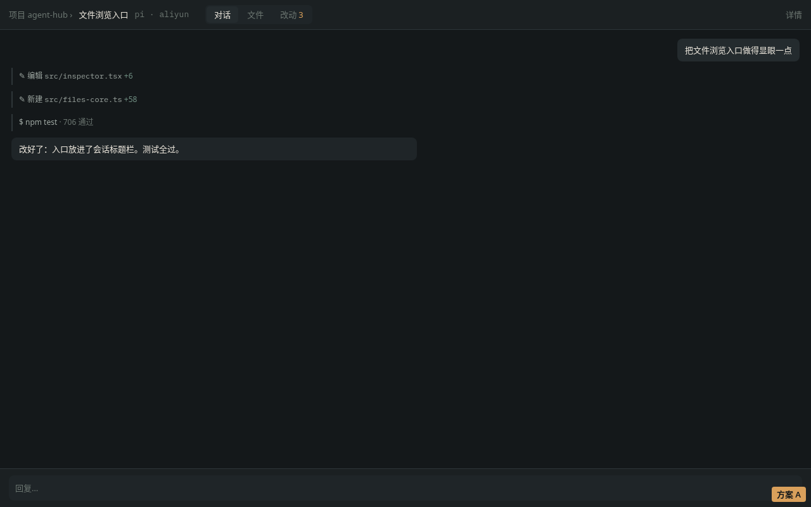
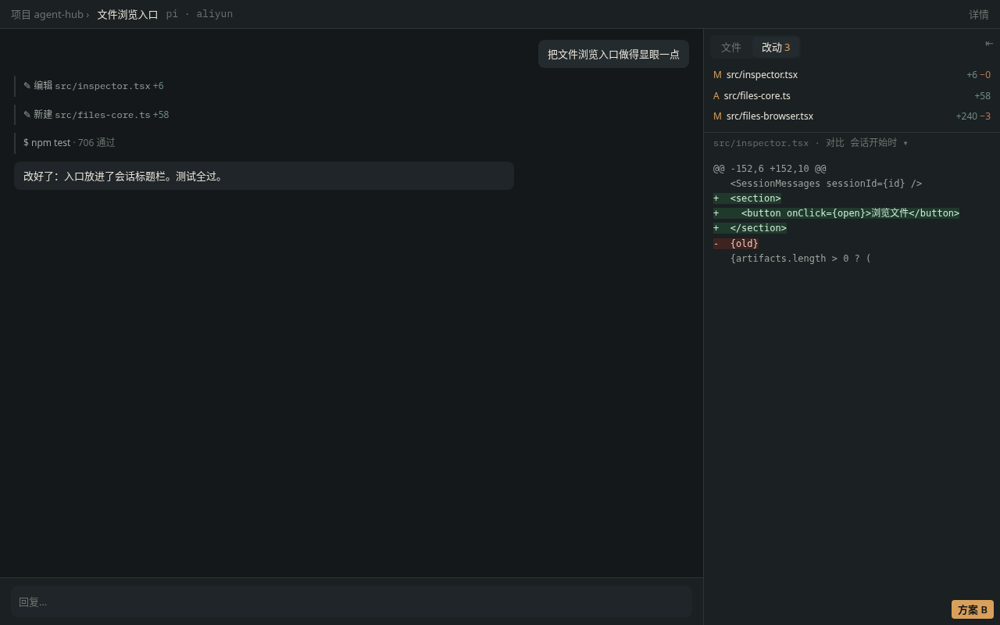
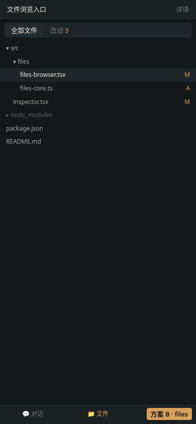
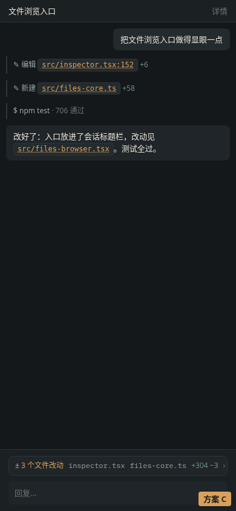
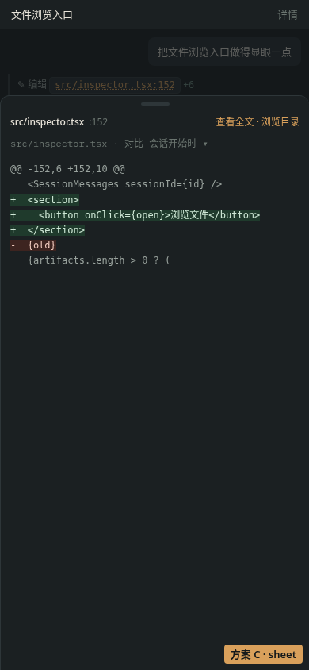

# 工作空间文件：入口位置设计（调研 + 三方案）

> **决定（2026-11-01，David）：采用方案 A**——会话头部「对话 / 文件 / 改动」标签切换，手机 390 与桌面 1280 都要好用；改动默认对比会话开始（session_git_bases，可切 HEAD）；工具参数里的路径可点暂不做；「详情 → 浏览文件」保留。下文第 3 节的推荐（C+B）仅作调研记录，未采纳。实现见 feat/files-tabs PR。
>
> 起因：现在文件浏览器只能从 会话 → 详情 → 浏览文件 进入，太隐蔽。本文是纯设计文档，不改代码。
> Mockup：`docs/design/mockups/files-entry.html?opt=A|B|C&view=…`，截图在 `docs/design/mockups/files-entry/`。

## 1. 竞品调研

| 产品 | 桌面端 | 移动端 | 来源 |
|---|---|---|---|
| opencode web | 左侧文件树（Cmd+B）+ 右侧 Review 面板（Cmd+Shift+R），带「N files changed」触发器、改动/全部 tab、文件 tab | 768px 以下不显示侧面板 | [文档](https://anomalyco-opencode.mintlify.app/web)、[session-side-panel.tsx](https://github.com/anomalyco/opencode/blob/b6478dce/packages/app/src/pages/session/session-side-panel.tsx) |
| Claude Code web | 聊天旁边的面板里有 Changes 卡片（+42 −18），点开看 diff；标题栏/⋮ 里也有 Changes 入口；可以和分支对比、行内评论 | Claude App 的 Code tab；社区 issue 抱怨移动端没有文件树，并认为 Codex 做得更好 | [文档](https://code.claude.com/docs/en/claude-code-on-the-web)、issue #61160 |
| Cursor 云端 agent | 侧边 Review | 没有文件浏览器，只有 diff/Review；**点对话里的文件链接会打开该文件的对应行**（实时读取 agent 机器上的文件） | [mobile 文档](https://cursor.com/docs/cloud-agent/mobile)、[release notes](https://cursor.com/docs/release-notes/mobile) |
| OpenAI Codex | 同上 | 每轮结束后显示「2 files changed +38 −12」摘要卡，点开 diff → 看全文（高亮）→ 行内评论 / 引用回对话 | [mobile 文档](https://learn.chatgpt.com/docs/mobile)、[博客](https://developers.openai.com/blog/mastering-codex-remote-for-engineering) |
| Devin | 会话顶部的一级 tab：Progress/Activity · Shell · IDE · Browser | 同样是 tab | [文档](https://docs.devin.ai/work-with-devin/devin-session-tools)（2026-10 的「Activity 合并」说法**未核实**） |
| Replit | 工作区里 Files/Preview/Changes 等都是 tab，文件树在侧栏 | App 里同样是 tab | [文档](https://docs.replit.com/build/code/navigate-your-workspace) |
| Lovable / v0 / bolt.new | 顶部有 Preview ↔ Code 切换，Code 模式下左侧是文件树；bolt 在移动端/Safari 上只读 | 同样是切换 | [Lovable](https://docs.lovable.dev/features/code-mode)、[v0](https://v0.app/docs/code-editing)、[bolt](https://support.bolt.new/building/code-view) |
| GitHub Copilot agent | 会话日志页里，Session logs 和 Overview / Files changed 并列 | GitHub Mobile 能看原生会话日志，改动要跳到 PR 的 Files changed | [changelog 2026-04](https://github.blog/changelog/2026-04-01-github-mobile-stay-in-flow-with-a-refreshed-copilot-tab-and-native-session-logs/) |
| Manus | **未核实**（搜索没找到文件面板相关文档） | — | — |

**结论**：没有一家把文件藏在「详情」里。
- 桌面端：主流做法是常驻侧面板，加一张「改动 +N −M」卡片（Claude、opencode、Copilot）。
- 移动端：主流做法是把改动摘要卡放进对话流（Codex、Cursor），以及让路径可以点击（Cursor、Codex）。
- 一级 tab 适合「工作区型」产品（Devin、Replit、Lovable），这类产品里文件和对话同等重要。

## 2. 三个方案

### A：会话标题栏一级 tab「对话 / 文件 / 改动(n)」
 
- 优点：最显眼，结构简单；现有 FilesBrowser 可以直接作为 tab 内容。
- 缺点：看文件时看不到对话；移动端标题栏会多一行。

### B：桌面端常驻右侧面板；移动端用底部 tab
 
- 优点：桌面端可以边聊边看 diff（参照 Claude、opencode）。
- 缺点：会挤占 1280 宽度下的对话区，需要能折叠；底部 tab 会和全局导航冲突。

### C：对话里的路径可点击，输入框上方加「± N 个文件改动」条
 
- 用户在哪里看到文件，就在哪里打开（参照 Codex、Cursor）。点击后弹出 sheet 显示 diff 或全文，sheet 里还有「浏览目录」，可以进入完整文件树。
- 缺点：没改动的会话里看不到入口，需要配一个兜底入口。

## 3. 推荐：C 为主，B 为辅（分两期）
1. **P1（改动小、收益大）**：
   - 输入框上方加改动条：有改动时才显示，点击打开现有 overlay 的「改动」tab。
   - 工具输出和消息里的路径做成 chip：点击打开 overlay 并定位到对应行。
   - 标题栏加一个常驻的 📁 图标：打开「文件」tab，作为没有改动时的兜底入口。
   - 「详情 → 浏览文件」保留，作为次要入口。
2. **P2**：宽度 ≥1200px 时，overlay 改为可折叠的右侧常驻面板（方案 B 的桌面部分）。移动端继续用 sheet / 全屏 overlay，不加底部 tab。
- 不选 A 作为主方案的原因：agent-hub 以对话为主，文件只是辅助信息，用一级 tab 会把两者割裂开。

## 4. 待决定
- chip 的识别规则：只识别工具调用参数里的路径，还是也匹配正文里的路径？
- 改动条的口径：统计本会话的改动（opencode #42290 的做法），还是工作区相对 HEAD 的改动？
