# Orca 桌面端交互设计调研

**对象：[Stably AI / Orca](https://github.com/stablyai/orca) · 版本：[`v1.4.278`](https://github.com/stablyai/orca/releases/tag/v1.4.278) · 实测：2026-11-26，Linux x64，1600 × 960。** 本文嵌入 **11 张本地客户端实拍**，另提供 **8 张 Orca 官方演示图的上游链接**。本地图片可点击查看原图；官方图仅以链接标注，不作为实测结果。

## 结论先看

- **Orca 先让人找回一份工作，再让人找回一段对话。** 左栏用项目和 worktree 定位，中间保留终端、编辑器、Diff 等并排视图，右栏显示当前 worktree 的 Git 状态。切去另一份工作再回来，不必重搭桌面。这比「多开几个 Chat」更能解释它的产品价值。
- **最完整的一段是本地代码评审。** 源码差异、行内反馈和发送入口在同一处；用户不用复制文件名与行号去另一条会话。可见的短板也在这里：窄分屏时 Diff 工具栏挤到叠字，未配置 Agent 时发送菜单缺少清晰的下一步。
- **最值得 agent-hub 借鉴的是上下文连续性，不是 worktree 中心制。** 快捷打开、差异评审在本仓库已有实现和测试，优先打磨同名结果的识别、窄面板工具栏、待评审草稿和投递状态。保留 Task、Session、Worker、WorkDir 与血缘各自的语义；Git worktree 是工作目录的一种，不是任务，也不是安全沙箱。

[开工](#1-首次上手与创建工作区) · [工作台](#2-桌面工作台与分屏) · [导航](#3-跨工作区导航与状态) · [运行与恢复](#4-agent-会话与恢复) · [评审](#5-从-diff-到修改意见) · [远程与编排](#6-远程预览与多-agent-编排) · [收尾](#7-工作区收尾与设置) · [对 agent-hub 的建议](#8-给-agent-hub-的建议) · [证据与边界](#9-证据索引与适用边界)

## 1. 首次上手与创建工作区

**先选用法，再选工具，最终也能从空终端开工。** 首次引导有五步、语言入口和跳过路径。这个干净 Linux 配置中，首屏预选且推荐 `Chat UI`；第二步检测不到 PATH 中兼容的 Agent，却仍允许稍后设置。`Yolo mode` 在第二步初始画面是开启态，说明写明 Agent 可免询问执行命令及编辑文件，部分还会绕过自身沙箱，并提示单个 Agent 可以覆盖全局值。**看到的是开关初始态，不是已验证的启动参数或审批行为**；未运行 Agent。固定版本的 Chat 文档写的是新安装默认 Terminal，与本次引导实拍不一致，不宜外推到其他平台、旧配置或绕过引导的启动路径。

[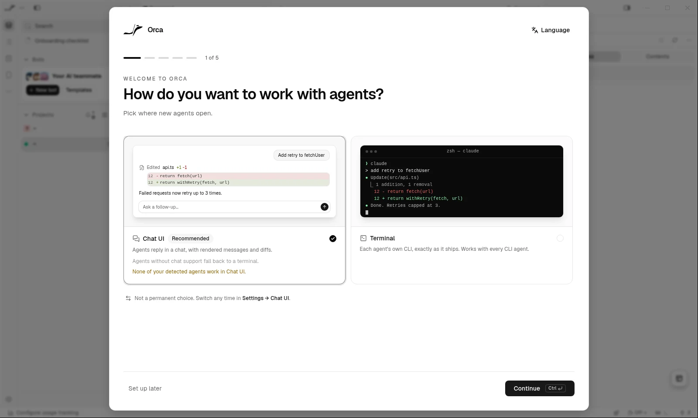](screenshots/01-onboarding.webp)

*图 01 · 实拍。先解释 Chat / Terminal 两条路径，而不是先让用户配置模型。*

[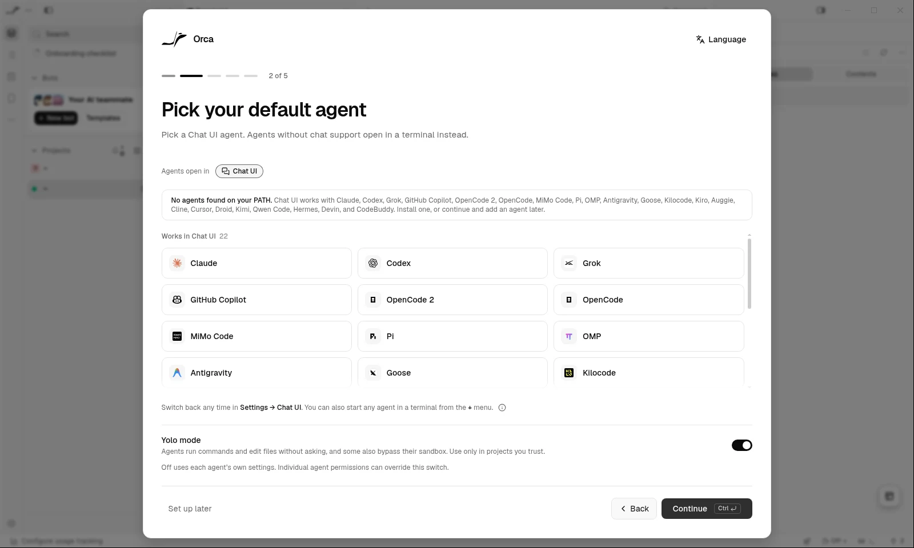](screenshots/02-agent-setup.webp)

*图 02 · 实拍。权限选项与默认 Agent 同屏；未实际启动任何 Agent。*

**创建表单把作用范围和执行位置抬到了第一行。** `Projects` 的 `+` 可以选已有本地目录、从 URL 克隆或新建项目。本次选了本地 Git 仓库 `atlas-notes`，再用 `Ctrl+N` 打开 `Create worktree`：`Project` 和 `Run on` 并排；可选 `Create From` 接收名字、`#1234`、分支及 GitHub / GitLab / Jira URL，并露出基线 `origin/main`；Agent 可选 `Blank Terminal`，高级项折叠，另有 `Create more` 和键盘提交。实测建立了 `review-notes`，未走在线 issue 或 clone 流程。混合输入节省空间，但「仅作工作区名称」与「引用外部对象」含义不同，候选列表必须清楚显示实际采用哪一种。

[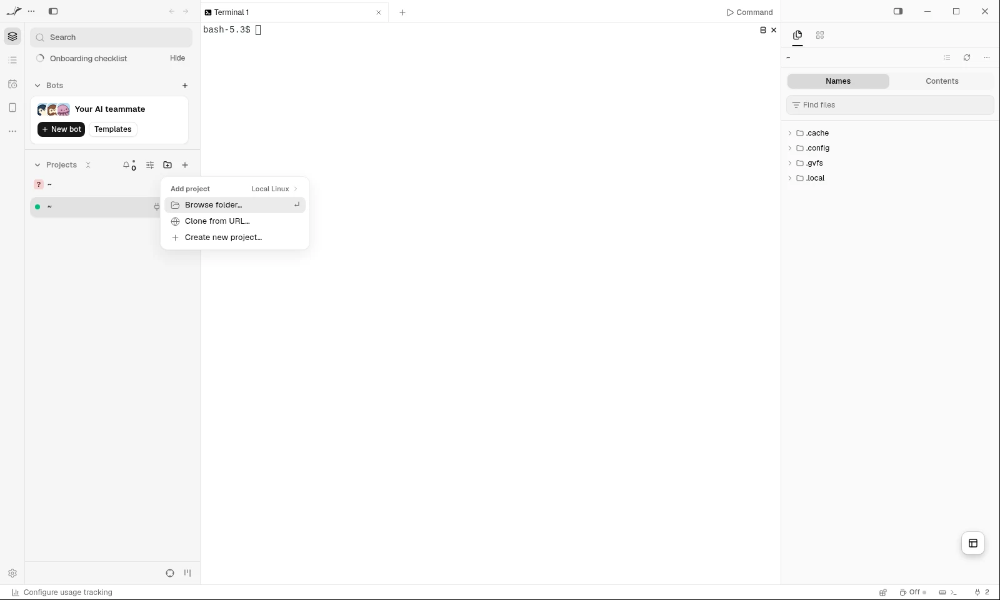](screenshots/03-add-project.webp)

*图 03 · 实拍。项目入口先交代在哪台机器上选目录。*

[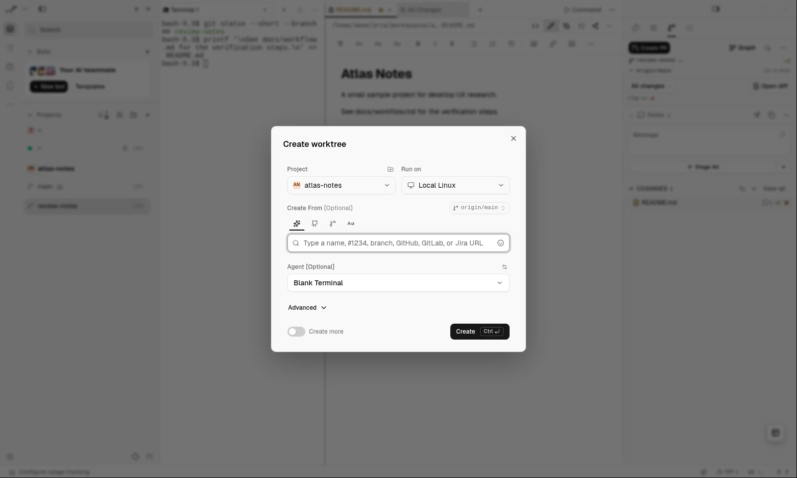](screenshots/04-create-worktree.webp)

*图 04 · 实拍。没有 Agent 也能建工作区；来源与基线不是同一字段。*

[Worktrees 文档][worktrees] 还描述了后台创建：提交后关闭表单，侧栏显示进度，详情可取消、失败可重试；用户可以去别的工作区，不必等 Git 操作完成。实测成功路径，没有制造慢 fetch 或建树失败。Git worktree 分开 checkout，并不自动隔离主机权限、环境、网络、共享文件或密钥。

## 2. 桌面工作台与分屏

**左栏负责选定工作，中间动手，右栏核对当前对象。** 最左窄轨切换应用区域，旁边侧栏放 Search、Bots、Projects；项目下显示 `main`、`review-notes`。中部是标签和可拆分的 pane，不是固定的「聊天列」。右侧 Source Control 带当前分支、基线、差异范围、改动数、暂存与 `Create PR`。布局把代码和差异留在工作上下文，不用为了看一眼变更跳去另一页。

[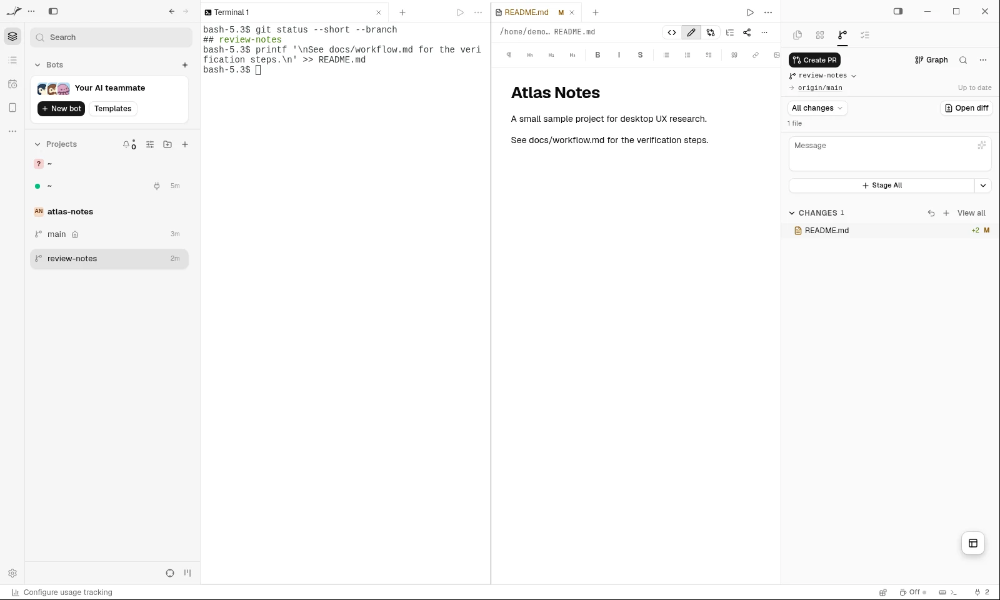](screenshots/05-workbench-split.webp)

*图 05 · 实拍。通过标签菜单 `Move Tab to Split → Right` 分屏；切到 `main` 再返回 `review-notes`，分屏仍在。*

在视觉上，大块内容区使用低对比度边框分隔，选中工作区用底色，强按钮及差异增删色承担视觉重点。好处是同时显示四块内容仍不至于满屏强调；代价是终端命令已经换行，部分路径被截断，右栏图标与次级文字紧凑。**布局可分屏**与**任何宽度都适于阅读**不是一回事：可切换为单 pane 或收起侧栏，应该和拆分一样容易发现。标签拖放、固定、嵌套分屏和每 worktree 布局见 [Tabs, panes & split layouts][panes]；本次只核实了右分屏与切换返回。

[官方演示：终端、页面预览、开发服务器输出和差异的四宫格](https://github.com/stablyai/orca/blob/f105ca47275a05867d505857d99ea45a2c0a395b/docs/assets/readme-features/split-anything.poster.jpg)

*官方演示 A · 四宫格画面说明可组合性，不代表这种密度适合所有屏宽。*

## 3. 跨工作区导航与状态

**用全局搜索回到工作，用文件搜索留在工作里。** Linux 实拍里，侧栏 `Search` 和 `Ctrl+K` 可打开全局搜索；空查询就有近期 Chat / Terminal 和 Workspaces，底部标出上下选择、Enter 跳转、Esc 关闭和 Tab 筛选，近期条目还有 `Ctrl+数字`。另有 `Ctrl+P`（设置中为 `Go to file`）和标签栏 `+` 的混合入口。官网 [Quick Open & Jump Palette][quick] 仍以 `Cmd-J` 叙述工作区跳转；这里的 Linux 键位以图 06 和图 11 为准。

[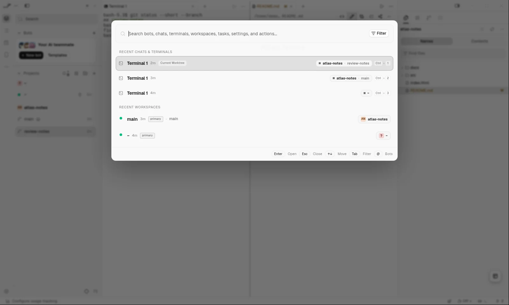](screenshots/06-jump.webp)

*图 06 · 实拍。同名 `Terminal 1` 要靠右侧小型项目／工作区标签区分；项目、工作区、主机是识别信息，不只是备注。*

官方文档还有一个值得借鉴的规则：**打开面板时固定近期会话的成员和顺序**，不会因为后台状态变化而让数字快捷键跳去别处。实拍核实了入口、键位、结果分组和键盘跳转，没有做后台重排行为测试。

对并行工作，官方 [Agents & sessions][agents] 的重点是把「正在运行、需要你、已完成、空闲、受阻」放到标签、工作区行及实验性 Dashboard，而不是要人逐条进会话看。Dashboard 可以用看板或独立窗，用项目、工作区状态和 PR/MR 状态筛选；需要审批或回答的事项优先。**UI 状态、进程状态和任务完成判定不要混在一起**：一个 Agent 停下来，不等于 Task 完成；普通终端也不应被当成空闲 Agent。本次没有启动真实 Agent，未验证状态变化、通知或看板。

## 4. Agent 会话与恢复

**Chat 和 Terminal 能并存，但界面切换不是单一种操作。** [Chat UI 文档][chat] 区分了两种底层形态：结构化 Chat 本身没有同一进程的原位终端视图，「Continue in terminal」会打开新标签，复制可续接的对话并保留原来那条；terminal-backed chat 则是同一终端 Agent 的 transcript 视图，可在受支持的场景切回终端，不必新建会话。[Agent Session History][history] 可从右侧按范围找旧会话，可否继续由 Agent、记录和执行主机的能力共同决定。Composer 设计则把模型、强度、模式和 `/` 命令放在输入旁；文档称受支持的会话重连时可保留已稳定的对话和草稿。这些行为没有做真实会话测试。

[官方演示：结构化 Chat 与 CLI 终端并排展示](https://github.com/stablyai/orca/blob/f105ca47275a05867d505857d99ea45a2c0a395b/docs/assets/readme-features/chat-or-terminal.poster.jpg)

*官方演示 B · 图显示两种呈现的侧重点，不证明两边一定是同一会话。*

**「回到上次界面」与「进程还在跑」要用不同反馈。** 实拍证明在同一应用窗口内切换 worktree 会保留分屏；跨退出恢复见 [Session restore][restore]。文档区分布局、滚屏、焦点的恢复与 daemon 对存活 PTY 的重连；主机重启或 daemon 丢失时，历史仍可回来，但原进程不再运行。`Quit Completely` 则会显式停止本机终端。这些跨退出行为未实测；尤其不要从一个恢复的标签推断计算还在进行。

## 5. 从 Diff 到修改意见

**实测路径：增加一行正文 → 打开差异 → 留行内意见 → 选择接收方。** 在 `review-notes` 中改 `README.md`，`main` 的检出保持干净。右栏点 `Open diff` 后，差异进入独立标签；第 5 行通过 gutter 的 `+` 留下一条意见，中部保留批注卡，右栏同步显示 `Notes 1`。右栏进入 `Send notes to` 后，可见的接收 Agent 均标记 `Install required`，没有继续投递。真实模型回复、修订完成和平台 PR 未验证。

[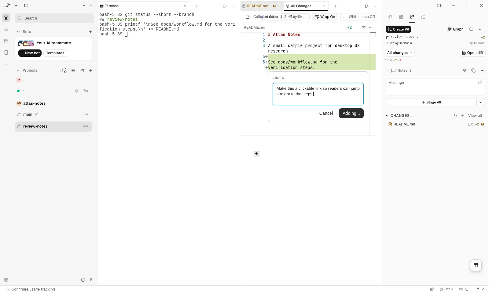](screenshots/07-diff-note.webp)

*图 07 · 实拍。捕捉到提交批注时的 `Adding…`，图 08 显示保存后的批注卡。当前分屏宽度下，Diff 顶部 `AI notes` 与相邻操作文字发生重叠。*

[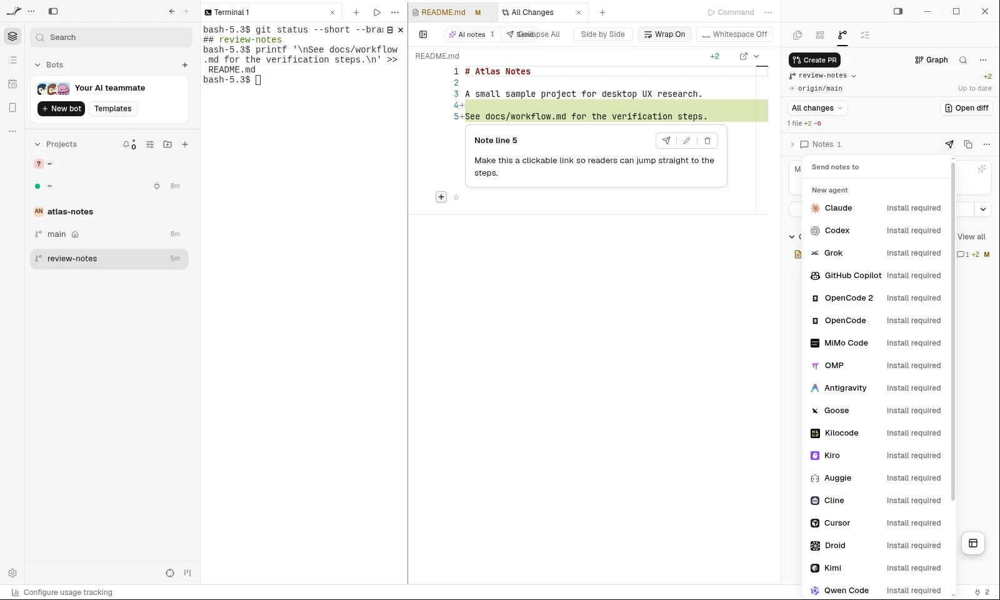](screenshots/08-send-note.webp)

*图 08 · 实拍。这个空配置里，菜单已能说明可见选项未安装，但没有把「先去安装／以后继续」变成明确下一步；未检查列表底部。*

官方 [Annotate AI Diff][diff] 描述的后半段是批量发回 Agent、继续修订、解决批注后重审。这里好的不是「自动修代码」，而是让**意见留在被评审的内容旁**，再走显式发送。右侧 Git 工作流上还能看基线、做暂存或进入 PR；外部提交依然是另一个动作。官方图展示的是成功演示，不是本次投递证明。

[官方演示：已发送的 diff 行内批注和右侧 Agent 修订](https://github.com/stablyai/orca/blob/f105ca47275a05867d505857d99ea45a2c0a395b/docs/assets/readme-features/annotate-ai-diffs.poster.jpg)

*官方演示 C · 左边留意见，右边看到修订进展。*

[官方演示：带差异和提交摘要的创建 PR 界面](https://github.com/stablyai/orca/blob/f105ca47275a05867d505857d99ea45a2c0a395b/docs/assets/readme-features/git-integration.poster.jpg)

*官方演示 D · Git / PR 与当前分支和改动并排，未实测连接代码托管平台。*

## 6. 远程、预览与多 Agent 编排

这一节除 `Run on` 的本机入口外均是**官方演示／文档**，不作为真实远程、转发能力或多 Agent 执行测试。官方 [Ways to run Orca][ways] 区分四种执行位置：本地、直连 SSH、配对 Remote Orca Server、按 worktree 配置的按需环境。SSH 模式下 Agent 与 Git 跑在远端，桌面保留编辑和评审；配对服务器则持有项目、终端和会话，桌面是访问该运行时的客户端。外观相近，但重连与状态归属不同。

| 能力 | 交互设计与风险 | 图 |
| --- | --- | --- |
| 并行 worktree | 创建时先明确项目、执行位置、来源和 Agent，进工作区后继续保持分支与上下文可见。真正的并行收益来自恢复和导航，而不是单纯增加 workspace 数。 | [官方演示 E：创建并行 worktree](https://github.com/stablyai/orca/blob/f105ca47275a05867d505857d99ea45a2c0a395b/docs/assets/readme-features/parallel-worktrees.poster.jpg) |
| 远程执行 | 官网把本机和远端作为 `Run on` 候选，旁边显示路径。创建时选的位置要延续到窗口和发布／删除等高后果操作；断连时也不能把远端进程误标为已停止。 | [官方演示 F：Run on 的主机选项](https://github.com/stablyai/orca/blob/f105ca47275a05867d505857d99ea45a2c0a395b/docs/assets/readme-features/remote.poster.jpg) |
| 内置浏览器 / Design Mode | 预览与对话并排，可从页面选中元素并带着上下文描述改动。[浏览器设置][settings] 将页面在哪里渲染与流量从哪里走分开。远端 `localhost` 的来源需要明确标识。没有验证远端网络、DOM／截图上下文实际采集或运行配置。 | [官方演示 G：在预览中指向要改的元素](https://github.com/stablyai/orca/blob/f105ca47275a05867d505857d99ea45a2c0a395b/docs/assets/readme-features/design-mode.poster.jpg) |
| 多 Agent 交接 | 官方画面把 worker 的进度摘要回流到上层对话，并在侧栏显示子工作；这比在主线程铺开每个子日志更易扫读。画面不证明跨主机同步、权限继承、失败恢复，也不等同于 agent-hub 已持久化的 Session 血缘。 | [官方演示 H：上层会话中的 worker 更新](https://github.com/stablyai/orca/blob/f105ca47275a05867d505857d99ea45a2c0a395b/docs/assets/readme-features/orchestration.poster.jpg) |

[官方演示：任务来源、Agent 与执行主机共同组成另一份 worktree](https://github.com/stablyai/orca/blob/f105ca47275a05867d505857d99ea45a2c0a395b/docs/assets/readme-features/parallel-worktrees.poster.jpg)

*官方演示 E · 工作任务不同，项目和机器选择可以保留为同一套创建入口。*

[官方演示：创建窗口选择本机、远程主机或按需环境](https://github.com/stablyai/orca/blob/f105ca47275a05867d505857d99ea45a2c0a395b/docs/assets/readme-features/remote.poster.jpg)

*官方演示 F · 主机是明确的创建参数，不是藏在全局设置里的默认值。*

[官方演示：聊天与 checkout 预览并排，预览处于元素选取模式](https://github.com/stablyai/orca/blob/f105ca47275a05867d505857d99ea45a2c0a395b/docs/assets/readme-features/design-mode.poster.jpg)

*官方演示 G · 视觉意图和具体页面对象一起进入反馈流程。*

[官方演示：左侧列出子工作，右侧上层会话收到 worker 更新](https://github.com/stablyai/orca/blob/f105ca47275a05867d505857d99ea45a2c0a395b/docs/assets/readme-features/orchestration.poster.jpg)

*官方演示 H · 可借鉴消息聚合与向下追溯，不必照搬工作树层级。*

## 7. 工作区收尾与设置

**休眠、静音、标为未读和删除是四种不同决定。** 工作区右键菜单包含 `Sleep`、`Mark Unread`、`Mute Notifications`、`Delete`、置顶、移动到状态、交给 Bot 和 `Parent & Children`。前几项处理「要不要继续看、继续收通知」；删除则会处理真实目录和本地改动，不该挤成同一个轻量的「清理」。官方文档中的父子关系是侧栏组织信息，不代表 Git 的分支或提交血缘；自动清理、保留分支等策略只做了文档查阅。

[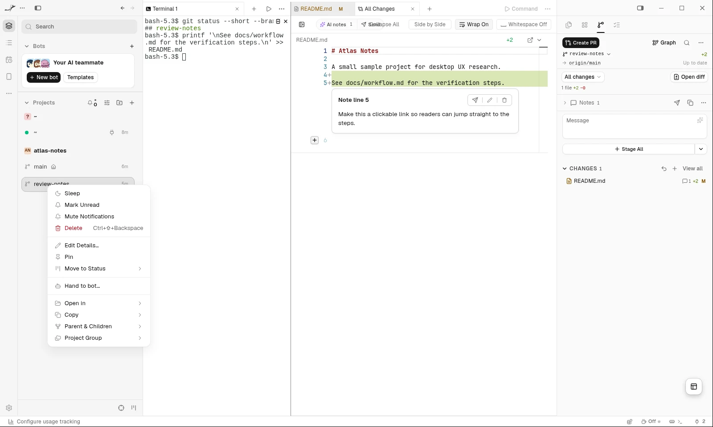](screenshots/08-workspace-actions.webp)

*图 09 · 实拍。工作区的排序、注意力和生命周期动作集中在上下文菜单。*

[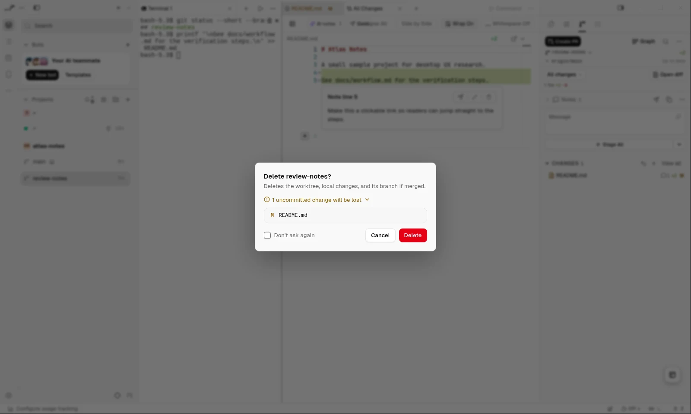](screenshots/09-delete-confirm.webp)

*图 10 · 实拍。对话框说明会删除 worktree 与本地改动、分支已合并时也会删除分支。本次只展开查看 `1 uncommitted change will be lost` 和 `M README.md`，随后取消。*

这个确认框做对了对象、后果和受影响文件三件事；风险在于同屏 `Don't ask again` 未交代作用范围。**不能从画面推断勾选后一定会跳过脏目录确认**，但 agent-hub 不宜给不可逆的数据丢失提供含糊的常驻跳过选项。将关闭视图、归档、删除工作目录与清理分支分开；有未保存改动时始终单独确认，并在影响清单显示目录、机器和变更。尤其不能把借来的长期 WorkDir 当临时目录回收。

[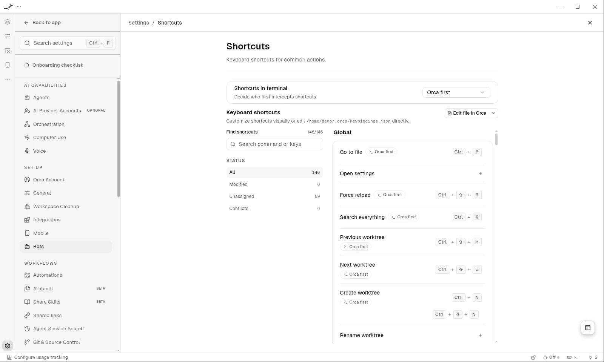](screenshots/10-shortcuts.webp)

*图 11 · 实拍。Linux 当前配置中 `Ctrl+P` 是文件搜索、`Ctrl+K` 是全局搜索，`Ctrl+N` 或 `Ctrl+Shift+N` 可创建 worktree。终端优先级可以配置，快捷键支持界面搜索和重绑定。*

**关于易用性：** 实拍可确认主要导航有键盘入口；截图也确实暴露了窄分屏下的拥挤。没有测多 DPI、极窄视口、屏幕阅读器、完整焦点顺序或对比度，不能据此给出无障碍合规结论。后续应优先验证键盘可达性、收起侧栏后的焦点回落，以及小视口下能否看到工作区和运行主机。

## 8. 给 agent-hub 的建议

以下是设计建议，不是产品实施承诺。现有 [快捷打开验证](../../../e2e/workbench-quick-open.spec.ts) 已覆盖顺序稳定和跳转原目标，[差异评审验证](../../../e2e/diff-review.spec.ts) 已覆盖跨文件草稿、陈旧锚点和重试不重复入队；不要把这些写成新功能。

| 优先级 | 建议 | 怎么判断做对了 |
| --- | --- | --- |
| P0 | **优先打磨已有的快捷打开和回到现场。** 主标题旁就显示 Task / 项目及必要的 Worker；搜索打开时锁定候选与键位，保留状态变化提示；继续打开已有 Session，而不是复制新会话。 | 多个 Worker 下，同名 Session 仍一眼可选；列表后台刷新不移走高亮项；回来时仍是原 Session、原检查对象。 |
| P0 | **把差异评审做完整。** 窄面板优先留给代码和注释，次要动作进溢出菜单；提交前显示批注总数、陈旧锚点与原 Session。没有可用目标时说明原因并保留草稿。 | 小视口上批注、发送和返回仍可达；区分「Hub 已入队」「运行时已接收」「结果未知」，不给结果未知的请求盲目重送。 |
| P1 | **把注意力队列与运行状态分开。** 在项目工作台用「待你处理」「运行中」「已结束」「连接断开」等文字标签，把需审批、需回答或需评审的 Session 提上来；把 Task 完成条件留给 Task。 | 刷新、重连和多会话并发时，用户能找到真正需要处理的事项，并从摘要跳到消息或 Artifact。 |
| P1 | **创建时明示执行位置，重连时保留上下文。** Task 或 Session 的启动入口明示 Project、Worker、WorkDir 与 Agent；单独呈现启动中、失败、可取消。在恢复时分开 UI 历史、Worker 在线与 Agent 回合。 | Worker 掉线时，用户不会把历史已载入误认为进程在线；重试不会悄悄换 Worker 或新建两个 Session。 |
| P2 | **等核心闭环稳定后，再试验可选的工作台布局和预览交接。** 优先做 Session + Diff + Preview，而不是先造通用 IDE、大量平行 pane 或完整多 Agent 看板。 | 桌面可以并排，移动端可顺序进入，同一批注、产出和会话可往返；布局删除不影响任务和运行。 |

**不照搬**：worktree 作为所有工作入口、广泛默认免审批、无法解释范围的删除跳过、只有颜色没有语义的状态点。更合适的映射是：项目工作台负责进入工作，**Task** 描述目标，**Session** 承载对话和执行，**Worker + WorkDir** 指明机器与真实目录，**Artifact** 承载结果，**血缘**记录派生和分叉。详见 [agent-hub 术语表](../../../GLOSSARY.md) 与已有的 [模型／Agent 选择设计](../model-providers.md)、[对话同步设计](../conversation-loading.md)。

## 9. 证据索引与适用边界

| 范围 | 证据等级与结果 |
| --- | --- |
| 引导、空 Agent 配置、添加本地项目、建 worktree | **实拍和操作**。选目录、建 `review-notes` 成功；未读取真实用户目录或凭据。|
| 分屏、工作区来回切换、全局搜索、快捷键 | **实拍和操作**。终端与编辑器分屏切换回来保持；`Ctrl+K` 和键盘选择可用。未测试跨退出恢复、快捷键冲突场景或 macOS / Windows。|
| Git、评审、删除 | **实拍和操作**。只修改测试 worktree，验证行内批注和发送入口；未投递、未推送、未创建 PR；删除确认已取消。|
| Chat 实时运行、审批、历史续接、Daemon 恢复、Dashboard、远程与预览、多 Agent | **固定版本官方文档／演示**。没有运行真实 Agent、配对或 SSH，也未端到端验证这些流程。|

- **实拍来源**：GitHub Release 的官方 Linux AMD64 DEB（SHA-256 `d2503e0cfcf32a0ddc928a5c943ea7dc6d7c2fde749b59ba18719f7a001fb84f`）。在隔离的 Xvfb、临时 HOME、断网沙箱中启动客户端，使用自建 `atlas-notes` Git 仓库。实拍原图均为 1600 × 960 WebP，为保留窗口结构未裁剪。
- **官方图来源**：[`v1.4.278` 对应提交 `f105ca4` 的 `docs/assets/readme-features`][official]；本页链接 8 张上游官方 JPG poster（960 × 600），不嵌入或复制这些图片。对应素材曾与上游 Git blob 核对。素材在 tag 中并不代表其录制于同一个客户端构建；画面使用示例数据。
- **版本取舍**：官方文档用来解释模型、设计意图与未实测能力，不覆盖当前客户端的现场观察。没有测试 agent-hub 产品变更，本交付仅包含调研文档和图片。

[worktrees]: https://github.com/stablyai/orca/blob/f105ca47275a05867d505857d99ea45a2c0a395b/docs/site/content/docs/model/worktrees.mdx
[panes]: https://github.com/stablyai/orca/blob/f105ca47275a05867d505857d99ea45a2c0a395b/docs/site/content/docs/model/tabs-panes-splits.mdx
[quick]: https://github.com/stablyai/orca/blob/f105ca47275a05867d505857d99ea45a2c0a395b/docs/site/content/docs/model/quick-open.mdx
[agents]: https://github.com/stablyai/orca/blob/f105ca47275a05867d505857d99ea45a2c0a395b/docs/site/content/docs/model/agents-sessions.mdx
[chat]: https://github.com/stablyai/orca/blob/f105ca47275a05867d505857d99ea45a2c0a395b/docs/site/content/docs/agents/native-chat.mdx
[history]: https://github.com/stablyai/orca/blob/f105ca47275a05867d505857d99ea45a2c0a395b/docs/site/content/docs/agents/session-history.mdx
[restore]: https://github.com/stablyai/orca/blob/f105ca47275a05867d505857d99ea45a2c0a395b/docs/site/content/docs/model/session-restore.mdx
[diff]: https://github.com/stablyai/orca/blob/f105ca47275a05867d505857d99ea45a2c0a395b/docs/site/content/docs/review/annotate-ai-diff.mdx
[ways]: https://github.com/stablyai/orca/blob/f105ca47275a05867d505857d99ea45a2c0a395b/docs/site/content/docs/ways-to-run.mdx
[settings]: https://github.com/stablyai/orca/blob/f105ca47275a05867d505857d99ea45a2c0a395b/docs/site/content/docs/settings.mdx#browser
[official]: https://github.com/stablyai/orca/tree/f105ca47275a05867d505857d99ea45a2c0a395b/docs/assets/readme-features
