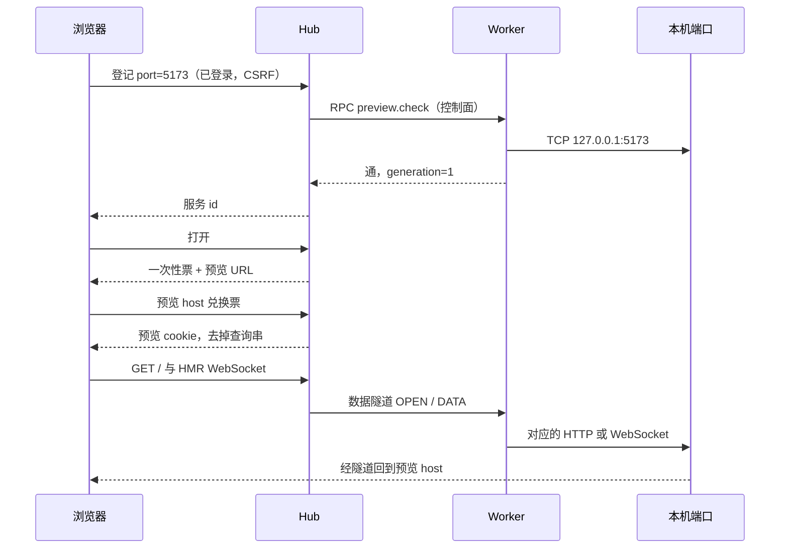

# 工作空间服务预览 设计

> 状态：**提议（proposed，2026-11-09）**。只是设计，没有代码，没有合并，没有部署。决定摘要见 [ADR 0034](../adr/0034-service-preview.md)。
>
> 更正：cookie **不按端口隔离**。同一 host 的不同端口共享 cookie jar。不能用「Hub 在 7878、预览在另一个端口」当作安全方案。

## 目录

1. [背景与用户故事](#1-背景与用户故事)
2. [目标与非目标](#2-目标与非目标)
3. [一个具体例子和 MVP 范围](#3-一个具体例子和-mvp-范围)
4. [现状（仓库里已有的）](#4-现状仓库里已有的)
5. [关键决策与替代](#5-关键决策与替代)
6. [模型](#6-模型)
7. [状态与时序](#7-状态与时序)
8. [控制面与数据面](#8-控制面与数据面)
9. [安全](#9-安全)
10. [部署矩阵](#10-部署矩阵)
11. [接口草案](#11-接口草案)
12. [应用兼容](#12-应用兼容)
13. [落点与实现顺序](#13-落点与实现顺序)
14. [测试与验收](#14-测试与验收)
15. [开放问题与推荐默认](#15-开放问题与推荐默认)

## 1. 背景与用户故事

Hub 和 worker 不在同一台机器上时，人在浏览器里看着会话，服务却听在 worker 的回环地址上。今天只能到那台机器上打开，或者自己做 SSH 转发。后者要求 worker 有入站，NAT 后面通常没有。

**故事。** 作为在团队里开工的人，我在某台 worker 的某个工作空间里起了开发服务器。我想在自己正在看 Hub 的浏览器里打开它，并且只有能在这个工作空间里干活的人可以打开。关掉页面或在 Hub 里停掉预览，不应把那个进程杀掉。这不是把网站部署出去，也不生成任何人无需登录就能打开的链接。

## 2. 目标与非目标

**目标**

- 显式登记一个本机端口，经 worker 已有的出站方向，把 HTTP 和 WebSocket 接到授权用户的浏览器。
- 预览页的脚本拿不到 Hub 的 cookie，也发不出带 Hub cookie 的写请求。
- 两台 worker 都用 5173 时互不串线。
- worker 掉线、重连、端口被别人占用时，旧的打开授权失效。
- 额度、超时、并发有默认值，并标明是建议，不是测过的容量。

**非目标**

- 不实现、不部署、不公开分享。
- 不自动发现监听端口（以后可以列候选，仍要人确认）。
- 不代杀进程，不发 SIGTERM。
- 不把预览嵌进 Hub 页面（iframe 不是 MVP）。
- 不改写 HTML、不注入 `<base>`、不承诺任意网站透明可用。
- 不做通用 HTTP 代理。不接受用户粘贴的任意 URL 或 host。
- 不把 Docker 网络命名空间里的 `127.0.0.1` 说成宿主机的 `127.0.0.1`。

## 3. 一个具体例子和 MVP 范围

小李在项目「店面」里，工作空间是 worker「工作站」上的 `/home/li/shop`（只关联这一个项目）。他在那台机器上执行 `npm run dev`，进程听 `127.0.0.1:5173`。

1. 他在 Hub 的这个工作空间上登记：端口 5173，标签「店面 dev」。可选地带上当前 `sessionId`，只表示「从这条会话点的登记」。
2. worker 在线时对 `127.0.0.1:5173` 做一次 TCP 连接。通了才算可达。
3. 他点「打开」。Hub 发一枚约 60 秒、一次有效的票。浏览器新标签进入 `https://<随机>.preview.example/exchange?ticket=…`（host 与 Hub 不同，且不共享 cookie host）。
4. 兑换成功后地址栏不再带票。页面的 HTML、`/_next` 或 `/@vite/client`、HMR 的 WebSocket，都走预览 host，再经数据隧道到 worker 的 `127.0.0.1:5173`。
5. 他关掉标签，或在 Hub 里点「停止预览」。隧道没了，`npm run dev` 还在。

同一工作空间可以再登记 3000 端口的 API。MVP 允许多条，建议每工作空间不超过 8 条。不自动把「前端 + 它调用的 API」合成一个产品对象；跨源的 API 要应用自己配 CORS，见第 12 节。

同事如果只是 viewer，默认不能登记也不能打开。工作空间若同时关联「店面」和「结算」两个项目，小李仅因「店面」有 `session.create` 也不够，要有团队 `workspace.manage` 的人来登记和打开。原因见第 6 节。

## 4. 现状（仓库里已有的）

这些是今天 master 上的事实，不是本设计已实现的能力。界面上没有「打开预览」。

| 事实 | 证据 |
| --- | --- |
| Worker 主动连 Hub 的 `/worker`，Hub 不拨 worker 的端口 | `packages/node-gateway/src/worker-link.ts` 的 `new WebSocket(options.url)`；`docs/remote-access.md`「只要能出站连 WS」 |
| 断线后退避重连，hello 再报还活着的会话；控制面帧可进 outbox，上限 5000，丢最旧的 | 同文件 `OUTBOX_LIMIT`、hello 帧 |
| RPC 是 JSON 的 call / reply / cancel，默认 60 秒，断线时在途调用直接结束，不进 outbox | `packages/contract/src/rpc/frames.ts`、`worker-link.ts` 里 channel 的注释 |
| 读文件是 base64；网页预览 ≤ 1 MB，下载 ≤ 20 MB，整段读完再响应 | `packages/contract/src/worker-methods.ts` 的 `fs.read_file`；`apps/server/src/files-routes.ts` |
| `ws.preview` 是 git diff，不是网页 | `worker-methods.ts` 的 `wsPreview` |
| 模型中继、MCP、Hermes 网关都只绑 worker 的 `127.0.0.1`，给本机进程用 | `packages/node-gateway/src/provider-relay.ts`；`docs/design/tasks-and-capabilities.md`；ADR 0022 |
| 中继转发有体大小和总时长上限，且剥掉入站凭据头。那是 worker 去访问上游，方向相反 | `packages/node-gateway/src/provider-proxy.ts` 的 `DEFAULT_PROXY_LIMITS`（16 MiB、等头 120 秒、总时长 30 分钟） |
| 工作空间属于团队，路径在一台 worker 上唯一，可关联多个项目。会话指向 `workspaceId` | ADR 0026；`packages/domain/src/use-cases/authorization.ts` 的 `authorizeWorkspace` |
| `authorizeWorkspace`：团队 `workspace.manage` 直接通过，否则**关联项目里任意一个**允许该权限即可 | 同函数 |
| 登录 cookie `hub_login` 为 httpOnly、SameSite=Lax、path=/、不设 Domain。`hub_csrf` **不是** httpOnly，同样 Lax、path=/、不设 Domain | `apps/server/src/auth.ts` |
| 分发不是 Docker。容器会切开 PTY 和宿主机凭据 | ADR 0002 |
| Tailscale `serve` 的例子只把 https 名转到 `127.0.0.1:7878` | `docs/remote-access.md` |

控制面因此不能承载预览流量：一帧要装下整个结果，大响应会撑爆 JSON；outbox 会在断线时丢控制事件或把过时字节补发出去；60 秒超时盖不住一条长连接的 HMR。

## 5. 关键决策与替代

| 选择 | 采用 | 不采用及原因 |
| --- | --- | --- |
| 归谁 | 工作空间。进程绑目录和机器 | 归会话：同目录的另一条会话看不到，会话结束还得定义进程怎么办 |
| 谁可以开 | 见第 6 节。多项目关联不按单一项目放行 | 沿用「任一项目的 project.read」：viewer 能打开一个往往不鉴权的本机应用 |
| 怎么连字节 | 第二条 worker 出站隧道 | 复用 JSON RPC / base64 / outbox |
| 浏览器里的地址 | 每条服务的每个 generation 一个独立 host | Hub 路径反代；同一 host 换端口 |
| 打开方式 | 新标签 | iframe（和 Hub 页面缠在一起，也不是安全边界的替代） |
| 没有独立 host | 禁用预览 | 同源反代或「换端口就安全」 |
| 进程归属 | generation 使旧授权失效；承认证明不了 pid | 读 `/proc` 当证明。竞态大，网络命名空间里经常对不上 |

个人仍可用 SSH `-L` 把 worker 的端口接到自己的笔记本。那不进 Hub 的授权，也要求入站。文档只把它当作现成的权宜之计。

## 6. 模型

```text
Team ──< Workspace（已有，workerId + path）
              │
              └──< PreviewService
                     id            稳定
                     port          仅本机端口
                     label
                     createdBy
                     sessionId?    来历，可空，不参与授权
                     generation    从 1 起，只增
                     state         见第 7 节
```

worker 绑定来自工作空间上已有的 `workerId`。登记不能另选一台机器。临时工作空间跟着它的任务和项目；长期工作空间用 ADR 0026 的关联表。

**generation。** 预览票和预览会话都带上当前 generation。下列情况加一，旧票、旧 cookie 全部失效，数据面上该服务的流全部关闭：

- 用户撤销、删除登记，或把端口改成另一个数（改端口视作新登记，更直接的做法是删掉再建，generation 自然不沿用）。
- 可达性从「不通」变为「通」（端口上出现了监听者，不论是不是原来那个进程）。
- worker 的控制连接重新 hello（重连期间无法观察端口是否被换过程序）。代价是：worker 一闪断，已经打开的预览要重新点「打开」。这是推荐默认，换安全窗口，不换「无感重连」。

**证明不了进程归属。** worker 向外连接 `127.0.0.1:port` 只能知道当时有人接受了 TCP。`SO_PEERCRED` 用在对方连我们的 Unix 套接字上，不适用于我们连出去。把 `/proc/net/tcp` 对到 pid 有竞态，在另一个网络命名空间里会指错。因此：

- 不保存、不展示「我们认定的 pid」。
- generation 只保证旧授权不会无声地继续用；它不证明新监听者是用户起的那个命令。
- 若端口在两次探测之间被换成另一个进程，且探测都成功，generation 不会加。这是已知缺口。第一版用重连必加 generation、以及「不通再到通」必加 generation 把缺口限制在「连接没断、探测也没看到失败」的窗口。不在 MVP 里做应用回调口令（那要求改被预览的程序）。

**权限（建议，不是现有权限）。** 在 `PERMISSION_CATALOG` 里新增两条，资源类型用 `project` 或单独讨论后放 `team`。推荐名字：

| 权限 | 含义 | 建议默认 |
| --- | --- | --- |
| `preview.register` | 登记、修改标签、撤销登记 | 见下 |
| `preview.open` | 兑换票并打开 | 与 register 同一批人。打开比读文件更接近「使用那台机器上的一个服务」 |

建议默认，按工作空间形状分支，而不是按「任意一个关联项目」放行：

- 临时工作空间，或长期工作空间恰好关联一个项目：主体对该项目有 `session.create` 即可登记和打开。viewer 的内置角色没有 `session.create`（`packages/domain/src/access.ts` 的 `viewer` 只有 read），因此默认不能预览。
- 长期工作空间关联了两个及以上项目：必须有该团队的 `workspace.manage`。只在其中一个项目里有 `session.create` 的成员不够。进程能看见整个目录，Hub 无法在转发的网页里按项目切开。
- 关联项目一个都看不见的人：保持现有 `authorizeWorkspace` 的 notFound，不泄露工作空间是否存在。
- API 令牌：MVP 不把这两项放进任何现有 scope（不要塞进 `sessions:write`）。以后若要给脚本，单独 scope，再审。

这两条是提议。实现前要加进目录、内置角色和 `can()` 测试。本文不改那些代码。

## 7. 状态与时序

登记的状态：

| 状态 | 含义 |
| --- | --- |
| `reachable` | worker 控制连接在，最近一次探测 TCP 成功 |
| `unreachable` | worker 在，TCP 失败 |
| `worker_offline` | 没有已接受的 hello |
| `revoked` | 人撤销了，或工作空间已删除。保留一行到审计可查，不再接受打开 |

打开预览不等于状态变成另一种「运行中的进程」。进程不由 Hub 跟踪。



**worker 离线与重连。** 控制连接一断，该 worker 上所有登记变为 `worker_offline`，数据隧道上的流以错误结束，不补发。hello 回来之后 Hub 下发 `preview.rebind`。worker 再探测。探测失败则 `unreachable`。探测成功则 generation 加一（第 6 节的推荐默认），浏览器需重新打开。

**撤销。** 状态 `revoked`，generation 加一，隧道关闭。不向端口写任何「请退出」的字节，除了拆掉 Hub 自己拨出去的那条 TCP。

**删除工作空间。** 与撤销相同，对该工作空间全部登记做一遍。不删除目录的策略仍跟 ADR 0026；预览不多删文件、不多杀进程。

**可达性探测。** 建议默认每 15 秒一次，仅对 `reachable` 与 `unreachable` 且 worker 在线的登记。这是建议间隔，不是测量得到的最佳值。探测失败不立刻加 generation；加 generation 发生在下一次成功，避免抖动把 generation 打得很高。连续失败时打开按钮不可用。

## 8. 控制面与数据面

控制面继续用现有 RPC 端口（`packages/contract/src/rpc/channel.ts` 那种 call/reply）。新增方法要声明能力，建议新能力名 `preview`，不要复用 `files.read`。方法只有：

- `preview.check`：对一个端口做 TCP，返回通或不通。参数里没有 host。
- `preview.rebind`：重连后按服务 id 再探测一批端口。

数据面是 worker 再拨一条出站 WebSocket，例如路径 `/worker-preview`（名字实现时可改，语义是第二条连接）。认证用与 hello 相同的机器凭据。第一条消息表明 workerId。Hub 未接受前不转发任何流。

这条连接上的帧建议二进制、长度前缀，避免 base64。逻辑字段：

| 字段 | 用途 |
| --- | --- |
| `streamId` | 一条浏览器请求或一条 WebSocket 对应一条流 |
| `type` | `open`、`data`、`eof`、`window`、`cancel`、`close`、`error` |
| `metadata` | 仅 `open`：serviceId、generation、方法、路径、精简后的头、是否 WebSocket 升级 |
| `data` | 字节。可空 |
| `credit` | 仅 `window`：对端还可以再收多少字节 |

`open` 之后可以有多个 `data`。请求体结束用 `eof`（半关闭）。响应体结束也用 `eof`。任一侧 `cancel` 表示浏览器中止或 Hub 取消，worker 拆掉到本机端口的连接。`close` 是正常结束。`error` 带稳定的 code（`generation_stale`、`unreachable`、`worker_offline`、`limit`、`bad_request`），message 给人看，不含票和 cookie。

**流控。** 每条流一个发送窗口。建议默认 256 KiB（可调）。窗口用尽就停止从浏览器或从本机端口读取。Hub 和 worker 都不得为一条流无限缓冲。

**并发与公平。** 建议默认：每个服务同时 32 条流，每台 worker 同时 64 条（可调）。调度按流轮转，避免一条大上传占满隧道导致 HMR 饿死。超出并发返回 `limit`，不排队到无界。

**断连。** 数据隧道断开：全部流 `error`，不重放。控制面重连不恢复 streamId。浏览器自己重试页面。

**取消。** 浏览器断开响应的读端，Hub 发 `cancel`。worker 必须中止到 `127.0.0.1` 的请求，不能在取消后继续把正文读进内存。

WebSocket（HMR）是同一套帧：`open` 里标记升级，之后 `data` 是 WebSocket 帧的载荷（建议按消息边界，而不是再包一层浏览器帧）。升级失败用 `error`。不要为 HMR 再开第三种传输。

SSE 就是响应头为 `text/event-stream` 的一条长 `data` 流，不单独设计。

## 9. 安全

威胁模型按「预览的是一个不受 Hub 控制的本机程序」来写。它可能没有鉴权，可能是恶意的，也可能在登记之后被换成另一个进程。独立 origin 解决的是「它的脚本不要变成 Hub 的源」，不是所有跨站问题，也不是内网安全。

### 9.1 独立 host，而不是换端口

源（origin）包含方案、host 和端口，所以脚本不能读另一个端口的 DOM。Cookie 另一套规则：RFC 6265 的 host 不包含端口。`http://127.0.0.1:7878` 写入的 cookie，浏览器会在请求 `http://127.0.0.1:5173` 时带上，页面脚本也能读到非 httpOnly 的那些。`hub_csrf` 正是非 httpOnly（`apps/server/src/auth.ts`）。因此：

- 禁止把预览听在与 Hub 相同的 host 上，不论端口。
- 禁止路径反代（`https://hub.example/preview/...`）：脚本与 Hub 同源。
- 预览 host 必须是另一台主机名，且 Hub 的 cookie 没有 `Domain` 指到它的父域。今天 Hub 的 cookie 不设 Domain，是 host-only，这是有利的，实现时不能为了方便改成父域。

推荐：预览使用单独的可注册域，例如 `preview.example`，与 Hub 的可注册域不同。每个服务的每个 generation 一个不可猜测的标签：`https://<标签>.preview.example`。标签在 generation 变化时更换，避免旧的 Service Worker 和旧 cookie 还落在同一 host。

仅子域（`preview.hub.example` 与 `hub.example`）属于同一站点（schemeful same-site）。Hub cookie 若保持 host-only，不会发给子域；但一旦有人把 cookie 的 Domain 设成父域，SameSite=Lax 的 cookie 会在同站请求里带上。MVP 不依赖「子域刚好安全」。推荐默认是另一块可注册域。做不到就禁用，见第 10 节。

### 9.2 票、预览会话、CSRF、WebSocket

1. 用户在 Hub 源上点打开（已有登录 cookie + `X-Hub-CSRF`）。
2. Hub 核对该服务的 generation 与 `preview.open`，在内存里放一枚票：随机、约 60 秒、一次有效，绑 userId、serviceId、generation、workerId。
3. 浏览器只在预览 host 上兑换。兑换检查：票未用、未过期、generation 仍当前；`Origin` 或 `Sec-Fetch-Site` 不得是 Hub 以外的第三方页面替用户兑换（导航进来的顶级 GET 可以兑换，兑换后 303 到不带查询串的 `/`）。
4. 成功则设置预览会话 cookie：httpOnly、path=/、不设 Domain、有 TLS 时 `Secure` 且名称用 `__Host-` 前缀、SameSite=Lax、寿命建议 8 小时（可调）或到 generation 失效为止，以先到者为准。
5. 之后的 HTTP 和 WebSocket 只认这枚预览 cookie。WebSocket 升级要求 `Origin` 等于该预览 host。对不上就 403，不连 worker。
6. 撤销和 generation 变化使 cookie 立刻失效（Hub 查的是服务记录，不只靠 cookie 自述）。
7. 票不进日志、不进审计正文、不进 Referrer。兑换响应 `Referrer-Policy: no-referrer`，`Cache-Control: no-store`。

Hub 的 `hub_login` / `hub_csrf` 永远不转给本机端口。预览 cookie 也在转发前剥掉。应用自己的 `Cookie` 头可以转发，因为那是浏览器对预览 host 的 cookie，不是 Hub 的。

### 9.3 头、重定向、缓存、Service Worker

- 转给本机端口的 `Host` 固定为 `127.0.0.1:<登记端口>`。不转发浏览器带来的 `Host`、`X-Forwarded-Host`、`X-Forwarded-For`、`Forwarded`。本机程序常因这些头生成错误的绝对 URL，也可能被骗去信任来源。
- 响应里的 `Set-Cookie`：去掉 `Domain`，强制成为预览 host 的 host-only cookie。若名字与 Hub 的 cookie 相同，丢掉。
- 重定向：只跟随或改写相对路径，以及仍指向当前预览 host 的绝对 URL。指向其他 host（包括 `127.0.0.1` 的另一端口、Hub、内网 IP）的 `Location` 不代为请求，把 302 原样退回浏览器或改成 502 并说明。否则预览通道会变成开放代理。
- `Cache-Control` 至少 `private`。共享缓存不得存放带预览 cookie 的响应。
- Service Worker 的作用域是预览 host。generation 换 host，旧的 Service Worker 接触不到新预览。不要在 Hub host 上注册任何预览用的 Service Worker。

### 9.4 独立 origin 仍然留下的问题

- 同站 CSRF：若预览和 Hub 处于同一可注册域，并且 Hub cookie 带父域 `Domain`，预览页可以触发带 cookie 的同站请求。推荐用另一块可注册域来避开，而不是宣称「独立 origin 就够了」。
- 本机服务常常相信「能连上 127.0.0.1 的就是自己人」。被授权打开预览的人，就站在这个位置上。登记文案要写明这一点。登记一次不能让一个没有鉴权的管理界面变安全。
- 预览页里的脚本可以向用户浏览器能碰到的其他源发请求（受 CORS 限制）。它不能因此读取 Hub 的 httpOnly cookie，但可以尝试访问用户内网里对浏览器开放的地址。这是任意网页都有的能力，转发器不额外放大浏览器的出站，也不负责封死。
- 恶意或被换掉的端口进程会看到转发过去的请求头和应用 cookie。不要在那些请求里放 Hub 令牌。

### 9.5 端口策略

只登记数字端口。worker 侧只连 `127.0.0.1` 或 `::1`。

拒绝：

- 小于 1024 的端口。
- worker 进程自己正在听的端口：模型中继、本机 MCP、Hermes 网关，以及将来同类的回环管理口。worker 知道这些端口，因为是它 `listen` 的。
- 环境里额外列出的拒绝表（建议变量名 `PREVIEW_DENY_PORTS`，默认为空，可调）。

即使端口不在拒绝表里，监听者仍可能是数据库管理台或云元数据之外的本机服务。策略是缩小误登记，不是证明安全。第一版不做「扫描所有监听端口再让用户勾」。自动发现若以后做，也只能产生待确认候选，默认不包含上述拒绝端口。

Docker：ADR 0002 的 worker 跑在宿主机网络里。若有人自行把 worker 放进容器，容器的 `127.0.0.1` 不是宿主机的。第一版写明此限制，不提供 `host.docker.internal` 或任意网络别名。同机（Hub 拉起的本机 worker）与远端 worker 用同一规则，都不允许填 host。

## 10. 部署矩阵

| 环境 | 能否做预览 | 原因 |
| --- | --- | --- |
| 只有 `127.0.0.1` 或一个 IP，用户和 Hub 同一 host | **禁用** | 换端口不隔离 cookie。禁止改成 Hub 同源路径 |
| Tailscale `serve` 只把一个 https 名转到 7878 | **禁用**，除非另有预览域 | 额外端口不会自动出现在这个 https 名上。再 `serve` 一个端口仍是同一 MagicDNS 主机的另一端口，cookie 照样共享 |
| Tailscale 或公网，另有一块可注册域（通配 DNS + 通配证书），且不是 Hub cookie 的 host | **启用** | 每个 generation 一个子标签。证书和 DNS 是部署前提，不是代码默认值 |
| 公网但只有 Hub 那一个主机名 | **禁用** | 同上，不为了能用而做同源代理 |

推荐默认：没有预览域配置（建议变量 `PREVIEW_ORIGIN_PARENT`，空）时，登记接口返回明确错误「未配置独立预览域，预览已禁用」，而不是静默改走路径代理。

## 11. 接口草案

HTTP 仍走现有 Hono 应用和 `can()`，不新做一套授权框架。写请求沿用 `hub_csrf`。

| 方法 | 路径 | 权限建议 |
| --- | --- | --- |
| GET | `/api/workspaces/:id/preview-services` | `preview.open` 或 `preview.register`（能看名单才能打开或管理） |
| POST | `/api/workspaces/:id/preview-services` | `preview.register`。体：`{ port, label, sessionId? }` |
| DELETE | `/api/workspaces/:id/preview-services/:serviceId` | `preview.register`。撤销登记 |
| POST | `/api/workspaces/:id/preview-services/:serviceId/open` | `preview.open`。返回 `{ url, expiresAt }` |

`sessionId` 若给出，只校验它属于该工作空间，写入来历。不属于就 400，不要借会话权限绕过第 6 节。

预览 host（另一域名）：

| 方法 | 路径 | 行为 |
| --- | --- | --- |
| GET | `/exchange?ticket=` | 一次兑换，303 到 `/` |
| 任意 | `/*` | 校验预览 cookie 与 generation，转入数据隧道 |
| WebSocket | `/*` | 同上，要求 Origin |

worker RPC（控制面，能力 `preview`）：

```text
preview.check  { port: number } → { listening: boolean }
preview.rebind { items: { serviceId: string, port: number }[] }
               → { items: { serviceId: string, listening: boolean }[] }
```

登记存 Hub（建议落库，否则 Hub 重启全部丢失；丢失可以接受为重启后需重新登记，但推荐落库，避免和「工作空间还在、预览凭空消失」的预期冲突）。票和预览会话建议只放内存，Hub 重启即失效。generation 必须落库，否则重启会从 1 再发，旧 cookie 若还在浏览器里可能撞上新进程。推荐：generation 落库；票不落库。

审计事件名建议：`preview.register`、`preview.revoke`、`preview.open`、`preview.generation`。字段只有 actor、workspaceId、serviceId、port、generation、结果。不记 ticket、cookie、请求头、正文。

建议默认限额（均可调，未作为容量测试的结论）：

| 项 | 建议 |
| --- | --- |
| 每工作空间登记数 | 8 |
| 票寿命 | 60 秒，一次 |
| 预览 cookie | 8 小时或到 generation 变化 |
| 每流窗口 | 256 KiB |
| 每服务并发流 | 32 |
| 每 worker 并发流 | 64 |
| 单请求体 | 32 MiB |
| 单响应不设总字节上限，靠窗口和总时长 | 总时长 30 分钟，与现有中继同一量级，但是建议 |
| 探测间隔 | 15 秒 |
| 等本机端口响应头 | 60 秒 |

## 12. 应用兼容

不承诺透明支持任意站点。第一版转发字节和 WebSocket，不解析、不改写 HTML。

| 情况 | MVP 行为 |
| --- | --- |
| 相对 URL 的脚本、样式、fetch | 能用。浏览器会向预览 host 要 |
| Vite / Next 的 HMR WebSocket | 能用，若客户端连的是当前页的 host。若配置写成 `ws://127.0.0.1:5173`，远程浏览器连的是自己的回环，不会进隧道 |
| `server.origin`、`assetPrefix`、绝对跳转 | 要用户把公网预览 host 配进应用。Hub 不改 HTML 来补救 |
| 重定向到别的 host | 不跟随，避免变成开放代理 |
| 应用要 HTTPS 才下 `Secure` cookie | 预览域有证书时浏览器侧是 HTTPS。转到本机端口仍是 HTTP（本机回环）。应用若按 `X-Forwarded-Proto` 决定 Secure，我们不转发该头，因此它不应依赖这个头。需要 Secure cookie 的应用应认「自己配的公网 origin」，而不是认转发头 |
| 页面再去调另一个端口的 API | 不自动打通。那个端口要单独登记，成为另一个 origin，由应用自己开 CORS。MVP 不注入 CORS 头 |
| 应用绑 `0.0.0.0` 而不是 `127.0.0.1` | 只要本机回环上能连上该端口就可以登记。这不表示对局域网开放是安全的；那是机器自己的防火墙问题 |
| 自签证书的本机 HTTPS | 第一版只连明文 TCP 上的 HTTP/WS。不终结或信任本机 HTTPS |

## 13. 落点与实现顺序

不新增一套平行的「网关接口」。沿用 domain 用例 + `can()`、contract 里的 RPC 方法、node-gateway 里的 worker 连接。

| 顺序 | 落点 | 做什么 |
| --- | --- | --- |
| 1 | `packages/domain` | 服务记录、generation 规则、授权分支（单项目 / 多项目）。纯函数可单测 |
| 2 | `packages/contract` | `preview.check` / `preview.rebind`，能力 `preview` |
| 3 | `packages/node-gateway` | worker 侧只连回环、拒绝保留端口、数据隧道帧的收发与窗口 |
| 4 | `apps/server` | 登记 HTTP、票、预览 host 的兑换与转发、审计 |
| 5 | `apps/web` | 工作空间上的名单、登记、打开（新标签）、停止。会话页只放链接，不嵌 iframe |

未配置 `PREVIEW_ORIGIN_PARENT` 时，第 4 步的登记直接返回禁用错误，后面的隧道可以不听。

## 14. 测试与验收

不调用收费模型，不连 Go，不连 GLM。用本机假 HTTP 与假 WebSocket。

| 层 | 内容 |
| --- | --- |
| 单元 | generation 在「不通→通」、撤销、控制面重连时加一；多项目必须 `workspace.manage`；单项目 `session.create` 可以、viewer 不行；票一次有效且绑 generation |
| 协议 | 帧的 open/data/eof/window/cancel；窗口为 0 时不再读；cancel 拆掉本机 TCP；隧道断开不重放 |
| 安全 | 预览响应里没有 Hub cookie；兑换后查询串消失；错误的 Origin 不能升级 WebSocket；指向其他 host 的重定向不被 Hub 请求；`hub_csrf` 不会出现在发往 `127.0.0.1` 的头里；拒绝小于 1024 和「本 worker 自己的中继端口」 |
| 两台 worker | 都登记 5173，各自打开只打到自己的假服务器 |
| HMR | 一条长 WebSocket 与一条大上传同时存在时，HMR 消息仍能在窗口内送达 |
| 断连 | worker 控制连接重连后，旧 cookie 被拒，新 generation 才能再打开 |
| 大上传 | 超过建议体上限的请求被拒；未超限的上传在浏览器中止后，worker 侧连接关闭且不再继续读 |
| 端口复用 | 假服务器关掉再在同一端口起另一个；generation 变化；旧票失败 |

验收时不要把「Hub 页面里出现了预览按钮」算作端到端通过，除非上述安全与两 worker 用例也过。

## 15. 开放问题与推荐默认

真正要部署的人拍板的只有一件事：**有没有一块与 Hub cookie host 分开的预览域（通配 DNS 和证书）。** 没有就保持禁用。不建议为了第一版去改 Tailscale 只转发 7878 的那条路径，也不建议改用同源代理。

其余用本文的推荐默认，不必再留空：

- 归工作空间；`sessionId` 只是来历。
- 一个工作空间多条手工登记，建议上限 8。
- 多项目关联要 `workspace.manage`；单项目或临时工作空间要 `session.create`；viewer 默认不行。
- 控制面重连、端口从不通到通、撤销，都会增加 generation。
- 不证明 pid。
- 新标签，不嵌 iframe，不杀进程。
- 不改写 HTML。
- 数据面独立出站隧道，帧含 streamId 与 window。

审阅时若要放宽「重连必增 generation」或「多项目必须 workspace.manage」，应改 ADR 状态说明，而不是在实现里悄悄放宽。
