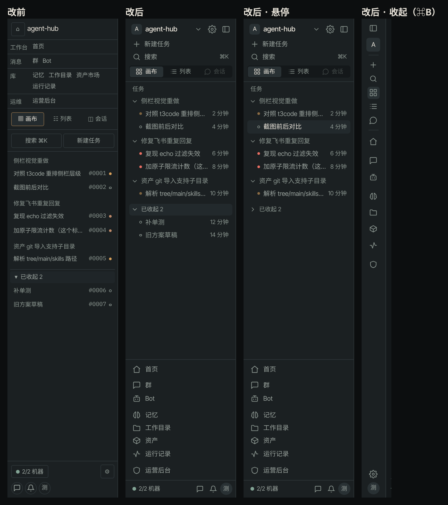
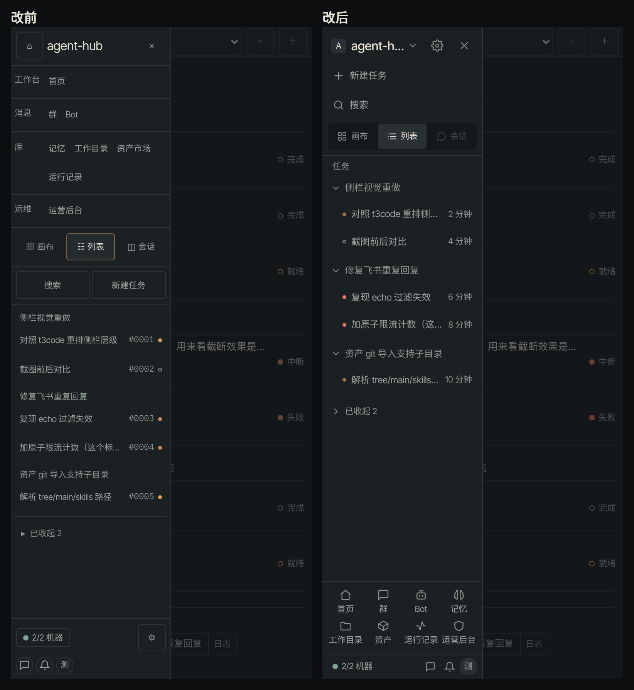
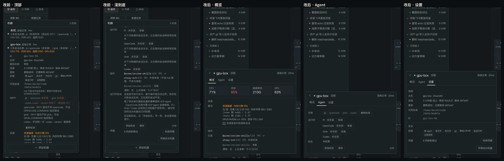
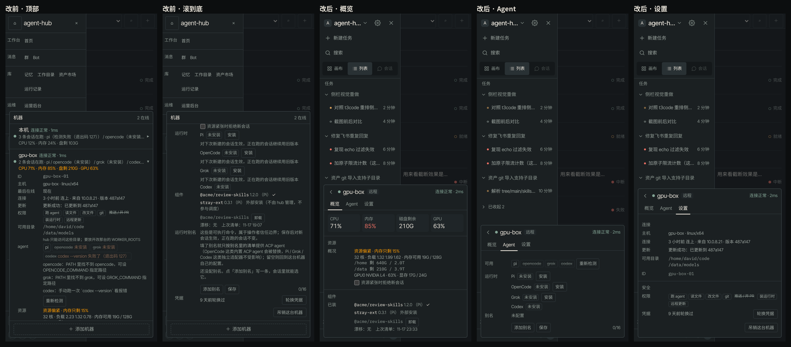
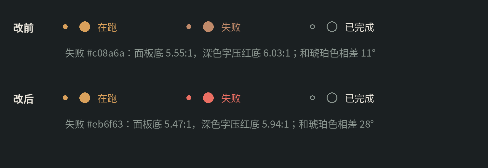

# 侧栏与机器详情重做（原型，design/sidebar-refresh）

基于 master 487a147。只改侧栏、机器面板和它们用到的共享令牌，路由与 test id 不变。

## 对比图

- 侧栏桌面：
- 侧栏手机抽屉：
- 机器详情桌面：
- 机器详情手机：
- 状态点配色（改前 / 改后）：

## 侧栏

| 问题（改前，origin/master） | 改法 |
|---|---|
| 每块都画边框：⌂、视图三钮、搜索/新建两钮、⚙ 都是带框按钮，悬停一律琥珀描边（sidebar.tsx:86/127/144/151/225），整栏 8 条横线切成表格 | 行级按钮去框，悬停 / 选中只抬一档底色（新令牌 `--color-hover` / `--color-selected`）；琥珀只留给「在跑」的状态点 |
| 全站导航是「组标题 + 横排小链接」（global-nav.tsx:19-41），「库」一组折成两行，参差不齐，占在最上面抢走任务区 | 导航挪到底部，一列「图标 + 名字」紧凑行，组间只留空隙不写组标题；手机抽屉里改成 4 列图标格（两行放完） |
| 字符图标混用 ⌂ ⚙ ▦ ☷ ◫ ×，和底栏的 SVG 图标风格不一 | 统一一套 16px 线性 SVG 图标（atoms/icons.tsx） |
| 会话行常驻 `#0001` 等宽短号，状态点在最右，任务标题和空状态同一字号同一颜色（sidebar.tsx:166-176, 280-282） | 状态点放左边，右边是「多久没动」；短号进悬停提示；任务行可折叠，折叠时显示会话数和在跑的点；去掉「都收起来了 / 还没有会话」等说明 |
| 底栏两行：机器徽标 + ⚙，再一行 4 个圆框图标；账号菜单和通知向下弹出，在底栏里直接出屏看不到（auth.tsx:483、notifications.tsx:35） | 底栏一行：机器状态 + 消息 / 通知 / 账号；⚙ 挪到项目名旁；底栏弹层改为向上弹 |
| 不能收起 | 桌面可收起成 56px 图标栏（按钮或 ⌘/Ctrl+B，记在本机）；任务树里 ↑↓ / Home / End 移动焦点 |

## 机器详情

| 问题（改前） | 改法 |
|---|---|
| 「详情」是在 340px 弹层里原地展开一长串 dt/dd（workers.tsx:149-249），列表和详情混在一起，60vh 里要滚很久 | 点一台机器进入独立的详情视图（弹层加宽到 420px），左上角返回列表；Esc 先退回列表 |
| 没有概览：状态、资源、版本平铺，最重要的数字埋在中间 | 头部：名字 + 本机/远程 + 连接状态；下面 4 个数字（CPU / 内存 / 磁盘剩余 / GPU 或会话） |
| 十几项无分组：ID 排第一，凭据、吊销夹在运行时和别名之间 | 三个页签：**概览**（四个数字 + 资源 + 组件）、**Agent**（可用、运行时、别名）、**设置**（连接：主机 / 版本 / 更新 / 目录 / ID；安全：权限、凭据，吊销放最后） |
| 开发者说明铺满屏：`PATH 里找不到 opencode，可设 OPENCODE_COMMAND…`（harness.tsx:65）、每个运行时一行「对下次新建的会话生效…」（runtimes.tsx:100-102）、别名两段信任边界说明（worker-agents.tsx:96-103）、`WORKER_ROOTS` 提示、「外部安装（不由 hub 管理，不参与调度）」 | 这些都进悬停提示；「只对新会话生效」只在点确认时出现一次；空状态统一成「未配置」 |
| 列表行一句话里塞全部 agent 的不可用原因（workers.tsx:169） | 列表行只写「N 个会话 · M 个 agent 不可用」 |

## 配色

| 问题（改前） | 改法 |
|---|---|
| 失败 / 危险色 `--color-rust: #c08a6a` 是偏橙的砖色，和「在跑」的琥珀 `#d9a05b` 色相只差 11°，侧栏 6px 小圆点上几乎分不出 | 改成明确的红 `#eb6f63`（色相差 28°）；高对比模式 `#ff9b92`。在 canvas / panel / card / card-raised 上都 ≥4.79:1，红底压深色字 5.94:1。红底按钮（确认删除 / 卸载等）改用深色字。`theme-contrast.test.ts` 补「深色字压红底 ≥4.5」和「红与琥珀色相差 ≥25°」两条。界面只有深色主题（外加高对比模式），没有浅色主题要适配 |
