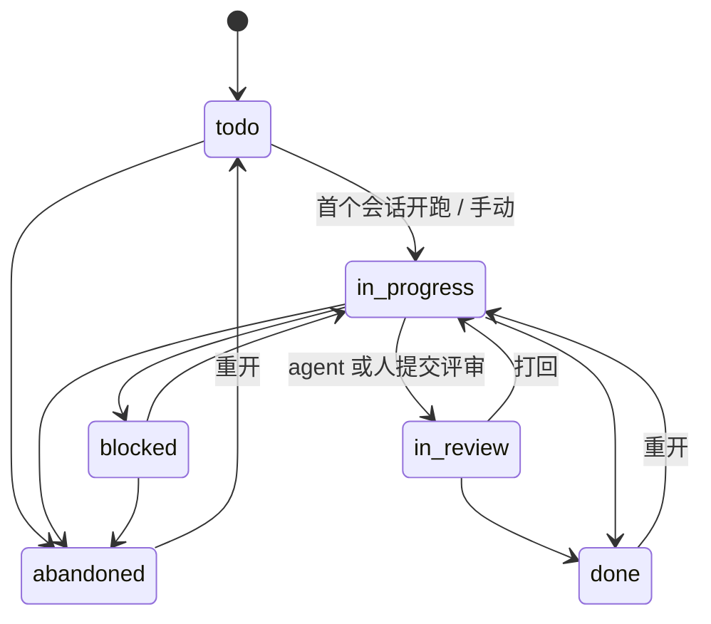
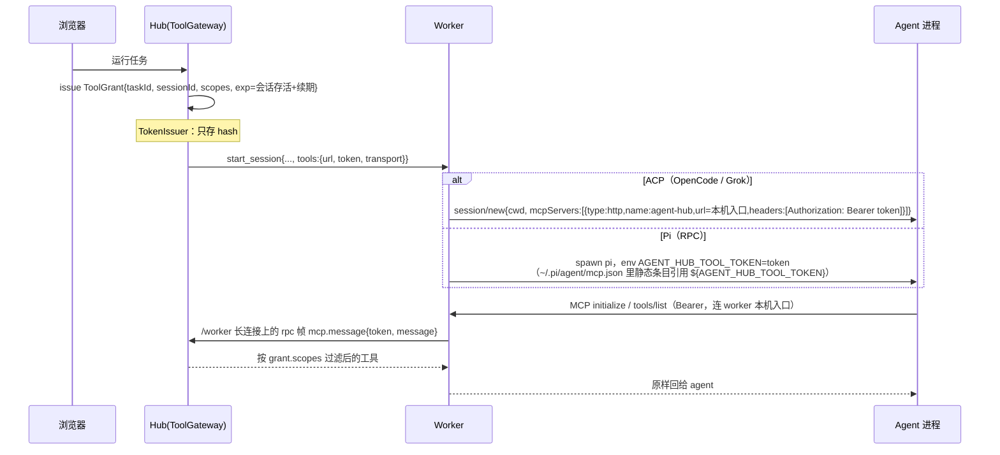
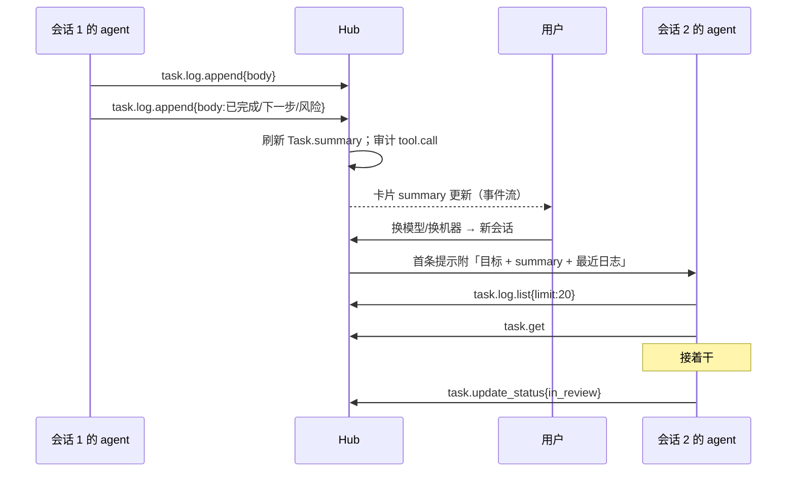

# 任务模型 v2 与 Agent 能力接入层（设计稿）

> 状态：**已评审通过（2026-10-25）**，§7 八个问题全部按建议定案；按 P1–P4 分阶段实施。前置文档：[workspaces.md](./workspaces.md)（Task 是一等实体，画布卡片 = 任务；git 项目的任务分支放在临时工作空间里；第三版见该文）。
>
> 目标：①把任务做成「有进度记忆」的实体——自带**工作日志**；②让**挂在任务下的 agent 会话**用一种通用、可扩展的方式接入平台能力，第一个场景是「新会话读任务和日志，干完写日志交接」。

## 1. 现状（读代码得出）

| 实体 | 位置 | 字段 | 说明 |
| --- | --- | --- | --- |
| `Task` | `packages/domain/src/task.ts` | `id, projectId, title, goal \| null, status, createdAt, updatedAt` | 状态 `open → done/abandoned`，`done/abandoned → open`（`TRANSITIONS`）；用例只有 `createTaskUseCase`、`setTaskStatusUseCase`（`use-cases/tasks.ts`） |
| `Session` | `session.ts` | `id, taskId, agentId, model, origin(derive/fork), status(running/stopped/done/interrupted/failed), lastSeq, agentSessionRef, options, optionSpec, workerId` | 会话**必须**挂在任务下；fork 记录 `fromSessionId + atSeq` |
| `Project` | `project.ts` | `rootPath, workerId, directories` | workspaces.md（第三版）拆出 `Workspace`（长期 / 临时，一台 Worker 可有多个），任务 worktree 并入临时工作空间；Task 不记住上次的机器或工作空间 |
| 画布 | `canvas.ts` | `CanvasLayout`；`buildLineage(tasks, sessions)`、`nodesOf` | 卡片 = 任务，会话以血缘边挂在卡片下 |
| 端口 | `ports/task-repository.ts`、`token-issuer.ts`、`audit-log.ts` | — | `TokenIssuer` 已是「高熵令牌只存 hash」，可直接复用 |
| wire | `contract/src/wire.ts` `start_session` | `sessionId, taskId, agentId, workspaceRoot, origin, resume, options` | Worker 已经知道 taskId，但**没有任何能力通道** |
| ACP 适配器 | `adapters/acp/src/acp-runtime.ts` | `sessionParams()` 固定 `mcpServers: []` | 注入点现成 |

结论：Task 现在只是「标题 + 目标 + 三态」，没有进度记忆；会话之间的交接只能靠人把上一条会话的结论复制给下一条。注意 domain 里已有 `Capability`（`capability.ts`，指**运行时能力矩阵**），本文的新概念叫 **Tool / Toolset**，避免撞名。

## 2. Task 模型 v2

### 2.1 Task

```ts
type TaskStatus = 'todo' | 'in_progress' | 'blocked' | 'in_review' | 'done' | 'abandoned';

interface Task {
  id; projectId;
  title: string;
  goal: string | null;          // markdown，任务说明 / 验收标准
  status: TaskStatus;
  ownerId: UserId | null;       // 负责人（人）；agent 不当 owner，它是会话
  // 分支归工作空间：临时工作空间的 branch = agent-hub/<slug>-<短 id>（workspaces.md 第三版）
  summary: string | null;       // 「当前进展」一句话，由最近一条人/agent 写的日志（非系统条目）自动刷新，也可手改（`PATCH /api/tasks/:id/summary`）
  logSeq: number;               // 日志最大序号，乐观并发用
  createdAt; updatedAt;
}
```

状态机（domain 纯函数，延续 `TRANSITIONS` 写法）：



- 迁移映射：`open → todo`（有过会话的 `open → in_progress`），`done/abandoned` 不变。
- **agent 能改的状态有限**：`in_progress ↔ blocked`、`→ in_review`；`done/abandoned` 只有人能设（最小权限，见 §4.4）。
- 关系不变：`Project 1─N Task 1─N Session`；`Project 1─N Workspace`、`Session N─1 Workspace`（workspaces.md 第三版）；新增 `Task 1─N WorkLogEntry`。

### 2.2 WorkLogEntry（工作日志）

```ts
type LogAuthor =
  | { kind: 'user'; userId }
  | { kind: 'agent'; sessionId; agentId; model }   // 通过能力层写入
  | { kind: 'system' };                            // 平台自动：会话开始/结束、状态变化、PR 链接

interface WorkLogEntry {
  id; taskId;
  seq: number;                  // 任务内单调递增，分页游标 & 乐观并发
  author: LogAuthor;             // 唯一的区分维度：人 / 哪个 agent / 系统
  body: string;                 // markdown，内容不限，上限 32 KB
  links: { kind: 'session' | 'artifact' | 'file' | 'commit' | 'pr' | 'url'; ref: string; label?: string }[];
  attachments: AttachmentId[];  // 复用现有 attachment 存储
  sessionId: SessionId | null;  // 在哪条会话的上下文里写的（人也可以在会话里写）
  createdAt: number;
  editedAt: number | null;
  supersededBy: LogEntryId | null;
}
```

- **只追加**：日志是事实记录。「编辑」= 追加一条新版本，旧版 `supersededBy` 指向新版；默认只显示最新版，可展开历史。删除 = 追加 tombstone（仅作者本人 / 项目 owner）。agent **不能**编辑或删除，只能追加。
- **日志没有种类（kind）**：一条日志 = 作者 + 时间 + 自由 markdown 正文（+ 可选链接）。早期设计里的 `note/progress/decision/blocker/handoff/status_change/session_event` 已整体删除——分类既让人犹豫又没被用来做任何事；真正需要区分的只有「谁写的」：人显示用户名，agent 显示「运行时 · 模型」并链接到写它的会话，系统条目显示「系统」。
- **交接不再是一种类型**：任何一条人/agent 写的日志都会刷新 `Task.summary`（取第一行有意义的文字，≤200 字；系统条目不刷）；`summary` 仍可手改。`## 已完成 / ## 进行中 / ## 下一步 / ## 风险/待决 / ## 关键文件` 只是一个可选的「插入交接模板」按钮。新会话启动时，平台把「任务目标 + summary + 最近日志」放进首条提示（最新一条人/agent 日志全文，其余至多 5 条压成一行，总共 ≤4 KB；可关闭），完整日志让 agent 按需用 `task.log.list` 读。
- **迁移**：sqlite 的 `task_log_entries.kind` 列为兼容旧库保留，新行写 `'entry'`，读取时忽略；HTTP/MCP 收到旧客户端带的 `kind` 一律忽略。
- system 条目自动产生：会话开始/结束（含状态、模型、机器·分支）、状态变化、PR 打开/合并。这样即便 agent 什么也没写，日志也有骨架。

### 2.3 UI

- **任务卡片（画布）**：标题、状态徽章、负责人头像、「机器 · 分支」、`summary` 一行（截断）、最近日志的相对时间与作者图标（人/agent/系统），运行中会话的脉冲点。
- **任务详情（桌面）**：右侧抽屉，两栏——左「概览」（目标 markdown、状态、负责人、分支/PR、会话列表）；右「工作日志」时间线（倒序，按作者着色：人 / agent / 系统（淡色），作者为 agent 时可点进对应会话）。底部输入框：markdown + 附件 + 「插入交接模板」按钮，没有种类选择。
- **移动端**：详情全屏，顶部 Tab「概览 / 日志 / 会话」；日志时间线单列，输入框吸底；卡片上 summary 折成两行。
- 会话视图里加一个「任务」侧栏：显示目标与最近日志，按钮「插入交接模板」（人写）或在会话结束时提示「让 agent 写交接」（发送一条预设提示）。

## 3. 能力接入层：调研

### 3.1 三个运行时实际怎么接 MCP（2026-10 实测 + 文档）

| 运行时 | 我们怎么启动 | 接 MCP 的方式 | 每会话注入 | 来源 |
| --- | --- | --- | --- | --- |
| **OpenCode** 1.19.4 | `opencode acp`（ACP） | ① ACP `session/new.mcpServers`；实测 `initialize` 返回 `mcpCapabilities: {http: true, sse: true}` ② `opencode.json` 的 `mcp` 段（`type: remote`，`url`、`headers`） | ✅ 走 ACP，零文件 | [ACP Session Setup](https://agentclientprotocol.com/protocol/v1/session-setup)、[OpenCode MCP servers](https://opencode.ai/docs/mcp-servers/) |
| **Grok Build** 1.0.70 | `grok agent stdio`（ACP） | ① 同上，实测 `mcpCapabilities: {http: true, sse: true}` ② `~/.grok/config.toml` `[mcp_servers.x]`，`url`、`headers`、`bearer_token_env_var`，支持 `${VAR}` 展开 | ✅ 走 ACP | [Grok Build MCP Servers](https://docs.x.ai/build/features/mcp-servers)、[CLI Reference](https://docs.x.ai/build/cli/reference) |
| **Pi** 1.4.0 | `pi --mode rpc`（自有 RPC，非 ACP） | 内置 MCP：读 `~/.pi/agent/mcp.json` 与（受信项目）`.pi/mcp.json`；HTTP 用 `url` + `headers`，值支持 `${ENV}`；不支持 SSE | ⚠️ 无协议级注入；用「全局静态条目 + 每进程环境变量」 | [Pi MCP docs](https://pi.dev/docs/latest/mcp)、[源码 docs/mcp.md](https://github.com/earendil-works/pi/blob/main/packages/coding-agent/docs/mcp.md) |

注意：OpenCode 的配置文件里 `{env:VAR}` 用在 remote headers 上有已知 bug（[#23664](https://github.com/anomalyco/opencode/issues/23664)、[#33853](https://github.com/anomalyco/opencode/issues/33853)），这正是我们优先走 ACP `session/new` 直接传 header 的原因之一。

### 3.2 方案对比

| 方案 | 优点 | 缺点 | 结论 |
| --- | --- | --- | --- |
| **A. Hub 托管 MCP（Streamable HTTP）** | 三个运行时都原生支持；工具对模型就是普通工具；一处实现、所有 Worker 共用；鉴权/审计/限流集中在 hub | Worker 机器要能访问 hub URL（多机部署里 Worker 本来就连 hub） | ✅ **主路径** |
| B. Worker 上的 stdio shim，经 Worker 链路代理 | Worker 访问不到 hub 的 HTTP 时可用（只有 WS 出站） | 多一个进程；要在 wire 加 `tool.call` 帧 | ✅ **兜底**（同一份工具目录，只换传输） |
| C. ACP 扩展方法（`_agenthub/...`） | 不用 MCP | agent 不会主动调用自定义扩展方法——模型看不到这些「工具」；Pi 不是 ACP | ❌ |
| D. 纯 HTTP API + CLI（`agent-hub task log append`） | 任何能跑 shell 的 agent 都能用；调试方便 | 依赖 agent 想到去调 CLI；参数校验/发现性差 | ➕ 作为**附带**的人类/脚本入口，复用同一套用例 |

## 4. 推荐设计

### 4.1 架构（六边形）

```
            ┌───────────── apps/server ─────────────┐
 agent ──MCP(HTTP)──▶ /mcp  (McpTransportAdapter)    │
 agent ──stdio──▶ worker shim ──WS tool.call──▶ ┤    │
 human/CLI ──REST──▶ /api/tools/*                │    │
            │            ▼                            │
            │   ToolGateway 用例（domain）            │
            │   鉴权 → 授权(grants) → 限流 → 调用 → 审计│
            │            ▼                            │
            │   ToolProvider 端口（插件）             │
            │   ├─ TaskToolProvider   task.*          │
            │   ├─ WorkspaceToolProvider (后续)       │
            │   └─ ArtifactToolProvider  (后续)       │
            └───────────────────────────────────────┘
```

```ts
// packages/domain/src/ports/tool-provider.ts
interface ToolDescriptor {
  name: string;               // 'task.log.append'
  version: number;            // 破坏性变更 +1，旧版本并存一个周期
  description: string;        // 给模型看的中文/英文说明
  inputSchema: JsonSchema;    // 由 contract 的 zod 生成
  scope: ToolScope;           // 'task:read' | 'task:log:write' | 'task:status:write' | ...
  rateLimit?: { perMinute: number };
}
interface ToolContext { grant: ToolGrant; now: number; audit: AuditLog }
interface ToolProvider {
  readonly id: string;
  tools(): ToolDescriptor[];
  call(name: string, input: unknown, ctx: ToolContext): Promise<Result<Json, DomainError>>;
}
```

MCP 只是 `ToolProvider` 集合的一个**传输适配器**（`node-gateway`/`apps/server` 里用 MCP TS SDK 实现）；domain 不知道 MCP 的存在，以后换 ACP 原生工具、OpenAPI 都只是再加一个适配器。

### 4.2 首批工具目录（v1）

| 工具 | scope | 说明 |
| --- | --- | --- |
| `task.get` | `task:read` | 当前任务：标题、目标、状态、summary、分支、会话列表、`latestEntry`（最新一条人/agent 日志） |
| `task.log.list` | `task:read` | 参数 `{ beforeSeq?, limit≤50 }`，倒序分页 |
| `task.log.append` | `task:log:write` | `{ body, links? }`，作者由令牌决定（运行时 + 模型 + 会话）；可带 `expectedSeq` 防并发覆盖语义 |
| `task.update_status` | `task:status:write` | 只允许 §2.1 中 agent 可走的迁移 |

后续：`workspace.files.read/list`（Worker 侧实现）、`artifact.publish`、`task.create_subtask`、`session.spawn`（需要人确认）。

工具**永远隐式绑定当前任务**：参数里没有 `taskId`，从令牌里取——agent 无法越权读别的任务。

### 4.3 令牌：怎么到 agent 手里



- **短期 + 绑定**：令牌 = `{taskId, sessionId, workerId, scopes, exp}` 的不透明句柄，库里只存 hash；滑动 TTL 1h（每次认证成功续到 now+1h），签发后最长 12h；会话每次 resume 由 hub 重新签发并作废旧的；worker 报会话 `ended/gone`（跑完、停止、失败、进程退出）立即吊销；hub 启动时吊销所有「库里不是运行中」的会话的授权（运行中的可能被重连的 worker 接回，交给 TTL 兜底）。
- **最小权限**：默认 grant = `task:read + task:log:write`；`task:status:write` 由项目设置开启；以后的高危工具（写文件、开会话）走「需要人确认」的 grant。
- **不落盘、不进日志**：令牌只存在于 wire 帧（WS 已鉴权）和 agent 进程内存/环境变量里；Worker 日志与事件流对 `tools.token` 做脱敏；Pi 的 mcp.json 里只有 `${AGENT_HUB_TOOL_TOKEN}` 占位符。
- **全部走长连接（默认 `relay`）**：worker ↔ hub 只有一条 `/worker` WebSocket，agent 的 MCP 也在上面。
  - Worker 在 127.0.0.1 随机端口起本机 MCP 入口（`node-gateway/mcp-endpoint.ts`，SDK 的 Streamable HTTP 传输当管道用），把会话的工具 URL 换成它；令牌不变、只在内存和 env 里。
  - 入口不懂任何工具：每条 JSON-RPC 请求原样经 RPC 端口发 `mcp.message {token, message}`，hub 端（`apps/server/mcp-relay.ts`）经 SDK 的 `InMemoryTransport` 交给与 `/mcp` 同一个 MCP 服务端（`mcp-server.ts`）→ 领域 ToolGateway。
  - hub 每条消息都核对：令牌有效；授权绑定的 Worker = 转发的这台；会话此刻确实托管在这台（网关路由表 `hostOf`）。任一不符 `forbidden`。会话结束授权立即吊销。
  - Pi：用户全局 MCP 配置（Pi 0.99+ 为 `~/.pi/agent/mcp.json`，老 Pi + pi-mcp-adapter 为 `mcp-adapter.json`）里是 stdio 垫片（`apps/worker/src/mcp-shim.ts`）→ 本机入口；OpenCode / Grok：ACP `mcpServers` 里给本机入口的 http 条目，没声明 http 的退到同一个垫片。
  - 断线时在途调用立即以 `closed` 失败（不进补发队列）；调用超时 60 秒，超时 / agent 断开会发 `cancel`。
  - 直连 HTTP（`HUB_TOOLS_TRANSPORT=http`）已移除：relay 线上验证后删掉了 `/mcp` 入口，配置会被忽略并打日志。
- 协议：`PROTOCOL_VERSION = 2`（旧的 `tool_request` / `directories` 等专用帧都换成了通用 `rpc` 帧）；版本不一致 hub 关 4426，worker 提示跑 `scripts/update-worker.sh`。

#### 4.3.1 分层（端口与适配器）

```
domain（ToolGateway、enrollWorker 用例；不认识任何传输）
   ▲
contract/rpc —— 端口 RpcPort + 纯逻辑通道 createRpcChannel（关联 id、超时、取消、zod 校验）+ 方法表 worker-methods
   ▲            （只 import zod 和相对路径：CI 的 check:boundaries 文件级规则保证）
node-gateway —— WS 适配器：server-gateway（hub）/ worker-link（worker）只把 rpc 帧搬进搬出通道；worker-enroll（接入握手）
             —— 只依赖端口的适配器：mcp-endpoint（本机 MCP 入口 → 端口）、worker-fs-rpc（端口 → WorkerFiles）；不得 import ws
   ▲
apps/server —— mcp-relay（端口 → MCP 服务端 → ToolGateway）、mcp-server、worker-enroll（限流 → enrollWorker）、main（组合根）
apps/worker —— mcp-shim（stdio ⇄ 本机入口）、enroll.ts（接入 CLI）、main（组合根）
```

同一个通道承载三类调用：`mcp.message`（worker→hub）、`fs.*`（hub→worker，目录浏览 / 建目录 / 列文件 / 读附件）；接入握手是连接上的第一帧，成功即关，不经通道。换传输（比如以后 HTTP/2 或 QUIC）只需要再写一个把帧搬进 `receive()`、`send()` 搬出去的适配器。

### 4.4 一次交接的完整流程



### 4.5 扩展、版本、审计、限流

- **插件**：`ToolProvider` 在 server 启动时注册（`registerToolProvider(provider)`）；每个 provider 声明自己的 scopes。项目设置里按 provider 勾选开启，形成 grant 模板。
- **版本**：工具名稳定，`version` 字段 + MCP `tools/list` 只暴露每个工具的最新版本；破坏性变更用新名（`task.log.append.v2`）并存一个发布周期。
- **审计**：沿用 `use-cases/admin.ts` 的 `record()`：每次调用写 `{actor: session, tool, version, args 摘要(不含 body 全文), result, latencyMs}`。
- **限流**：按 grant 的令牌桶（默认 60 次/分钟，`task.log.append` 10 次/分钟、单条 32 KB），超限返回 MCP tool error（`isError: true` + 中文原因），不断开连接。限流窗口只在 hub 内存里，重启清零（已知取舍：授权短期且重启时只保留运行中会话，最坏是一条运行中的会话在重启那一分钟多拿一个窗口的配额；需要时可改为从 `tool_calls` 审计表回放最近 60 秒）。
- **可观测**：会话事件流里把能力调用渲染成普通 tool_call 卡片（agent 侧本来就会上报 tool_call 帧），用户能看到 agent 读了/写了什么日志。

## 5. 分阶段计划

| 阶段 | 内容 | 验收 |
| --- | --- | --- |
| P1 日志 | domain `work-log.ts` + `WorkLogRepository` 端口 + sqlite 实现；Task 新字段与状态机；REST `GET/POST /api/tasks/:id/log`；system 自动条目；任务详情抽屉（桌面+移动） | 人能写/读日志，会话起停自动出条目 |
| P2 能力层 | `ToolProvider` 端口、`ToolGateway` 用例、`ToolGrant` 签发/吊销、`/mcp` Streamable HTTP 适配器、`TaskToolProvider` 四个工具；wire `start_session.tools`；ACP 适配器把 `sessionParams` 的 `mcpServers` 换成注入值（按 `mcpCapabilities.http` 判断） | OpenCode、Grok 会话里能调 `task.*` |
| P3 Pi + 交接体验 | Worker 启动时确保 `~/.pi/agent/mcp.json` 有 `agent-hub` 条目，spawn 时注入 env；新会话首条提示附带最近日志；「插入交接模板」按钮 | 三个运行时都能完成 §4.4 |
| P4 兜底与扩展 | stdio shim + MCP 经长连接中转（`rpc` 帧 + `mcp.message`，**已完成，默认**）；限流/审计面板；`workspace.*`、`artifact.*` provider；CLI `agent-hub task log` | 只有 WS 出站的 Worker 也能用 |

## 6. 迁移

1. sqlite 迁移：`tasks` 加 `owner_id, branch, summary, log_seq`；状态 `open` → 有会话则 `in_progress`、否则 `todo`。新表 `task_log_entries(id, task_id, seq, author_json, kind（已废弃，保留兼容）, body, links_json, attachments_json, session_id, created_at, edited_at, superseded_by)`，`UNIQUE(task_id, seq)`；`tool_grants(id, token_hash, task_id, session_id, worker_id, scopes, expires_at, revoked_at)`。
2. 回填：为每个已有会话生成一条 `system/session_event`（开始时间、模型、最终状态），让老任务的时间线不是空的。
3. contract：`taskSchema` 新字段一律可选读、带默认值；旧前端忽略未知字段；`start_session.tools` 可选——旧 Worker 收不到就当没有能力层，行为与现在一致。
4. 回滚：新表与新字段只增不删，回滚代码即可。

## 7. 已定问题（均采纳建议）

| # | 问题 | 决定 |
| --- | --- | --- |
| 1 | 日志允许编辑吗？ | 允许人「编辑 = 追加新版本」，保留历史；agent 只追加 |
| 2 | 新会话自动注入多少上下文？ | 只注入目标 + summary + 最近日志（≤4 KB），其余用 `task.log.list` 按需取；项目可关 |
| 3 | agent 能否把任务设为 done？ | 不能；最多 `in_review`，done 由人确认 |
| 4 | 主路径是 HTTP 还是 stdio shim？ | HTTP（三个运行时都原生支持，实现最少）；shim 只为网络受限的 Worker |
| 5 | 令牌放 URL 还是 header？ | header（`Authorization: Bearer`）；URL 会进访问日志 |
| 6 | 工具命名 | `域.动作`（`task.log.append`）；MCP 工具名不允许 `.` 的客户端用 `task_log_append` 别名，由适配器映射 |
| 7 | 是否给 agent 跨任务能力（读其它任务、建子任务）？ | v1 不给；后续以独立 scope + 人工确认开放 |
| 8 | Pi 的全局 mcp.json 会影响用户自己手动跑的 pi 吗？ | 条目 `enabled` 依赖 env：变量缺失时 hub 返回 401，pi 只报该 server 失败；或改用 Pi 扩展在进程内注册，P3 再定 |
