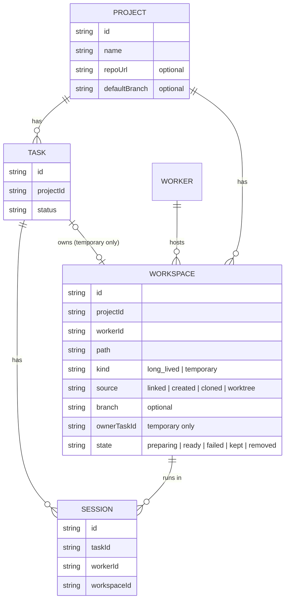

# 工作空间（Workspace）设计 · 第三版

> 状态：**已评审通过（2026-10-26）**。只是设计，不含代码改动。
>
> 这一版按 2026-10-26 的修订重写：同一台 Worker 上可以有**多个**同项目的工作空间（取消「每台最多一个」）；工作空间分**长期**和**临时**两类；原来单独的「任务 worktree（TaskCheckout）」并入临时工作空间；多个任务**可以**共用一个工作空间，并发时给警告。
>
> 上一版的调研（VS Code 多根、Codespaces、Coder、Codex environment 等）结论不变：执行位置（机器 + 目录）是一等实体，按需创建；仓库是「怎么把代码放到那台机器上」的配方，挂在项目上。见 git 历史。

## 1. 现状（读代码得出）

| 位置 | 现状 |
|---|---|
| `domain/project.ts` | `Project { rootPath, workerId, directories: Record<workerId, path> }`；`Workspace { workerId, root }` 只是用 `workspaceFor()` 推导出来的值 |
| `use-cases/continue-elsewhere.ts` | 目标机器没登记目录时让人选，结果作为副作用写进 `project.directories` |
| storage | `projects.root_path / worker_id / directories(JSON)`；`sessions.worker_id` |
| worker RPC | 已有 `fs.list_directories`、`fs.make_directory`、`fs.list_files`、`fs.read_file`、`mcp.message`，走长连接上的 RPC 通道，路径都用 realpath 校验在 `WORKER_ROOTS` 内 |

问题：主目录、副本目录、推导值三者重叠；建项目必须先选目录；换机器继续悄悄改项目；没有地方表达「为这个任务临时开一个干净的目录，用完就删」。

## 2. 领域模型



```
Project（聚合根）  id, name, ownerId, repo?{url, defaultBranch}, createdAt
                   不绑定 Worker，不持有路径。删除项目 = 归档，从不删目录。

Workspace          id, projectId, workerId, path, kind: long_lived | temporary,
                   source: linked（选的已有目录）| created（mkdir）| cloned（git clone）| worktree（git worktree add）,
                   baseWorkspaceId?（worktree 的主仓库工作空间）, branch?, ownerTaskId?（只有临时的有）,
                   label?, isGit, state: preparing | ready | failed | kept | removed, keptReason?, createdAt, removedAt?

Task               id, projectId, title, goal, status
                   不绑定 Worker；不记住上次的机器或工作空间（评审决定：不做隐式默认）。

Session            id, taskId, workerId, workspaceId（创建后不可变）, agent, model, status…
                   换工作空间 / 换机器 = 同一任务下的新会话，经工作日志交接。
```

### 不变量

1. **一个目录最多属于一个项目**：同一 `workerId` 上活跃（非 removed）工作空间的 `path` 唯一，且不能互相嵌套（worktree 放在仓库外的兄弟目录 `.worktrees/`，所以和主仓库不嵌套）。
2. **一台 Worker 可以有同一项目的多个工作空间**（新）。
3. 所有路径都在该 Worker 的 `WORKER_ROOTS` 内（Worker 侧 realpath 校验，沿用现有做法）。
4. 会话只用一个工作空间，`workerId = workspace.workerId`，创建后不可变。
5. 临时工作空间有且只有一个 `ownerTaskId`；长期工作空间没有。
6. 多个任务可以共用一个工作空间；同一工作空间里同时有两个以上运行中的会话时，界面给警告，不阻止。
7. **长期工作空间从不自动删除**；只能由人「移除登记」（默认不删目录，删目录需要二次确认，且只对 `created/cloned` 的开放）。
8. **临时工作空间只有在满足清理条件时才自动删**（§5）；否则标为 `kept` 并提示用户。
9. 成员默认只能用托管目录（`<roots[0]>/agent-hub-workspaces/...`）；关联已有目录需要 Owner（沿用账号设计）。

### 六边形落地

- **domain**
  - 实体：`workspace.ts`（纯函数：`canAutoRemove(status)`、`concurrentWarning(sessions)`、`nestedOrTaken(paths, path)`）。
  - 端口：`WorkspaceRepository`（list by project / worker / task，save，markRemoved）；`WorkspaceHost`（hub 视角的 Worker 能力：`create / clone / addWorktree / status / remove`），由 node-gateway 用 RPC 实现，domain 不知道 RPC 或 git。
  - 用例：`listRunTargets(project, worker)`、`prepareWorkspace(task, worker, choice)`、`runTask`（改：要先拿到 ready 的工作空间）、`continueElsewhere`（重写：目标是一个工作空间，不再改项目）、`sweepTemporaryWorkspaces(now)`、`removeWorkspace`。
  - Project 删掉 `rootPath / workerId / directories / workspaceFor`。
- **contract**：`workspaceSchema`、`runTargetsSchema`、`prepareWorkspaceRequest`；`worker-methods.ts` 新增 §3 的方法。
- **storage-sqlite**：表 `workspaces`；`sessions.workspace_id`；`projects.repo_url / repo_default_branch`。
- **worker**：`git` 子进程适配器（`execFile`，不经 shell），所有路径都校验在 roots 内。
- **web**：运行面板里的「位置」选择、项目设置里的工作空间列表。

## 3. Worker RPC 方法（走现有 RPC 通道）

命名沿用 `fs.*` 的下划线风格，参数和结果用 zod 定义在 `contract/worker-methods.ts`。耗时的方法（clone、fetch）在 RPC 之外发 `diagnostic` 进度帧，hub 转给任务卡片。

| 方法 | 参数 | 结果 | 说明 |
|---|---|---|---|
| `fs.make_directory` | `parent, name` | `path` | 已有 |
| `ws.inspect` | `path` | `exists, isGit, remoteUrl?, branch?` | 关联已有目录、迁移后探测 |
| `ws.clone` | `repoUrl, parent, name, branch?` | `path, branch` | 用 Worker 本机 git 凭据；hub 不存 token |
| `ws.add_worktree` | `repoPath, path, branch, base` | `path, branch` | `git fetch` 后 `git worktree add -b <branch> <path> <base>`；远端已有该分支就基于 `origin/<branch>` |
| `ws.status` | `path, defaultBranch?` | `dirty, untracked, ahead, unpushed, unmerged, branch, upstream?` | 清理前的检查；非 git 目录只回 `dirty: null` |
| `ws.remove` | `path, kind: 'worktree' \| 'directory', force: false` | `removed` | worktree 用 `git worktree remove`（不加 `--force`，分支保留）；directory 只对 hub 新建的临时目录开放；Worker 会**再查一次** status，有改动就拒绝（防止 hub 看到的是旧状态） |

所有方法都是幂等的（已存在就返回现有结果），超时和错误走现有 `RpcFailure`。

## 4. 交互流程

### 新建项目（不选目录）

名称，加可选的 git 仓库（URL、默认分支），然后「创建」。不选机器、不选目录。建完直接进画布。

### 运行任务：先选机器，再选工作空间

卡片「运行」打开运行面板（手机上是底部 sheet，行高 ≥ 44px）：

1. Agent 和模型。
2. **机器**：列出在线机器，离线的置灰；只有一台在线时直接选中它（这不是隐式记忆）。
3. **工作空间**：列出这个项目在这台机器上的工作空间（最近使用的在前），**不预选**，由用户每次选择。
   - 每行：标签或目录名 · 长期/临时 · 分支 · 「2 个会话运行中」（有就给黄色警告）。
   - 底部「＋ 新建…」展开三个选项：
     - **临时（git 项目）**：在主仓库旁 `.worktrees/` 下建 worktree，新分支 `agent-hub/<slug>-<短 id>`；这台机器上还没有主仓库时先 clone。
     - **长期**：托管目录 `<roots[0]>/agent-hub-workspaces/<project-slug>[-2]`（早先是 `agent-hub/`，和 Worker 默认安装目录 `~/agent-hub` 撞了，改名；老记录是绝对路径，照旧可用）；有 repo 就 clone，没有就 mkdir（可选 `git init`）；或者「选已有目录…」（目录选择器，Owner 才能选托管目录以外的）。
     - **临时（非 git 项目也可选）**：新建空目录 `<roots[0]>/agent-hub-workspaces/.tmp/<slug>-<短 id>`。
   - 这台机器上一个工作空间都没有时，直接展开「新建」，仍不预选。
4. 「运行」。准备中的进度显示在卡片上，ready 后启动会话。

卡片上显示「机器 · 工作空间 · 分支」。

### 换工作空间 / 换机器继续

会话菜单「换个地方继续」：选机器和工作空间（同上面板）。流程：停掉当前会话（如在运行）→ 源工作空间是 git 且有远端时，可选「先提交 WIP 并推送分支」→ 目标工作空间准备好（同分支的 worktree 基于 `origin/<branch>`）→ 新会话启动，提示词里带上该任务的工作日志（`task.get` + 日志，沿用现有交接）。不再修改项目。没有远端时提示「代码改动留在原机器上」。

### 项目设置 · 工作空间

按机器分组列出：路径、长期/临时、分支、状态（就绪 / 已保留：有未推送改动 / 已移除）、使用中的任务。操作：改标签、移除登记、对 `kept` 的临时工作空间「查看改动」「推送」「强制删除」（二次确认，列出将丢失的提交和文件）。

## 5. 清理规则（只针对临时工作空间）

触发：任务变为 `done` 或 `abandoned`；hub 启动时；每小时巡检一次（`sweepTemporaryWorkspaces`）。

对每个 `kind = temporary, state = ready` 且 owner 任务已结束的工作空间：

1. 有运行中的会话（不论属于哪个任务）→ 跳过，下次再查。
2. Worker 离线 → 跳过，上线后再查。
3. 调 `ws.status`：
   - `dirty` 或 `untracked` 有内容 → `kept`（未提交改动）。
   - git：有提交既没推到 upstream 也没合进默认分支 → `kept`（未推送 / 未合并）。
   - 都干净 → `ws.remove`；成功后 `removed`，分支保留（已推送或已合并，不丢东西）。
4. `kept` 的在卡片和项目设置里标出来，并在任务卡片上给一条提示；用户处理后（推送、合并、强制删除）下一轮巡检再删。

长期工作空间不参与清理。任务被重新打开时，若它的临时工作空间还在（`ready/kept`）就继续用；已删除就按分支重新建 worktree。

## 6. 存储与迁移

```sql
CREATE TABLE workspaces (
  id TEXT PRIMARY KEY,
  project_id TEXT NOT NULL REFERENCES projects(id),
  worker_id TEXT NOT NULL,
  path TEXT NOT NULL,
  kind TEXT NOT NULL CHECK (kind IN ('long_lived','temporary')),
  source TEXT NOT NULL CHECK (source IN ('linked','created','cloned','worktree')),
  base_workspace_id TEXT REFERENCES workspaces(id),
  branch TEXT,
  owner_task_id TEXT REFERENCES tasks(id),
  label TEXT,
  is_git INTEGER,
  state TEXT NOT NULL,
  kept_reason TEXT,
  created_at INTEGER NOT NULL,
  removed_at INTEGER,
  CHECK ((kind = 'temporary') = (owner_task_id IS NOT NULL))
);
CREATE UNIQUE INDEX workspaces_live_path ON workspaces(worker_id, path) WHERE state <> 'removed';
CREATE INDEX workspaces_by_project ON workspaces(project_id, worker_id);
ALTER TABLE sessions ADD COLUMN workspace_id TEXT REFERENCES workspaces(id);
ALTER TABLE projects ADD COLUMN repo_url TEXT;
ALTER TABLE projects ADD COLUMN repo_default_branch TEXT;
```

嵌套检查（不变量 1 的后半句）在 domain 里做，数据库只兜底完全相同的路径。

迁移（一次性、幂等，沿用 store.ts 里按列存在与否判断的做法）：

1. 每个项目的 `(worker_id ?? 本机 Worker id, root_path)` → 第一个长期工作空间，`source = linked`。
2. `directories` 里每一项 `(workerId, path)` → 追加长期工作空间，`source = linked`。
3. 路径冲突（两个项目登记了同一个目录或互相嵌套）：先建的项目拿到，其余跳过并写一条审计，在运营后台列出。
4. 老会话：`workspace_id` = 其 `worker_id` 上该项目的工作空间（找不到就是第一个）。
5. `is_git`、remote 在 Worker 上线时用 `ws.inspect` 补；读到 origin 时只在项目设置里提示「绑定为项目仓库？」，不自动绑定。
6. 旧列保留一个版本用于回滚，下个版本删除。

## 7. 边界情况

| 情况 | 处理 |
|---|---|
| 两个任务同时在一个工作空间里运行 | 允许；运行面板和两张卡片都显示警告「另一个任务也在这里写入」 |
| 同一分支想在两个 worktree 里检出 | git 不允许；`ws.add_worktree` 返回冲突，面板提示改用已有的那个工作空间 |
| 临时工作空间所在 Worker 永久下线 | 一直 `ready`，项目设置里可以「移除登记」（不碰目录） |
| 目录被人在机器上手动删掉 | `ws.inspect` 返回 `exists: false` → 标 `failed: 目录不存在`，可移除登记或重新创建 |
| 手动 `git push` 后才结束任务 | 清理时 status 已干净，直接删 |
| 项目删除（归档） | 工作空间全部只移除登记，目录一律不删，临时工作空间也不删 |
| clone 失败 / 凭据缺失 | 工作空间 `failed`，错误显示在卡片上，可重试或换成「选已有目录」 |
| 没有 repo 的项目换机器 | 只能在目标机器新建空目录或选已有目录，提示改动不会同步 |
| 会话运行中被要求删除其工作空间 | 拒绝，先停会话 |
| hub 与 worker 判断不一致（hub 以为干净） | `ws.remove` 在 Worker 侧再查一次，有改动就拒绝并回报，hub 改为 `kept` |
| 托管目录名冲突 | slug 首次创建时固定，冲突追加 `-2`、`-3` |

## 8. 分阶段实施

| 阶段 | 内容 | 可独立上线 |
|---|---|---|
| W1 | domain `Workspace` + 仓库端口 + sqlite 表 + 迁移（只有长期、linked）；会话写 `workspace_id`；Project 读写改走工作空间，旧字段并存 | 是，行为不变 |
| W2 | 新建项目不选目录；运行面板「机器 → 工作空间」选择（含手机 sheet）；长期工作空间的 mkdir 新建与「选已有目录」；并发警告 | 是 |
| W3 | 项目 repo 字段；`ws.inspect`、`ws.clone`；clone 进度帧 | 是 |
| W4 | 临时工作空间：`ws.add_worktree`、非 git 临时目录、任务分支命名 | 是 |
| W5 | 清理：`ws.status`、`ws.remove`、`sweepTemporaryWorkspaces`、`kept` 提示与项目设置里的处理 | 是 |
| W6 | 换工作空间 / 换机器继续重写（WIP 推送可选、工作日志交接）；删除旧字段 | 是 |

每一阶段一个或几个小 PR，ci + e2e 全绿再合并。

## 9. 产品语言（界面文案）

> 只改界面上的字。代码、domain、接口、数据库里的名字（Project / Task / Session / Worker / Workspace、`long_lived` / `temporary`）**一律不变**。

### 9.1 用词表

| 界面用词 | 一句话解释（给用户看） | 代码里 | 说明 |
|---|---|---|---|
| **项目** | 你在做的东西 | Project | 不变 |
| **任务** | 要完成的一件事；带一份进度记录，换人、换地方都能接着做 | Task | 「工作日志」在界面上叫「进度记录」 |
| **机器** | 干活的那台电脑 | Worker | 界面上不再出现 Worker；「本机」= hub 所在那台 |
| **工作空间** | 机器上的一个文件夹，agent 在里面干活 | Workspace | 保留这个词 |
| **持久工作空间** | 一直保留，下次还能接着用 | `kind = long_lived` | |
| **临时工作空间** | 为这个任务单独开一份，用完自动清理；有未保存的改动会保留并提醒 | `kind = temporary` | git 项目里「未保存」= 未提交、未推送或未合并 |
| **会话** | 和 agent 的一次来回 | Session | 保留现有用词，见 9.2 |

### 9.2 保留「会话」

评审决定：界面继续叫**会话**（现有约 90 处），不改成「对话」。本文其余文案里凡指 Session 的一律用「会话」。

### 9.3 开始一个任务：只问一个问题

运行面板的标题就是这个问题：

> **在哪台机器、哪个工作空间干活？**

- 第一行「机器」：`本机` / 机器名，离线的灰掉并写「离线」。
- 下面是选项（单选，大行，手机上整行可点）：
  1. **用已有的工作空间**：每行「文件夹名 · 持久/临时 · 分支」，有别的任务正在用时加一行小字「另一个任务也在这里干活，改动可能互相影响」。
  2. **新建持久工作空间**：副标题「一直保留，下次还能接着用」。
  3. **新建临时工作空间**（git 与非 git 项目都可选）：副标题「为这个任务单独开一份，用完自动清理；有未保存的改动会保留并提醒」；git 项目在这一项旁写一行小字「git 项目常用：每个任务一个分支，互不干扰」，但**不预选**。
- 选中新建时，下方一行灰字说明将发生什么：「将在 本机 的 ~/agent-hub/foo 下新建」「将把 github.com/me/foo 下载到这台机器」「将为这个任务新开分支 agent-hub/fix-login-3f2a」。
- **不预选**：持久和临时之间没有默认项，每次由用户选；也不隐式记住上次的选择（已有工作空间列表按最近使用排序，但同样不预选）。没选之前「开始」是灰的。
- 同一任务已有一个以上临时工作空间时，在「新建临时工作空间」下加一行提示「这个任务已经有 N 个临时工作空间」，不阻止。
- 主按钮「开始」；准备中显示「正在准备工作空间…」，失败时把原因写在按钮上方，按钮变成「重试」。

### 9.4 第一次使用的说明卡

首页、还没有任何项目时出现；点「知道了」后不再显示（存在浏览器本地）。

> **三个词就够了**
>
> **项目** → **任务** → **会话**
>
> 项目是你在做的东西；任务是其中要完成的一件事；会话是你和 agent 一起做这件事。
> 每个会话都在某台**机器**上的一个**工作空间**（一个文件夹）里进行。
>
> 〔新建项目〕　〔知道了〕

### 9.5 空状态文案

| 位置 | 文案 | 按钮 |
|---|---|---|
| 首页，没有项目 | 还没有项目。先建一个，告诉 agent 你在做什么。 | 新建项目 |
| 项目画布，没有任务 | 这个项目还没有任务。写下第一件要做的事。 | 新建任务 |
| 任务，没有会话 | 还没开始。选一台机器和一个工作空间就能开始。 | 开始 |
| 运行面板，这台机器上没有工作空间 | 这台机器上还没有这个项目的工作空间，新建一个吧。 | （直接展开两个「新建」选项） |
| 项目设置 · 工作空间，空 | 还没有工作空间。开始第一个任务时会让你选或新建。 | — |
| 没有在线的机器 | 现在没有在线的机器。打开一台已接入的机器，或者接入一台新的。 | 接入机器 |

### 9.6 提示（tooltip / 长按说明）

| 对象 | 提示 |
|---|---|
| 「机器」标签 | 干活的那台电脑。agent 在它上面读写文件、执行命令。 |
| 「工作空间」标签 | 机器上的一个文件夹，agent 只在这里面干活。 |
| 持久徽标 | 持久：一直保留，下次还能接着用。 |
| 临时徽标 | 临时：任务结束后自动清理；有未保存的改动会保留并提醒你。 |
| 「已保留」徽标（临时、被 kept） | 还有没保存的改动（未提交 / 未推送），所以没有清理。点开处理。 |
| 并发警告图标 | 另一个任务也在这个工作空间里干活，改动可能互相影响。 |
| 「进度记录」 | agent 每做完一步就记一笔；换机器或换工作空间继续时，新会话会先读它。 |
| 「换个地方继续」 | 在另一台机器或另一个工作空间里开一个新会话，接着这份进度记录做。 |
| 分支名 | 这个任务的改动都在这个分支上，不会碰到主分支。 |

### 9.7 手机布局

- 运行面板是**底部弹出的全高 sheet**：顶部是问题「在哪台机器、哪个工作空间干活？」和关闭按钮；机器是一行横向可换行的胶囊按钮（不横向滚动）；工作空间选项竖排，每行 ≥ 56px（标题 + 副标题两行），整行可点；「开始」固定在底部安全区上方，键盘弹出时跟着上移。
- 徽标（持久 / 临时 / 已保留 / 并发警告）在手机上没有悬停：点一下徽标弹出同样的说明气泡，再点别处关闭。
- 说明卡在手机上占满宽度，两个按钮上下排列、各 ≥ 44px。
- 卡片上的「机器 · 工作空间 · 分支」在窄屏折成两行，路径中间省略（`~/agent-hub/…/foo`）。
- 项目设置里的工作空间按机器分组，每组可折叠，操作收进每行右侧的 ⋯ 菜单。

## 10. 已定与待定

**已定**：项目不绑 Worker；删除项目不删目录；一个目录最多属于一个项目；一台 Worker 上可以有多个同项目工作空间；长期 / 临时两类，临时满足条件才自动删；多任务可共用工作空间并给并发警告；会话经工作日志换地方继续；用 Worker 本机 git 凭据；任务分支 `agent-hub/<slug>-<短 id>`；worktree 放在仓库外的 `.worktrees/`；合并默认 squash；没有 remote 时不做 git bundle 中转。

**第四轮已定（2026-10-26 评审）**：

1. 持久 / 临时**没有默认**，每次由用户选择；不隐式记住上次的机器或工作空间。
2. `kept` 的临时工作空间只提醒，不设期限。
3. 移除持久工作空间时，只对 hub 新建或 clone 的（`created / cloned`）提供「同时删除目录」，并二次确认。
4. 非 git 项目也可以选临时工作空间（新建空目录，清理规则相同：非空且有改动的判断见 §5）。
5. 每个任务、每台机器的临时工作空间数量不限，有多个时给提示。
6. 界面保留「会话」，不改「对话」。

目前没有待定问题。
