# 使用指南

这份指南带你从零跑起 agent-hub：先装好、登录，再加机器、建项目、派生会话，最后讲资产中心和运维。截图都来自当前版本的界面，名词也和界面保持一致（**会话**、**工作空间**、**持久 / 临时**）。

- [1. 安装与启动](#1-安装与启动)
- [2. 第一次打开](#2-第一次打开)
- [3. 添加机器（Worker）](#3-添加机器worker)
- [4. agent 就绪检测](#4-agent-就绪检测)
- [5. 新建项目](#5-新建项目)
- [6. 任务](#6-任务)
- [7. 派生会话：选机器和工作空间](#7-派生会话选机器和工作空间)
- [8. 画布、列表与对话视图](#8-画布列表与对话视图)
- [9. 分叉与换个地方继续](#9-分叉与换个地方继续)
- [10. 搜索](#10-搜索)
- [11. 资产中心：技能、指令、MCP 与密钥](#11-资产中心技能指令mcp-与密钥)
- [12. 运营后台：机器更新与设置](#12-运营后台机器更新与设置)
- [13. 手机上用](#13-手机上用)
- [14. 常见问题](#14-常见问题)

## 1. 安装与启动

要求：Node 26+、git，以及至少一个 agent CLI（`pi`、`opencode` 或 `grok`），并且已经在本机登录好。

```bash
npm install
npm run up          # 构建前端并启动 hub，打开 http://127.0.0.1:7878
```

想让它常驻（开机自启、崩溃自动拉起），用一次性安装脚本：

```bash
scripts/install.sh  # 装依赖、建数据目录、装 systemd user unit agent-hub.service
systemctl --user status agent-hub
```

hub 默认只监听 `127.0.0.1`。要从手机或别的机器访问，见 [remote-access.md](remote-access.md)：推荐 Tailscale；绑定非回环地址（`HUB_HOST=…`）时必须同时设 `HUB_TOKEN`，否则 hub 拒绝启动。

## 2. 第一次打开

打开后是登录页，有「登录 / 注册」两个标签。**第一个注册的账号自动成为主人**（管理员），之后的人能否自助注册由主人在「运营后台 · 设置」里决定。

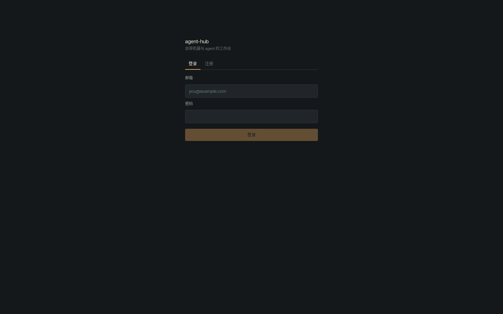

登录后进入首页：左边是「项目」列表（右侧 ＋ 新建项目），下面是 Worker 面板；右边是最近的会话和搜索框。

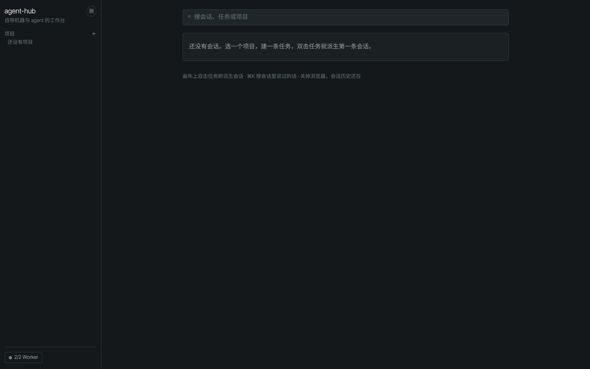

## 3. 添加机器（Worker）

hub 所在的机器自己就是一台 Worker（「本机」）。点左下角「N/N Worker」打开面板，展开某一行可以看到主机名、**可用目录**（`WORKER_ROOTS`）、各 agent 的状态，以及「重新检测」「吊销」。

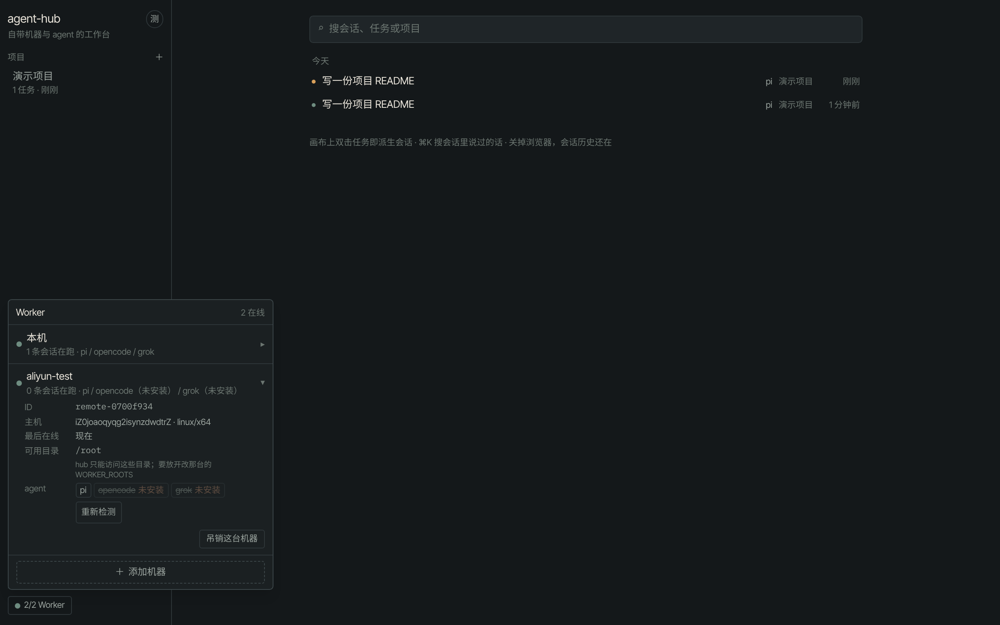

### 推荐：配对命令

面板底部点「＋ 添加机器」，弹窗给出一行命令，点「复制命令」，在新机器上运行：

```bash
curl -fsSL http://<hub>:7878/install-worker.sh | HUB_PAIR=ahw_pair_… bash
# 可选：WORKER_LABEL=工作站 WORKER_ROOTS=$HOME/code 放在 bash 前面
# 不想装 systemd：… | HUB_PAIR=… bash -s -- --no-systemd
```

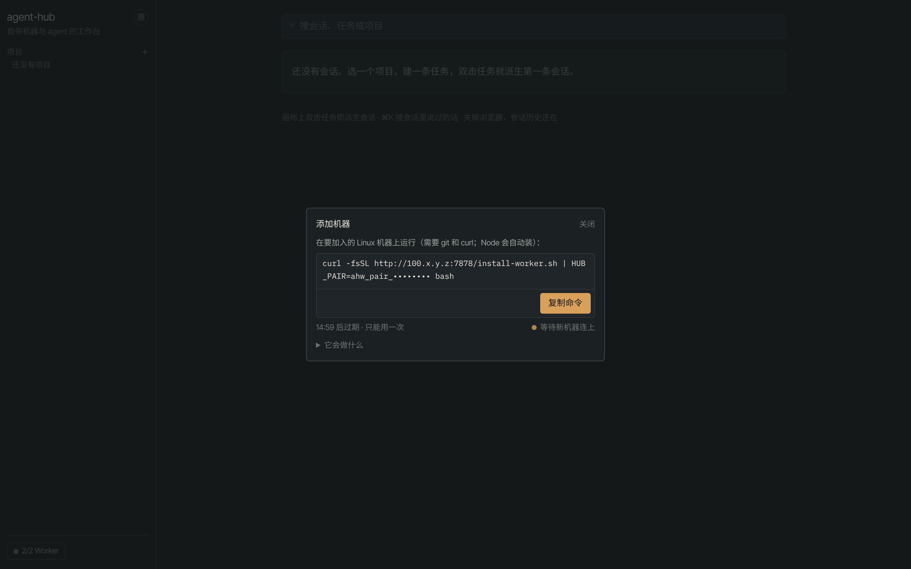

- 新机器只需要 `git`、`curl`、`tar`；脚本会装 Node 26、把代码拉到 `~/agent-hub` 并对齐 hub 的提交，用配对码换一份**这台机器专属的凭据**，再装 systemd 服务 `agent-hub-worker`。
- 配对码 **15 分钟有效、只能用一次**，弹窗里有倒计时；过期就点「重新生成」。弹窗会一直「等待新机器连上」，连上后提示已连上。「它会做什么」可以展开看脚本的每一步。
- 配置写在新机器的 `~/.config/agent-hub/worker.env`（权限 600），凭据不会出现在 unit 文件和进程参数里。
- 不要的机器在面板或后台点「吊销」：凭据作废、立刻断开、不再重连。

### 兜底：共享 HUB_TOKEN

hub 以 `HUB_HOST=<地址> HUB_TOKEN=<随机串> npm run up` 启动时，Worker 也可以直接用同一个 token：

```bash
git clone <agent-hub 仓库> && cd agent-hub
HUB_URL=ws://<hub>:7878/worker HUB_TOKEN=<和 hub 同一个> \
WORKER_LABEL=工作站 WORKER_ROOTS=$HOME/code \
scripts/install-worker.sh
```

### 没有 VPN 时：SSH 反向隧道

hub 留在回环地址、对方机器不能直接访问 hub 时，可以从 hub 这台用 SSH 把端口反向送过去：

```bash
# 在 hub 机器上，保持运行（断了自动重连）
while true; do
  ssh -N -o ServerAliveInterval=30 -o ExitOnForwardFailure=yes \
      -R 127.0.0.1:17878:127.0.0.1:7878 user@remote
  sleep 5
done
```

然后在远端机器上，用「添加机器」拿到的配对码，但把 hub 地址换成隧道口：

```bash
curl -fsSL http://127.0.0.1:17878/install-worker.sh | HUB_HTTP=http://127.0.0.1:17878 HUB_PAIR=ahw_pair_… bash
```

Worker 会连 `ws://127.0.0.1:17878/worker`。隧道断开时 Worker 会自动退避重连。注意：经隧道进来的连接在 hub 看来来自回环地址，所以只对你自己信任的机器这样做。

## 4. agent 就绪检测

每台 Worker 会检测自己装了哪些 agent、能不能用。不可用的 agent 在面板和派生弹窗里**置灰**，并写明原因：

| 原因 | 意思 |
| --- | --- |
| 未安装 | 这台机器上找不到这个 CLI |
| 未登录 | CLI 在，但没有登录 / 没有凭据 |
| 未配置模型 | 登录了，但没有可用模型 |
| 检测超时 / 检测失败 | 检测命令没在时限内返回或报错 |
| 缺少 MCP 适配器 | 项目启用了 MCP 资产，但这个 agent 接不上 |

装好或登录之后，点「重新检测」即可，不用重启 Worker。派生弹窗里选到不可用的 agent 时，会显示「「机器」上的 X 暂不可用：原因」，旁边也有「重新检测」。

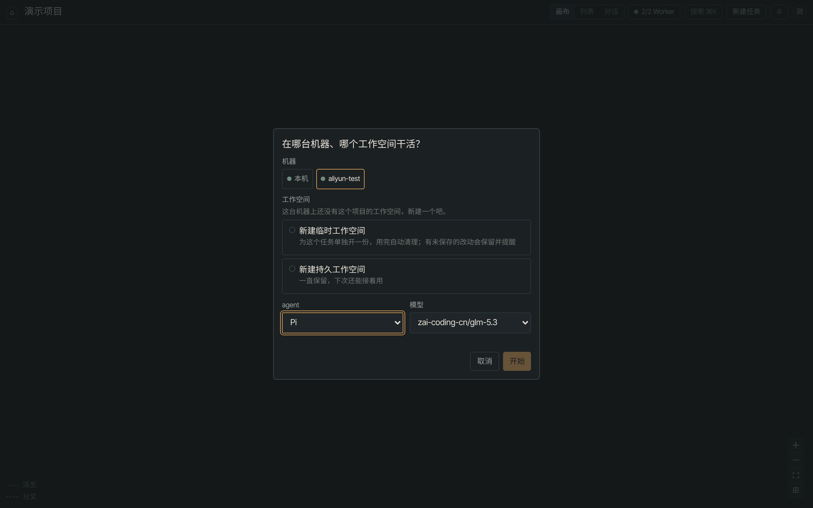

## 5. 新建项目

首页「项目」旁点 ＋：

- **目录在哪台机器上（可选）**：选一台机器。
- **目录（可选，/绝对路径）**：可以手填，也可以点「浏览…」在那台机器的文件系统里选。选择器里 ⎇ 标记 git 仓库，可以「上一级」「新建文件夹」，选好点「使用」。选了目录，它就成为项目的第一个**持久工作空间**。
- **项目名**、**git 仓库（可选）**、**默认分支（可选）**。
- **项目说明**：支持 markdown，写这是什么、仓库在哪、有什么约定——agent 开工时会读到。

点「开始」创建。

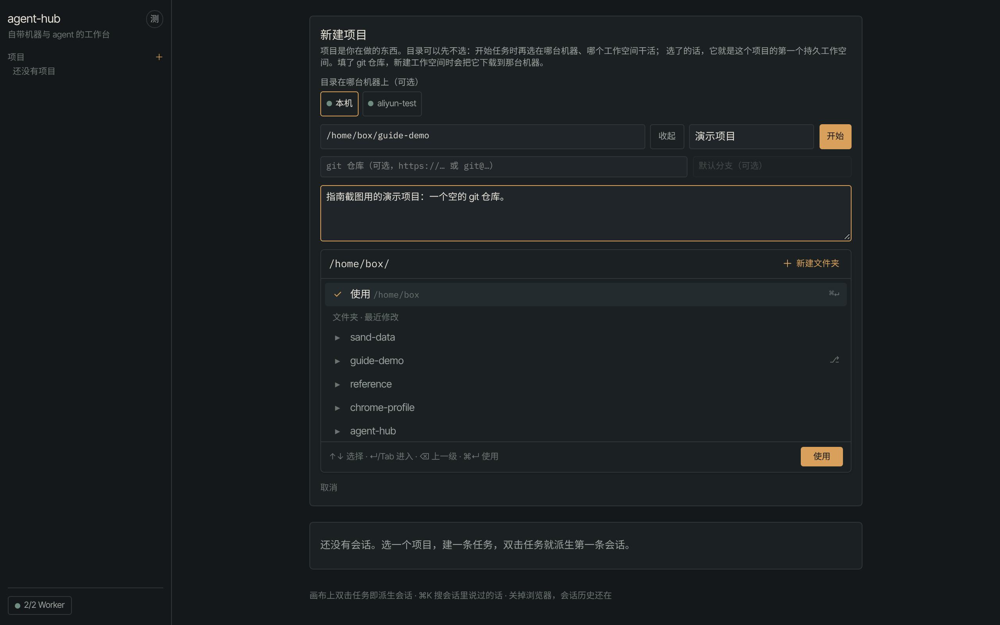

项目说明以后可以在顶栏 ⚙「项目设置」里改；那里还有本项目的资产开关和按机器分组的工作空间列表（可以「移除登记」，或同时删除目录）。

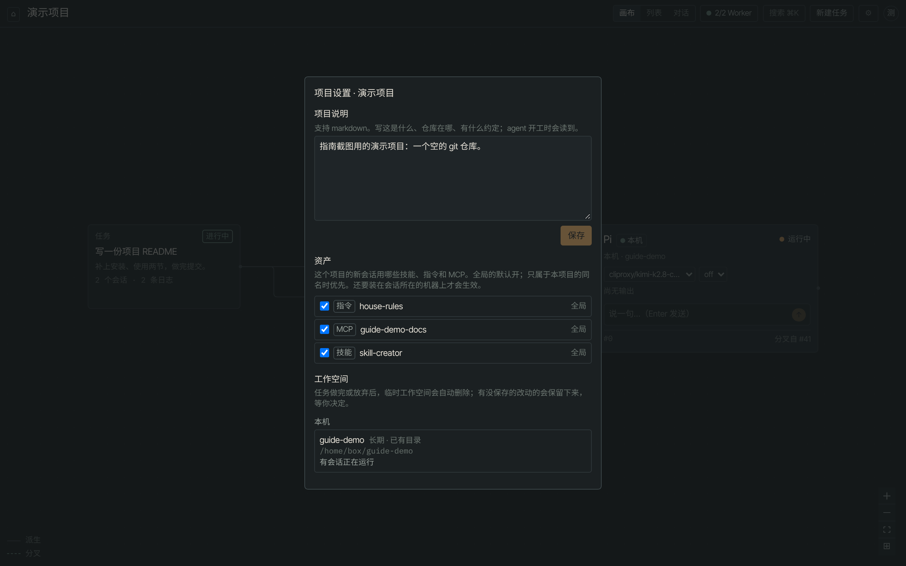

## 6. 任务

项目里的工作以**任务**为单位。新项目的画布是空的，中间有一句提示和「新建任务」按钮；之后也可以随时点顶栏的「新建任务」。填**标题**和**目标**（可留空），点「创建任务」。

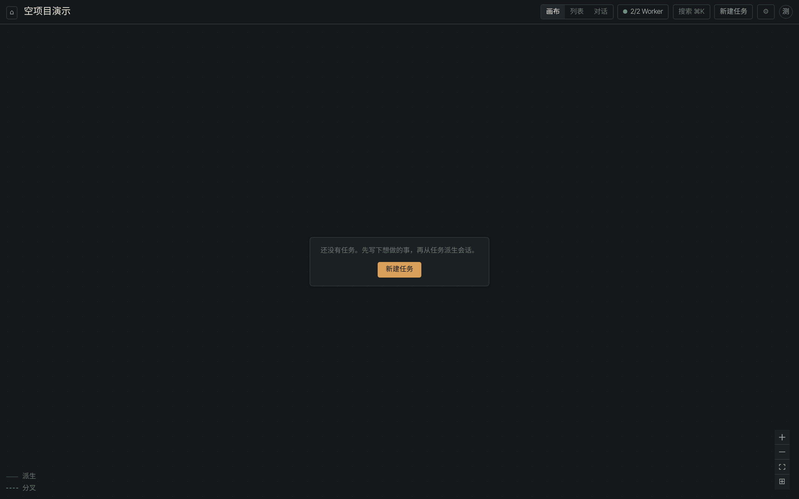
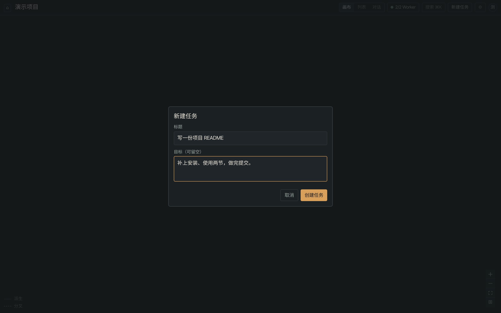

任务卡上显示状态（待开始 → 进行中）和「N 个会话 · N 条日志」。「＋ 会话」「日志」一直在卡片底部（鼠标移上去会更醒目）；「开始 / 放弃」或「收尾 / 放弃」在鼠标移到卡片上或选中卡片时出现，触屏上常驻。

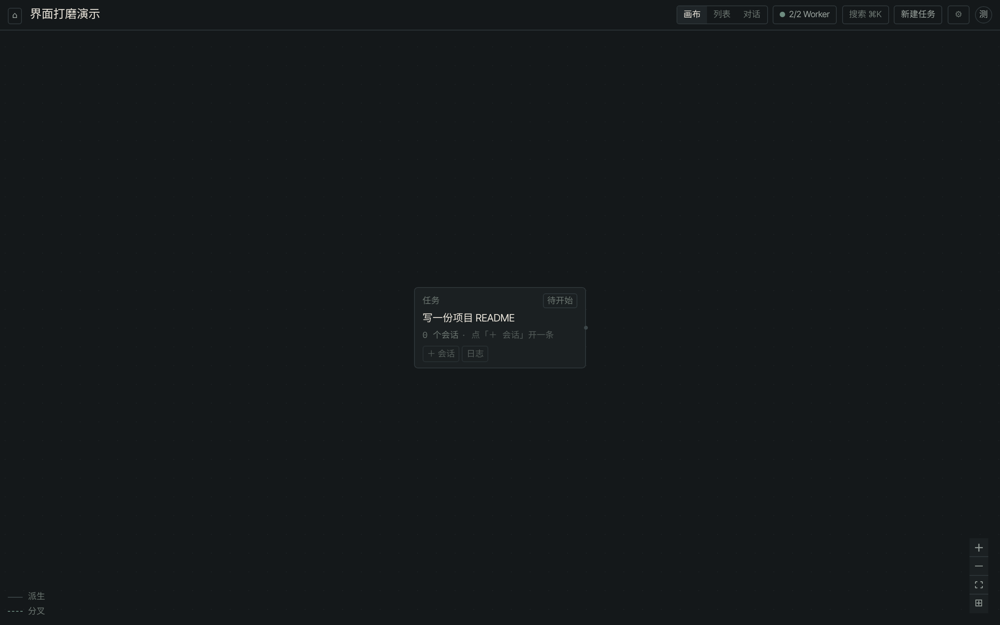

「日志」打开任务详情：顶部是「当前进展」，下面是时间线；可以「写日志」，或「插入交接模板」把进度交给下一个会话。

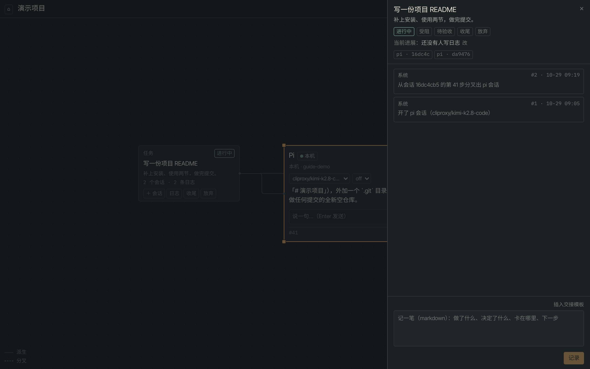

## 7. 派生会话：选机器和工作空间

在任务卡上点「＋ 会话」，弹窗问「在哪台机器、哪个工作空间干活？」：

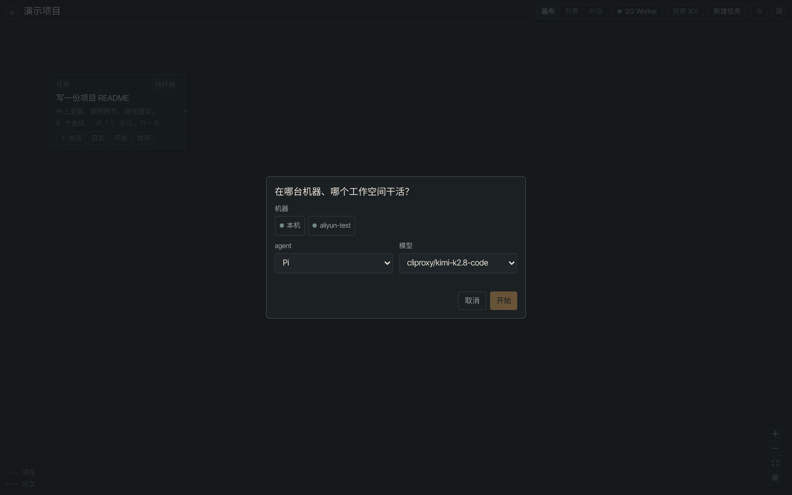

1. **机器**：默认不预选，自己点一台（只有一台能用时直接用它）。
2. **工作空间**：
   - 已有的工作空间，比如「guide-demo · 持久 ~/guide-demo」。
   - **新建临时工作空间**：为这个任务单独开一份，用完自动清理；有未保存的改动会保留并提醒。
   - **新建持久工作空间**：一直保留，下次还能接着用。可以「新建空目录」或「选已有目录」（项目配了仓库时还有「下载仓库」）。选择器默认从托管目录 `~/agent-hub` 开始，并提供「创建项目目录 agent-hub/<项目名>」。以「.」开头的隐藏文件夹默认收起，点底部「显示隐藏 N」展开，或者直接打「.」开头的名字。
3. **agent** 和**模型**。模型多时（比如 Pi 接了几个提供方）点开是可搜索的列表：按提供方分组，最近用过的排在最前，打 `glm`、`deepseek` 或提供方名就能筛；手机上贴底展开。

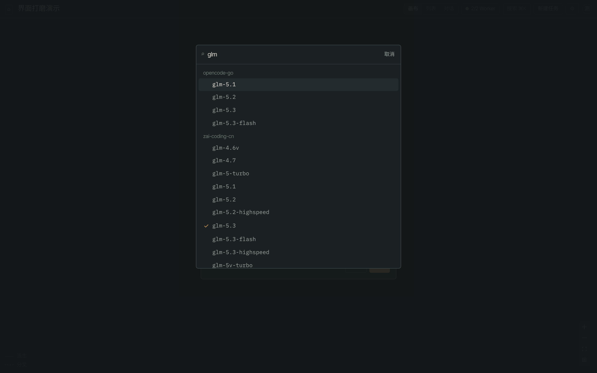

工作空间没选之前「开始」是灰的。远端机器上还没有这个项目的工作空间时，会提示「这台机器上还没有这个项目的工作空间，新建一个吧。」

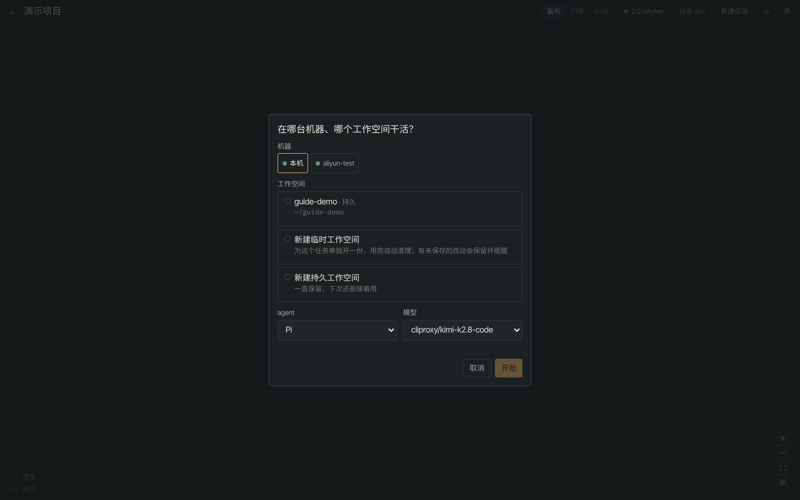
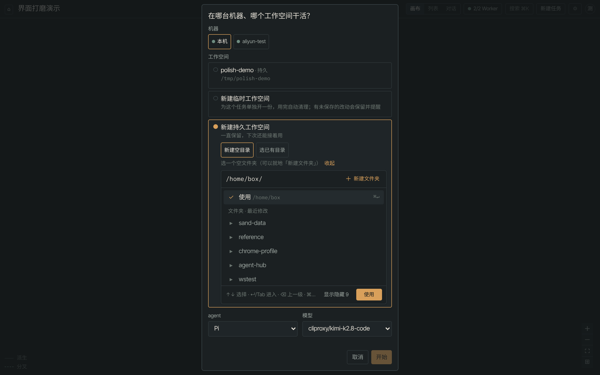

会话开起来后，在卡片上的「说一句…（Enter 发送）」里聊，或者进入对话视图用大输入框「接着说…（@ 引用文件，/ 命令，⌘↵ 发送）」——大输入框里 Enter 换行，⌘/Ctrl + Enter 发送。

点会话卡打开右侧检查器：属于哪个任务、启用的资产、能力矩阵、分叉点、「换个地方继续…」「查看事件流」。

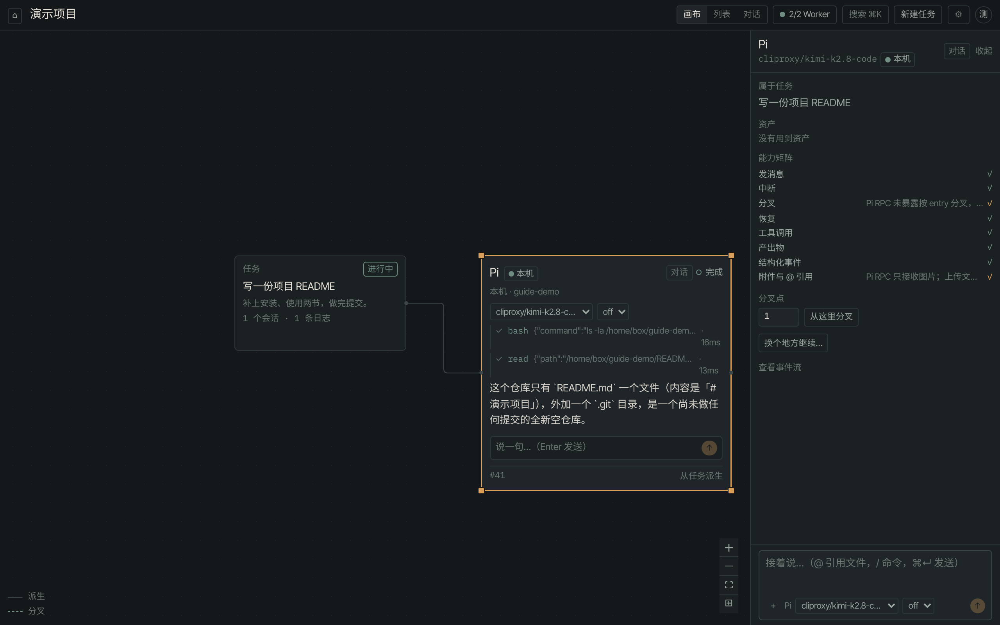

## 8. 画布、列表与对话视图

顶栏三个视图可以随时切换，地址栏就是状态（`#/p/<项目>/canvas`、`…/list`、`…/focus/<会话>`），刷新或把链接发给自己的另一台设备都会回到同一画面。

- **画布**：任务卡和会话卡，实线是「派生」，虚线是「分叉」。右下角 ＋ / − / 适应窗口 / 整理布局。
- **列表**：按任务分组的会话列表。
- **对话**：单个会话全屏，「← 返回」回去，「⋯」菜单里有「换个地方继续…」。

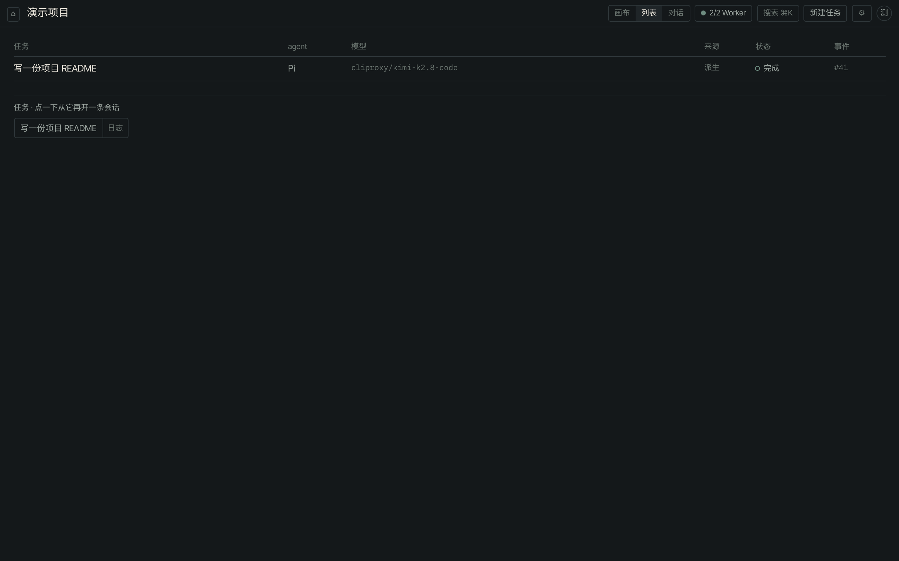
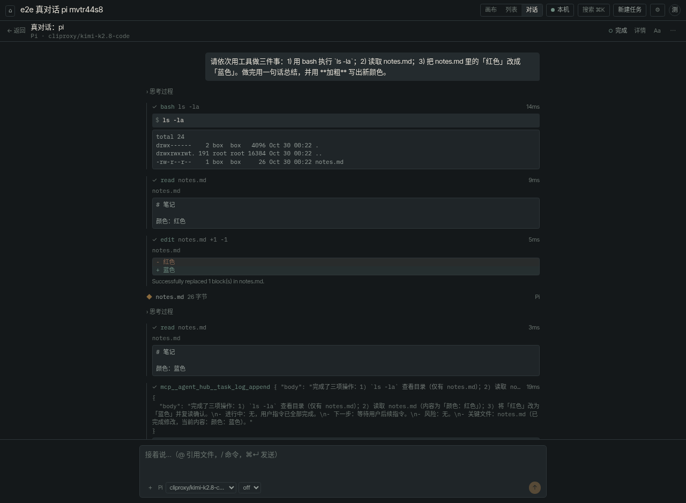

## 9. 分叉与换个地方继续

- **分叉**：在检查器的「分叉点」填一个位置，点「从这里分叉」，就从那一步的上下文开出一个新会话，画布上用虚线连起来。分叉和续聊都留在原来那台机器上。
- **换个地方继续…**：想换台机器或换个工作空间接着干，用它；会带着上下文在新的地方开会话。原机器离线时 hub 不会悄悄换机器，需要你明确这么做。

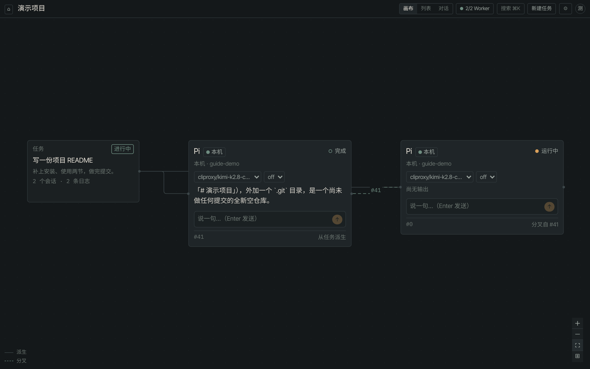
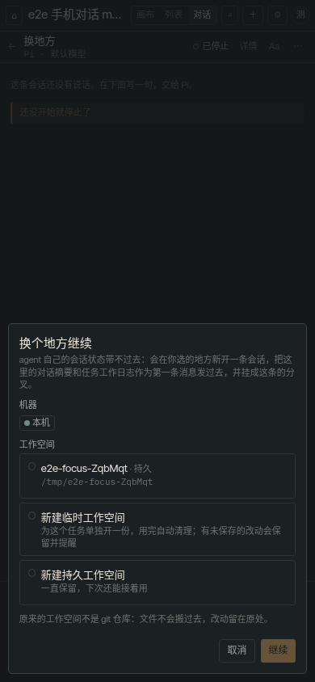

## 10. 搜索

顶栏「搜索 ⌘K」（或直接按 ⌘K / Ctrl+K）打开搜索面板，按会话正文和任务搜，结果标明是「会话」还是「任务」。首页的搜索框也能搜项目。

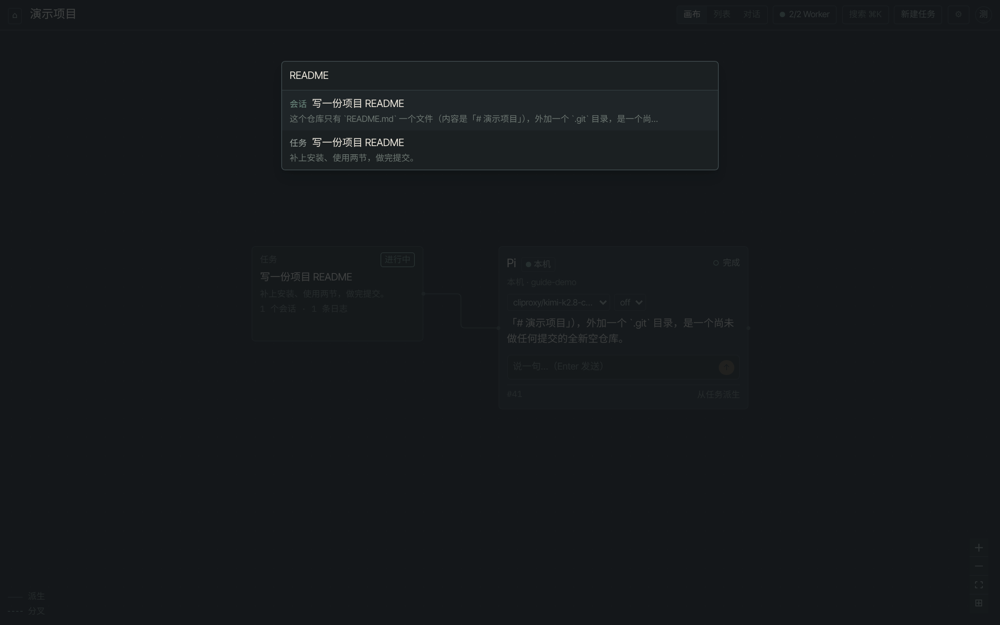

## 11. 资产中心：技能、指令、MCP 与密钥

「运营后台 · 资产」统一管理给 agent 用的东西：

- **技能**（SKILL.md 目录）、**指令**（一段 Markdown）、**MCP 服务器**。
- 按机器安装：技能和指令落进那台机器的 `~/.agent-hub/assets`（`skills/`、`instructions/`，外加 `.blobs`、`.manifest.json`）；MCP 在会话启动时接上，远端的 http MCP 经 hub 代连，**密钥不出 hub**。
- 只对之后新开的会话生效。

### 添加

点「添加」，选「上传」或「从 Git 导入」：

- **上传**：选类型，**作用域**选「全局（所有项目）」或「仅项目：X」，然后「选文件 / zip」或「选文件夹」。
- **从 Git 导入**：填仓库 URL 和可选的「分支 / tag」，点「扫描」，从候选里选一个点「导入」。只读拉取公开仓库，不执行任何脚本；导入会钉在当前提交上。比如 `https://github.com/anthropics/skills` 里的 `skill-creator`。

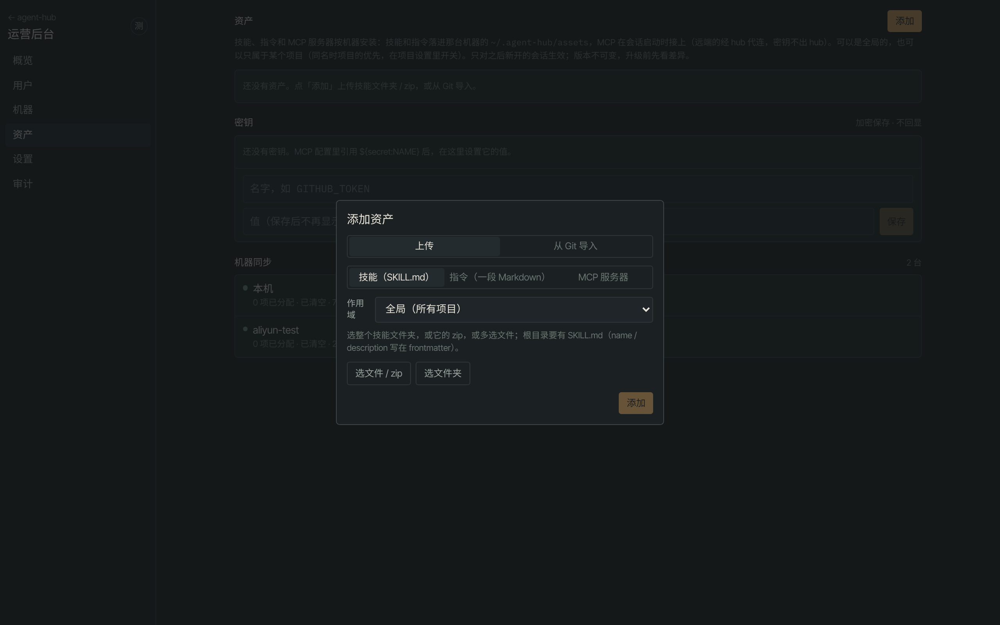
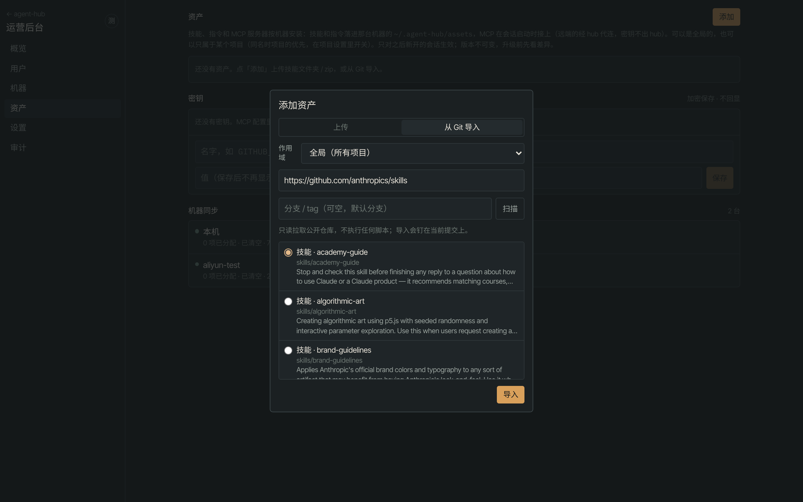

**MCP 服务器**用一段 JSON 描述（名字写在 JSON 里，也可以上传 json 文件）。凭据不要写明文，用 `${secret:NAME}` 引用密钥，明文会被拒绝：

```json
{
  "name": "guide-demo-docs",
  "transport": "http",
  "url": "https://example.com/mcp",
  "headers": { "Authorization": "Bearer ${secret:GUIDE_DEMO_TOKEN}" }
}
```

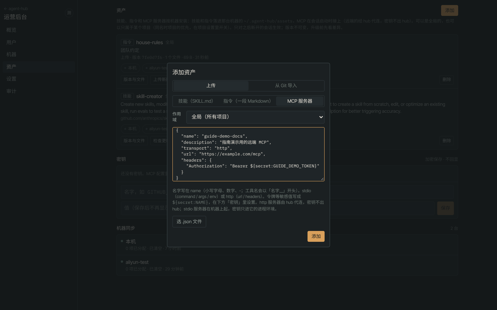

### 密钥

页面下方「密钥」区：填名字（大写，如 `GITHUB_TOKEN`）和值，「保存」。加密保存、**不回显**；列表里只显示「已设置 · 用于 X」，可以「替换」或「删除」。

### 装到哪些机器、作用到哪些项目

每个资产卡上有一排机器小标签，点一下就装到 / 卸下那台；「机器同步」区显示每台机器已分配几项、是否已同步。全局资产在每个项目的「项目设置 · 资产」里默认开着，可以按项目关掉；同名时项目自己的资产优先。

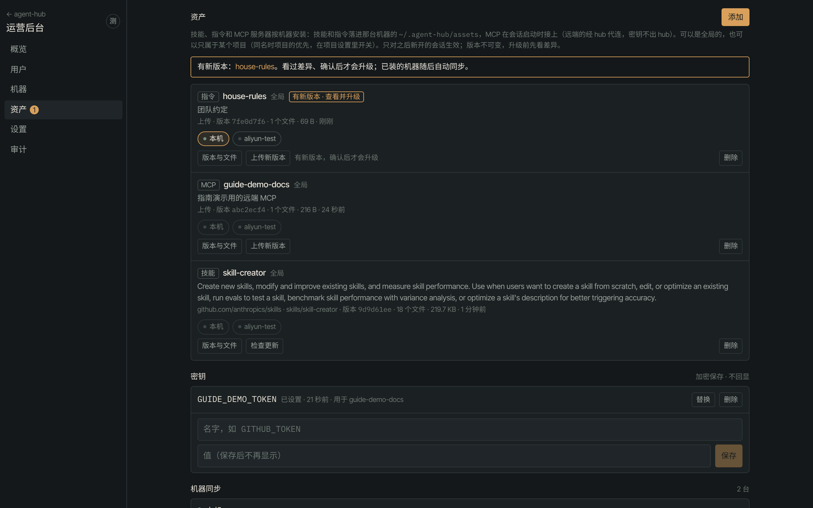

### 版本与升级

资产版本不可变，钉在某个哈希上。「版本与文件」看历史、文件内容和与上一版的差异，也可以「使用这个版本」回退。

- 上传的资产点「上传新版本」；Git 资产点「检查更新」（hub 也会定期自动检查，默认约 6 小时，`HUB_ASSET_CHECK_MS`）。
- 有新版本时卡片上出现「有新版本 · 查看并升级」，点开先看差异，再「确认升级」或「先不升级」。确认后已装的机器自动同步。

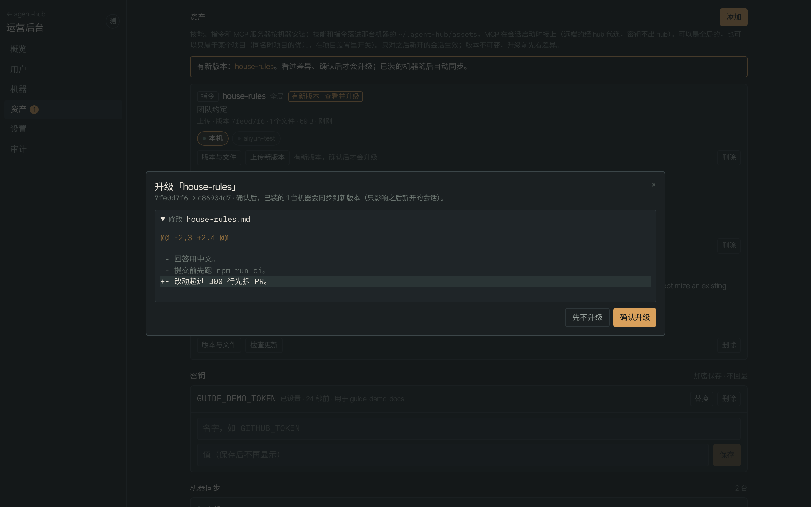

## 12. 运营后台：机器更新与设置

右上角头像进入「运营后台」：概览、用户、机器、资产、设置、审计。

**机器**页显示 hub 的版本和提交，以及每台 Worker 的版本；落后的标「过期」。可以单台「更新」，或「更新全部过期」；另有「断开」「吊销」「重新检测」。更新失败时 Worker 由 boot guard 自动回滚到上一个能启动的版本。

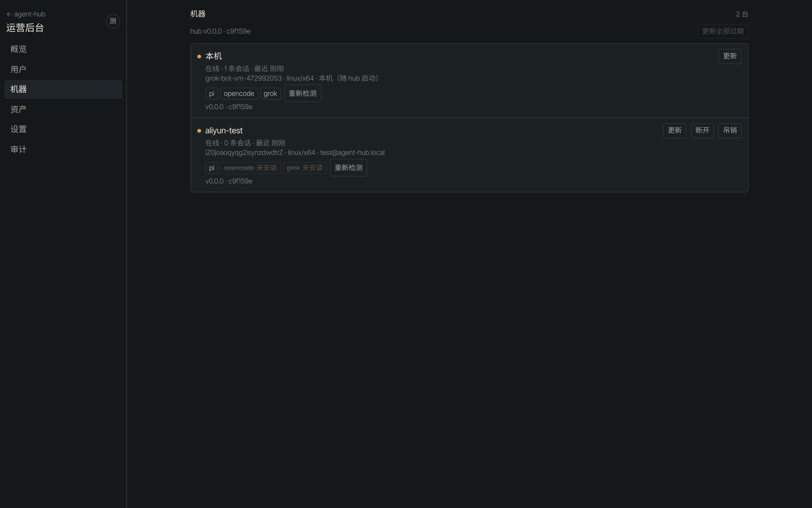

**设置**页：「开放注册」「成员可以加机器」。

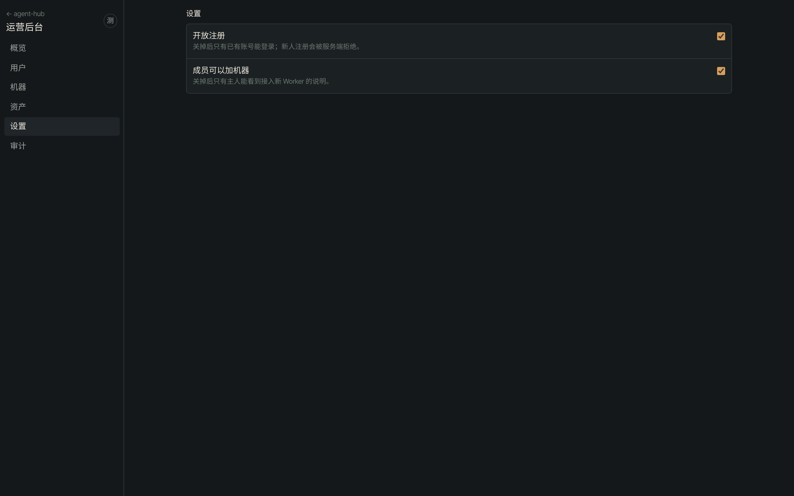
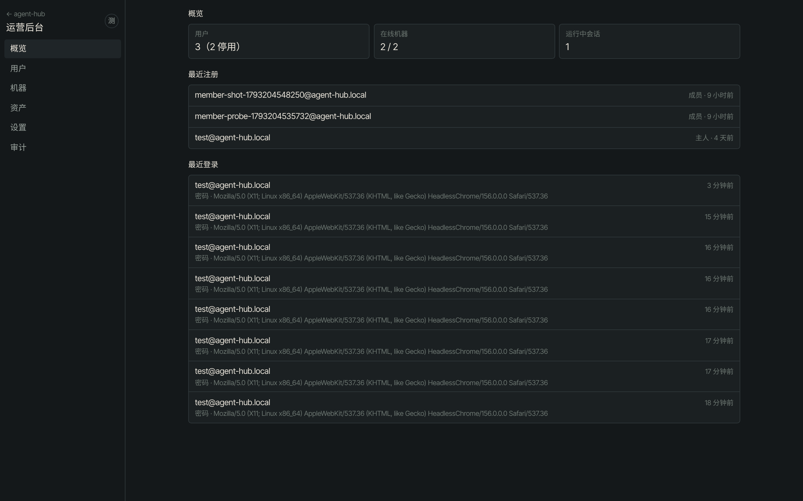

## 13. 手机上用

同一个地址在手机上打开即可（远程访问见 [remote-access.md](remote-access.md)）。窄屏默认进入列表；画布可以双指缩放，卡片上的按钮在触屏上常驻显示。

<p>
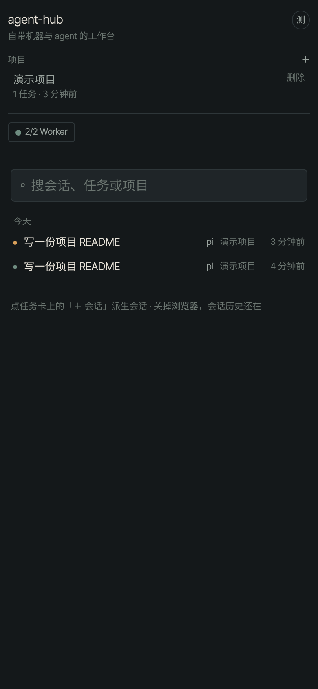
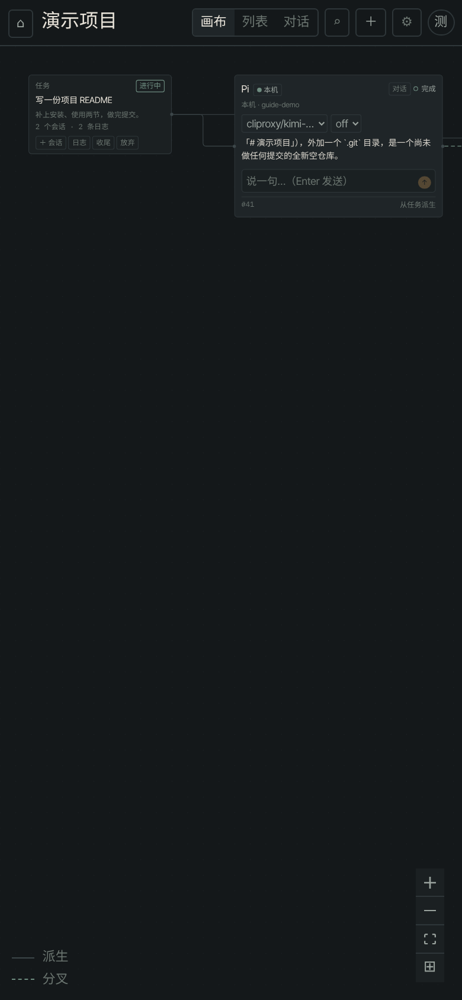
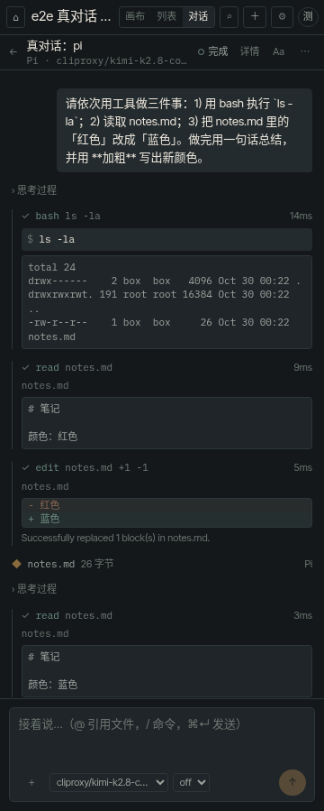
</p>

## 14. 常见问题

**派生弹窗里 agent 是灰的？** 看括号里的原因（未安装 / 未登录 / 未配置模型…）。到那台机器上装好或登录后，点「重新检测」。

**「开始」按钮点不了？** 还没选机器或工作空间。远端机器第一次用这个项目时需要先新建一个工作空间。

**临时工作空间里的改动会丢吗？** 任务做完或放弃后会自动删除，但有未保存的改动时会保留并提醒，可在「项目设置 · 工作空间」里处理。

**机器离线了，会话怎么办？** 续聊和分叉都回原来那台，离线时明确报不可用；要换机器就用「换个地方继续…」。Worker 恢复后会自动重连并接回还活着的会话。

**Worker 连不上，日志说协议版本不一致？** 在那台机器上跑 `scripts/update-worker.sh`，或在「运营后台 · 机器」里点「更新」。

**配对码过期了？** 在「添加机器」弹窗里点「重新生成」。配对码只能用一次。

**hub 绑定到 Tailscale 地址后启动失败？** 绑定非回环地址必须同时设 `HUB_TOKEN`，这是故意的。

**资产改了但会话里没生效？** 资产只对之后新开的会话生效；还要确认装到了会话所在的机器、项目设置里没关掉它，以及升级已经「确认升级」。

**MCP 的 token 放哪？** 放「密钥」，在 MCP JSON 里写 `${secret:NAME}`。不要写明文，会被拒绝。
